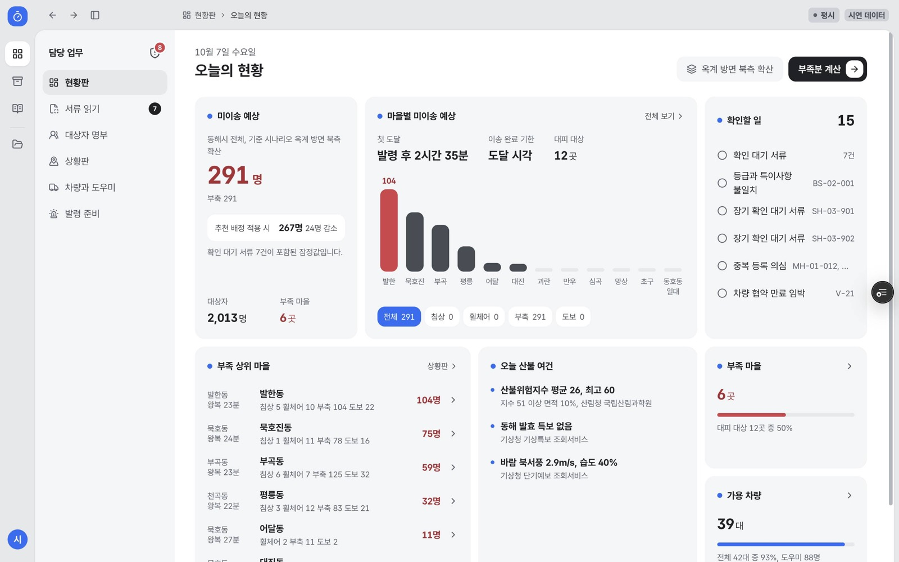

# 미리

**재난취약자 사전 이송 배정 서비스**

[](https://miri-indol.vercel.app)
[](./LICENSE)

미리는 강원특별자치도 동해시 담당자가 산불 때 혼자 대피하기 어려운 주민을 기한 안에 옮길 수 있는지 평시에 계산하고, 발령 때 차량과 도우미, 대상자를 묶은 배정표를 만드는 웹 서비스입니다.

담당자는 컴퓨터 콘솔에서 부족분을 계산하고 발령을 운영합니다. 현장 담당자와 대피 도우미는 설치 없이 휴대폰 웹 화면으로 배정을 받고 이송을 보고합니다.



| 구분 | 주소 |
| --- | --- |
| 담당자 화면 | [miri-indol.vercel.app](https://miri-indol.vercel.app) |
| 휴대폰 시작 화면 | [miri-indol.vercel.app/m](https://miri-indol.vercel.app/m) |
| 도우미 체험 | [miri-indol.vercel.app/m/h/demo](https://miri-indol.vercel.app/m/h/demo) |
| 사례 소개 | [miri-case.vercel.app](https://miri-case.vercel.app) |
| 개방 API 안내 | [miri-indol.vercel.app/open](https://miri-indol.vercel.app/open) |

## 핵심 기능

- **부족분 계산**: 마을별 대피 기한 안 미이송 예상 인원과 필요 추가 차량 산출
- **도달 시각 역산**: 확산 가정 기반 마을별 도달 시각, 이송 완료 기한, 발령 기한 계산
- **시간대 전환**: 야간과 휴일, 평일 낮의 가용 차량과 대상자 기준 전환
- **가정값 점검**: 탑승과 하차 시간 10분, 20분, 30분 가정별 부족분 비교
- **추천 배정**: 규칙 기반 탐색으로 미이송 감소 배정 산출
- **서류 판독**: 종이 대피계획서와 대피카드 사진의 이송 등급 초안과 근거 문구 추출, 원문 대조, 담당자 확인
- **발령과 배정**: 차량, 도우미, 대상자 묶음 배정표 생성, 도우미 수와 지원 등급 조건 적용, 대피소 정원과 회차별 목적지 적용
- **재배정**: 불가 응답 도우미와 해당 차량 제외, 발령 조건 재확인
- **소방 인계**: 기한 초과 대상자 목록과 동해 응급실 가용병상 참고 정보
- **문서함**: 공문, 보고서, 계획서 서식 25종(도우미 운영 기준, 도우미 교육 시나리오, 가족 안내 문자 포함) 자동 숫자 입력과 한글(HWPX) 저장
- **개방 API**: 마을별 부족분, 대피소 수용 현황, 시나리오 조회

부족분과 배정은 규칙으로 계산하며 AI를 쓰지 않습니다. 화면별 구성, 계산 규칙, AI 처리, 데이터 출처, 개인정보 설계는 [docs/OVERVIEW.md](docs/OVERVIEW.md)에 있습니다.

## 빠른 실행

```bash
git clone https://github.com/hyunho2378/miri.git
cd miri/client
npm install
npm run dev        # http://localhost:5173
npm test
npm run build
```

키 없이 실행해도 시연용 자료로 전체 화면이 동작합니다. 환경 변수, 배포, 개방 API는 [docs/DEVELOPMENT.md](docs/DEVELOPMENT.md)에 있습니다.

## 폴더 구조

```text
client/   서비스(화면, 서버리스 함수, 계산, 3D 상황판, 시험)
case/     사례 소개 사이트
tools/    바탕 지도와 건물 생성 스크립트
docs/     기획, 설계, 보고서, 공모전, 사용자 체험 자료
server/   백엔드 확장 자리
```

## 문서

| 문서 | 위치 |
| --- | --- |
| 서비스 상세(화면, 계산, AI, 데이터, 개인정보, 로드맵) | [docs/OVERVIEW.md](docs/OVERVIEW.md) |
| 개발 안내(기술 스택, 실행, 환경 변수, 배포, API, 구조) | [docs/DEVELOPMENT.md](docs/DEVELOPMENT.md) |
| 개발보고서 | [docs/report](docs/report) |
| 상세기획서 | [docs/contest/plan-v7](docs/contest/plan-v7) |
| 도식 5종(서비스 블루프린트, 시스템 구성도, 데이터 흐름도, AI 서류 판독 과정, 부족분 계산과 배정 규칙) | [docs/diagrams](docs/diagrams) |
| 사용자 체험 자료 | [docs/usertest](docs/usertest) |
| 법령 검토 | [docs/LEGAL_REVIEW.md](docs/LEGAL_REVIEW.md) |
| API 계약 | [docs/API_CONTRACT.md](docs/API_CONTRACT.md) |
| 현장 관찰 기록 | [docs/FIELD_NOTES_UX.md](docs/FIELD_NOTES_UX.md) |
| 기여 안내와 이슈 양식 | [CONTRIBUTING.md](CONTRIBUTING.md), [.github/ISSUE_TEMPLATE](.github/ISSUE_TEMPLATE) |

## 팀

**한림대학교 서비스디자인 2026-2 Team 오아시스**

| 구분 | 구성 |
| --- | --- |
| 서비스디자인 수업 팀원 | 주현호(팀장), 허준희, 김서환, 김채린 |
| 2026 AI 디지털 기반 사회문제 해결 챌린지 출품 | 주현호(대표), 송준하(팀원) |
| 기술고문 | 방기석 교수(한림대학교 소프트웨어학부, G-Lab@동해 책임교원) |
| 문의 | 저장소 이슈 |

## 라이선스

코드는 [MIT](./LICENSE)입니다. 공공 자료와 지도 자료의 라이선스, 참고한 공공 산출물은 [docs/DEVELOPMENT.md](docs/DEVELOPMENT.md#참고-산출물과-라이선스)에 있습니다.
