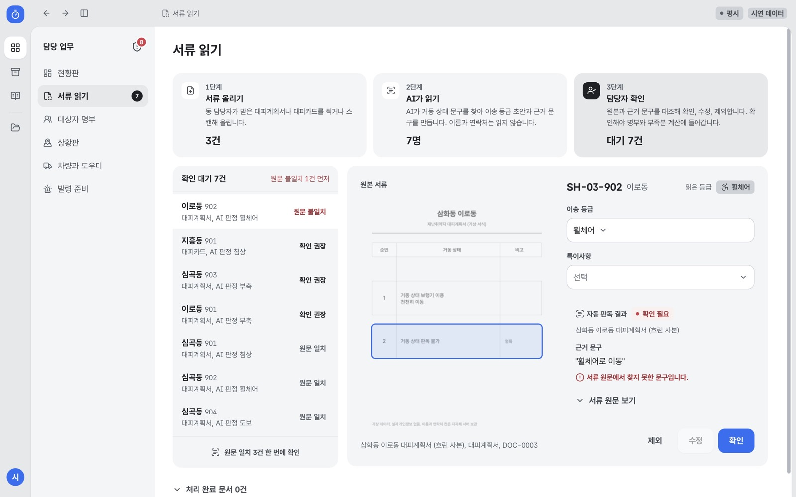
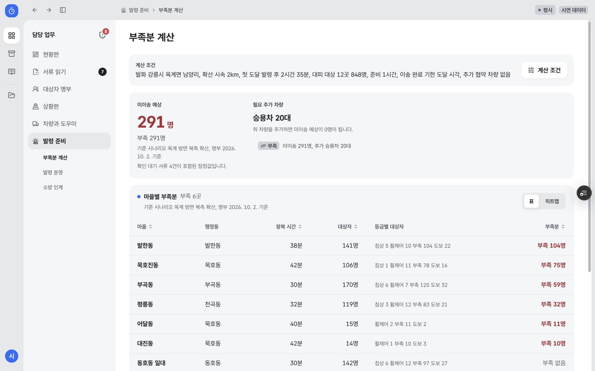
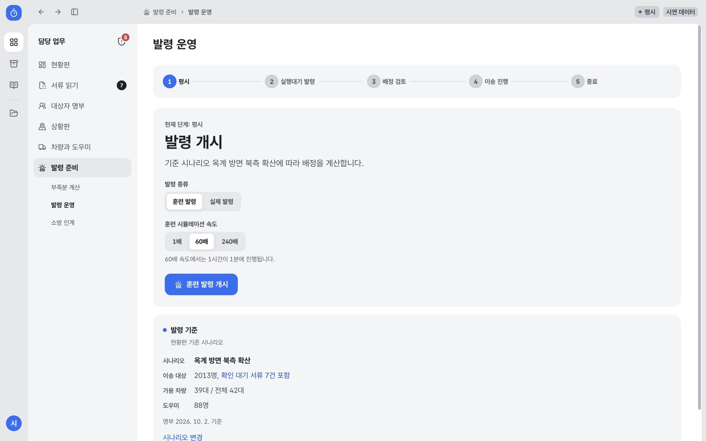
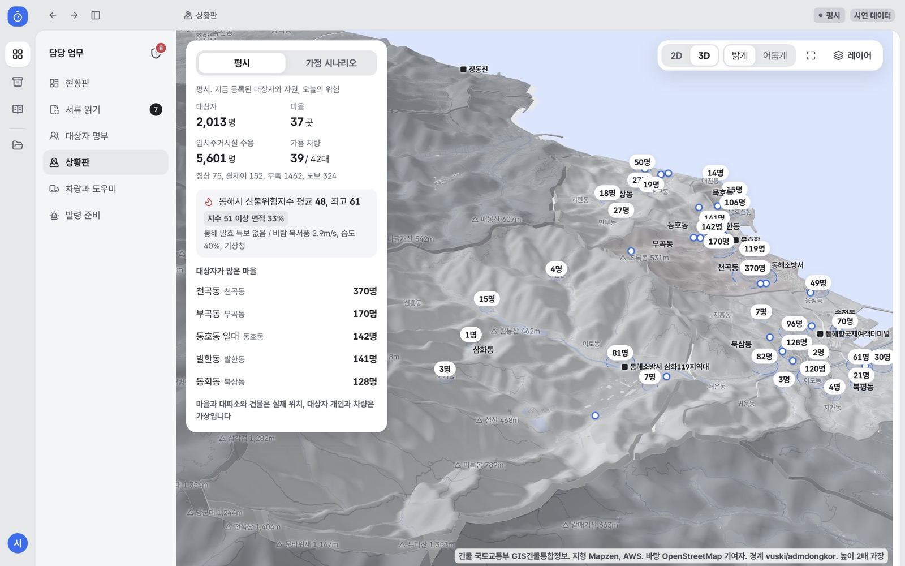
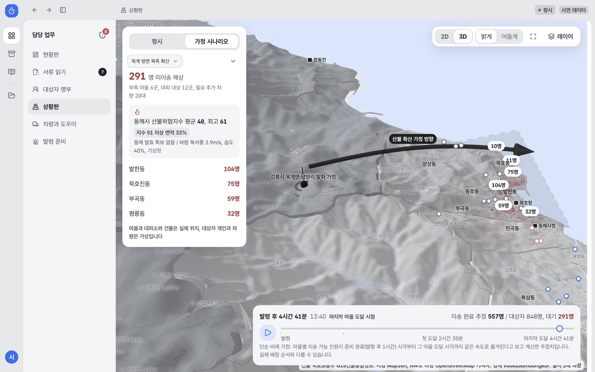
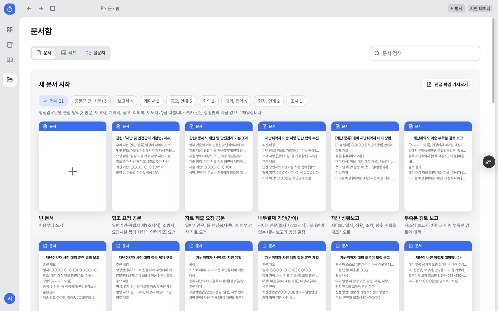
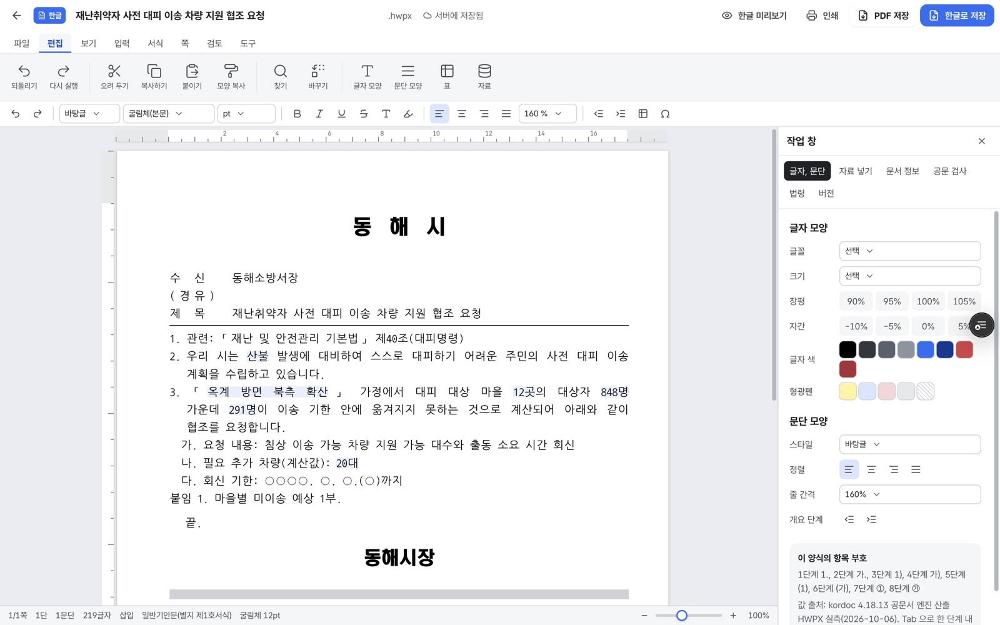

# 미리 서비스 상세

[README](../README.md)에서 옮긴 서비스 설명입니다. 화면, 사용 흐름, 계산 규칙, AI 처리, 데이터 출처, 개인정보, 다른 지역 적용, 로드맵을 담습니다. 개발과 배포는 [DEVELOPMENT.md](DEVELOPMENT.md)에 있습니다.

## 목차

- 최근 바뀐 점(2026. 10. 25.)
- 화면 구성
- 업무별 사용 흐름
- 추진 배경
- 계산 규칙
- AI 처리
- 데이터 구성과 출처
- 개인정보 보호 설계
- 다른 지역 적용
- 고도화 로드맵

---

## 최근 바뀐 점(2026. 10. 25.)

- **부족분 계산 화면**: 맨 위에 결론 한 문장을 둡니다. 예를 들어 "이 조건이면 기한 안에 옮기지 못하는 사람이 291명입니다"를 먼저 보여 주고, 그 아래에 왜 그런지와 무엇을 늘리면 줄어드는지를 차례로 보여 줍니다. 계산 방법과 자문 근거는 접어 둡니다.
- **발령 종료**: 콘솔 발령 운영 화면의 단계 표시 오른쪽에 `발령 종료` 버튼이 늘 보입니다. 휴대폰에서는 시 관리자의 발령 홈 아래 `발령 마치기`에 있습니다. 동 담당자에게는 "발령 종료는 시 관리자가 합니다"라는 안내가 보입니다.
- **서버 권한**: 로그인 세션에 역할(시 관리자, 동 담당자)과 담당 동을 서명해 담습니다. 동 담당자가 발령을 조회하면 서버가 담당 동 자료만 돌려주고, 저장과 종료는 막습니다.
- **사용량 상한과 접근 기록**: 문서 변환, 조판, 문서 검사, 법령 조회는 출처를 확인하고 분당과 하루 상한을 둡니다. 서버는 경로, 상태, 지연 시간, 역할만 기록하고 본문과 IP는 남기지 않습니다.
- **AI 판독**: 서류 판독 파이프라인은 네이버 클라우드의 CLOVA OCR과 HyperCLOVA X로 만들고 2026. 10. 20.부터 22.까지 검증했습니다. 사무국 안내에 따라 실시간 호출은 멈췄고, 공개 사이트는 2026. 10. 22. 실제 판독 결과 4건을 저장해 보여 줍니다. 미리 써 둔 시연 결과는 `예시 결과`로 구분합니다.
- **체험 기록**: 체험 주소(`/m/h/demo?exp=yeollim`, `?exp=bongsa`)로 들어오면 화면별로 머문 시간, 누른 버튼 종류, 마지막으로 도달한 단계를 무작위 체험 번호로 기록합니다. 이름, 연락처, 입력한 글, IP 원문은 저장하지 않으며 90일 뒤 지웁니다. 집계는 `node client/tools/exp-report.mjs`로 엑셀 파일을 만듭니다.
- **배정 문자**: 배정 문자, 대체 배정 문자, 재발송 문자가 모두 "[미리 훈련] 수락이나 불가를 눌러 주세요."로 시작하고, 링크를 뺀 본문은 90바이트 이하입니다. 이름, 주소, 전화번호는 넣지 않습니다.
- **훈련 결과 보고 서식**: 문서함의 훈련 결과 보고 서식이 최근 훈련 기록의 일시, 도우미 수, 대상자, 인계 완료, 소방 인계, 미완료로 자동으로 채워집니다.
- **명부 확인 완료**: 명부 상세에 `확인 완료` 버튼이 있어, 누르면 마지막 확인 날짜가 오늘로 바뀌고 누가 언제 확인했는지 남습니다. 현황판의 명부 재확인 인원이 바로 줄어듭니다.
- **서류 읽기 확인할 곳**: 확인 필요 사유마다 원본 서류에서 볼 곳을 한 줄로 보여 주고, 누르면 그 위치로 이동합니다.
- **현장 소식 보관**: 연결이 끊기거나 AI 읽기가 실패해도 글만 먼저 저장하고, 나중에 읽습니다. 대상자 화면에서 들어오면 그 대상자가 미리 골라져 있습니다.
- **도우미 위치 정보**: 도우미에게는 수락한 본인 대상자의 찾아가는 곳만 별도 동의나 실제 발령 때 보여 주고 발령 종료 때 지웁니다(개인정보 보호법 제15조, 제17조).
- **공공데이터 갱신 기준**: 산불위험예보의 허용 지연을 24시간에서 6시간으로 줄였습니다(공식 3시간 주기, 공공데이터포털 15084817, 2026. 10. 25. 접속). 기상특보와 응급실 가용병상은 팀 기준 그대로입니다.
- **상황판 첫 화면**: 건물 자료를 동해시 안 42,223동(1.3MB)과 접경 시군 153,888동(4.3MB)으로 나눠, 동해시를 먼저 받아 그립니다.
- **문서함**: 서식 카드의 파란 머리말이 `문서 (서식 이름)` 형식이고, 협조 요청 공문의 붙임은 하나일 때 번호를 뺍니다.

---

## 화면 구성

### 경로

| 경로 | 화면 | 쓰는 때 |
| --- | --- | --- |
| `/console` | 현황판 | 평시 아침 점검 |
| `/console/map` | 상황판(3D, 2D) | 평시, 가정 시나리오, 발령 중 |
| `/console/roster` | 대상자 명부 | 평시 명부 관리 |
| `/console/intake` | 서류 판독 | 종이 서류 정리 |
| `/console/notes` | 현장 소식 | 글과 음성 소식 정리 |
| `/console/resources` | 차량과 도우미 | 가용 상태, 민간 협약 관리 |
| `/console/shortage` | 부족분 계산 | 차량 협약 규모 결정 |
| `/console/dispatch` | 발령 운영 | 훈련 발령, 배정 검토, 이송 진행 |
| `/console/handover` | 소방 인계 | 기한 초과 대상자 인계 |
| `/console/records` | 이송 기록 | 발령 기록, 마을별 미이송 추이 |
| `/console/workspace` | 문서함 | 공문, 보고서, 시트, 설문지 |
| `/console/settings` | 설정 | 기관 정보, 계산 기본값, 이상 탐지 기준값, 사용자와 역할, 차종별 탑승 정원 |
| `/m` | 휴대폰 시작 화면 | 도우미와 현장 담당자 화면 고르기, 기기 틀 미리보기 |
| `/m/f` | 현장 담당자 휴대폰 화면 | 평시 할 일, 발령 진행, 마을 상세, 발령 종료(시 관리자) |
| `/m/h/:token` | 도우미 휴대폰 화면 | 배정 수락, 이송 보고(`/h/:token`은 이 주소로 넘어감) |
| `/f/:id` | 설문 응답 화면 | 문서함 설문지 응답 |
| `/open` | 개방 API 안내 | 다른 기관 조회 |
| `/privacy` | 개인정보 처리 안내 | 공개 안내 |

### 평시 화면

| 화면 | 구성 |
| --- | --- |
| 현황판 | 미이송 예상과 추천 배정 효과, 마을별 미이송 막대(침상, 휠체어, 부축, 도보 필터), 확인할 일(확인 대기 서류, 등급 불일치, 중복 의심, 협약 만료), 오늘 산불 여건(산불위험지수, 특보, 바람), 공공데이터 추가 연계(동해 응급실 가용병상, 장애인편의시설, 산불 이력) |
| 서류 판독 | 서류 올리기, 국내 AI 판독, 담당자 확인 3단계로 진행하고 원문과 다른 건을 먼저 보여 줍니다 |
| 대상자 명부 | 목록, 지도, 서식 출력을 지원하고 대상자는 코드(예: `SH-03-902`)로 표시합니다 |
| 차량과 도우미 | 차량 42대, 도우미 88명의 가용 상태, 대기 동, 협약 만료일 |
| 부족분 계산 | 발화 지점, 확산 속도, 준비 시간, 추가 협약 차량 조건을 바꾸면 표와 히트맵이 다시 계산됩니다 |





### 발령 화면

| 화면 | 구성 |
| --- | --- |
| 발령 운영 | 평시, 실행대기 발령, 배정 검토, 이송 진행, 종료 5단계이고 훈련 발령은 1배, 60배, 240배 속도로 돌립니다. 발령 기준 칸에 대피 대상 구역 대상자(12개 마을 848명)와 명부 전체(2,013건)를 나눠 보여 줍니다 |
| 도우미 휴대폰 | 내 배정(차량, 대상자, 사람별 대피소, 첫 출발 시각), 수락과 불가 응답, 출발, 탑승, 도착, 인계 보고를 설치 없이 웹 화면에서 합니다 |
| 소방 인계 | 기한 초과 대상자 목록, 동해 응급실 가용병상 참고 카드 |




### 상황판

| 상황 | 시점 | 표시 내용 | 판단 대상 |
| --- | --- | --- | --- |
| 평시(기본) | 상시 | 마을별 대상자 수와 등급, 임시주거시설 수용, 가용 차량, 산불위험지수와 특보 | 위험일 여부, 대피소 부족 마을 |
| 가정 시나리오 | 계획, 훈련, 시연 | 발화 가정 지점, 확산 방향, 도달 시각, 마을별 미이송 예상, 시간 축 재생 | 봄철 전 차량 협약 규모 |
| 발령 중 | 발령 시 자동 전환 | 해당 발령 시나리오 고정 | 다음 차량 투입 지점, 소방 인계 대상 |

- 범위: 동해시와 인접 강릉시(옥계면 포함), 삼척시, 정선군, 태백시 읍면동 60곳
- 지형과 건물: 실제 고도 기반 읍면동 지형, 국토교통부 GIS건물통합정보 196,111동
- 시간 축 재생: 발령 후 마을별 이송 완료와 대기 인원 변화
- 근접 표시: 10km 이내 골목과 길 이름 표시
- 2D 보기: 저사양 기기용 MapLibre 지도





### 재난 종류별 가정 시나리오

| 종류 | 근거 | 대상 마을 선정 기준 |
| --- | --- | --- |
| 산불 | 행정안전부 「초고속 산불 대비 주민대피 체계 개선방안」(2025. 4. 16.) | 확산 띠 안 마을 |
| 지진해일 | 연합뉴스 2024. 1. 2.(노토반도 지진, 묵호 첫 도달 18:06, 최대 85cm) | 해안 거리, 고도 |
| 태풍 호우 침수 | 연합뉴스 2019. 10. 3.(태풍 미탁 동해 367.7mm) | 저지대, 하천 인접 |
| 산사태 | 연합뉴스 2019. 10. 3.(삼척 오분동 비탈 붕괴) | 경사 |
| 대설 고립 | 연합뉴스 2014. 2. 10.(영동 폭설, 14개 마을 390여 가구 고립) | 산간 마을, 이동 시간 1.8배 |

### 문서함



| 서식 분류 | 서식 |
| --- | --- |
| 공문 | 협조 요청 공문, 자료 제출 요청 공문, 내부결재 기안(간이) |
| 보고서 | 재난 상황보고, 부족분 검토 보고, 대피 훈련 결과 보고, 업무보고(표지와 목차) |
| 계획서 | 재난취약자 사전대피 지원 계획, 대피 훈련 계획 |
| 공고와 안내 | 대피 도우미 모집 공고, 주민 대피 안내문, 재난문자 문안 |
| 회의 | 회의록, 재난안전대책본부 회의 자료, 보도자료 |
| 대외 협약 | 차량 지원 협약서, 개인정보 수집 이용 동의서, 기관 협조 요청서(연구) |
| 현장 인계 | 미이송자 소방 인계서, 이송 배정표 |
| 조사 | 인터뷰 기록지 |



- 편집 화면: 웹한글과 같은 메뉴, 기능 상자, 서식 도구 상자, 눈금자, 상태 표시줄 배치
- 양식 치수: 실제 한글 파일에서 측정한 쪽 여백, 글꼴, 줄 간격, 항목 부호 적용
- 자료 넣기: 미이송 예상, 필요 추가 차량 등 현재 값 자동 갱신, 문서별 값 고정과 복원
- 계산 넣기: 비율, 나누기, 곱하기, 더하기, 빼기 조합(예: 미이송 비율, 차량 가용률)
- 공문 검사: 행정업무운영 편람 표기 규칙 검사, 법령 인용 조문 실재 확인(법제처)
- 내보내기: 한글(HWPX) 저장, 한글 미리보기, 인쇄, PDF 저장을 지원하고 저장 전에 파일 구조를 검사합니다
- 기타: 표 계산 시트, 설문지, 프로젝트 인수인계서 상단 고정

---

## 업무별 사용 흐름

| 업무 | 화면 | 순서 | 산출물 |
| --- | --- | --- | --- |
| 봄철 전 차량 협약 규모 결정 | 부족분 계산, 문서함 | 추가 협약 차량 증가, 미이송 0명 대수 확인, 내부결재 서식 입력 | 차량 민간 협약 추진 내부결재 |
| 소방서와 요양시설 지원 요청 | 문서함 | 협조 요청 공문 선택, 수신처와 회신 기한 입력 | 협조 요청 공문(HWPX) |
| 종이 대피계획서 정리 | 서류 판독 | 사진 업로드, 원문 불일치 우선 확인, 확인 또는 수정 또는 제외 | 명부 반영 |
| 사전 대피 훈련 | 발령 운영, 상황판, 문서함 | 훈련 발령 60배 진행, 시간 축 확인 | 훈련 계획, 훈련 결과 보고 |
| 위험일 아침 점검 | 현황판 | 산불 여건과 가용 차량 확인, 확인할 일 처리 | 점검 기록 |
| 발령 대응 | 발령 운영, 도우미 화면, 소방 인계 | 배정 검토와 전송, 도우미 응답과 이송 보고, 기한 초과자 인계 | 재난 상황보고, 소방 인계서 |
| 기관 간 수치 공유 | 개방 API | `/api/open` 조회 | 공통 수치 |

### 둘러보기 순서

| 단계 | 화면 | 동작 |
| --- | --- | --- |
| 1 | 현황판 | 미이송 예상과 추천 배정 효과를 확인하고 등급 필터를 고릅니다. |
| 2 | 상황판 | 가정 시나리오 선택, 시간 축 재생 |
| 3 | 부족분 계산 | 계산 조건에서 추가 협약 차량 변경 |
| 4 | 서류 판독 | 원문 불일치 건의 원본과 근거 문구 대조, 등급 수정 또는 제외 |
| 5 | 문서함 | 협조 요청 공문 선택, 자료 넣기 값 변경, 한글로 저장 |
| 6 | 발령 운영, 도우미 화면 | 훈련 발령을 60배로 시작하고, 휴대폰에서 `/m/h/demo`를 열어 시연 배정을 받습니다. 끝나면 발령 운영 맨 위 단계 표시 오른쪽의 `발령 종료`를 누릅니다. |

---

## 추진 배경

| 구분 | 내용 |
| --- | --- |
| 정부 기준 | 행정안전부 「초고속 산불 대비 주민대피 체계 개선방안」(2025. 4. 16.): 위험구역 5시간 전, 재난취약자 8시간 전 대피 |
| 기존 체계 | 재난문자와 안전디딤돌(알림), 대피 도우미 1:1 매칭(사람 지정), 재난관리자원 통합관리시스템(기관 자원 관리) |
| 비어 있는 단계 | 대피 기한 안 이송 가능 여부와 차량, 도우미 부족분의 평시 계산 |

### 근거 수치

| 항목 | 값 | 시점과 출처 |
| --- | --- | --- |
| 2025. 3. 산불 사망자 | 30명 중 60대 이상 28명 | 한국경제 2025. 3. 31. |
| 2025. 3. 산불 복지시설 긴급 전원 | 52개 기관 1,458명 | 오마이뉴스 2025. 3. 26. |
| 2022. 3. 울진 삼척 산불 대피 | 마을 35곳 주민 6,126명 | 한겨레 2022. 3. 5. |
| 2025. 3. 경북 산불 확산 속도 | 시간당 8.2km | 서부지방산림청 2025. 5. 30. |
| 2022. 3. 5. 옥계 산불 동해 도달 | 01:08경 발화, 05:10~05:30경 동해시 망상동 만우마을 확산 | 뉴스핌, 연합뉴스 2022. 3. 5. |
| 동해시 65세 이상 인구 | 85,445명 중 23,590명(27.6%) | 행정안전부 주민등록인구 2026. 9.(KOSIS DT_1B04005N) |
| 동해시 재가 장기요양 수급자 추정 | 2,005명(급여이용수급자 2,668명 중 시설급여 663명 제외) | 국민건강보험공단 2025(KOSIS) |

### 기존 서비스와 역할 구분

| 구분 | 기존 서비스 | 미리의 역할 |
| --- | --- | --- |
| 알림 | 재난문자, 안전디딤돌, 홍수알리미 | 거동 불편자 이송 계산과 배정 |
| 종이 계획 | 산불 취약 특수보호시설 대피계획 가이드라인 | 재가 거주자 포함 차량 부족분 산출 |
| 사람 지정 | 대피 도우미 1:1 매칭, 마을순찰대 | 기한 안 이송 가능 여부 판정 |
| 자원 관리 | 재난관리자원 통합관리시스템(KRMS) | 취약자 개인별 차량 배정 |
| 해외 사례 | 일본 NEC 피난 행동 지원 서비스(2024. 2.) | 시간 제약 계산과 부족분 산정 |

---

## 계산 규칙

```
이송 가능 인원 = 차량 수 x 왕복 가능 횟수
왕복 가능 횟수 = (이송 기한 - 준비 시간) / 왕복 시간
왕복 시간     = 집결지에서 임시주거시설까지 도로 주행 시간 x 2 + 탑승과 하차 시간(기본 20분)
부족분        = 대상자 수 - 이송 가능 인원
```

### 이송 등급

| 등급 | 대상 | 차량과 인력 |
| --- | --- | --- |
| 침상 | 누운 상태 이송 | 구급차 또는 침상 승합차, 구급대원 |
| 휠체어 | 휠체어 착석 이송 | 리프트 승합차, 도우미 2명 |
| 부축 | 부축 후 승용차 탑승 | 승용차, 도우미 1명 |
| 도보 | 안내 후 자력 이동 | 마을 버스 또는 승용차, 인솔 1명 |

### 배정 조건

| 조건 | 적용 방식 |
| --- | --- |
| 배정 순서 | 침상, 휠체어, 부축, 도보 순으로 옮기고, 같은 등급 안에서는 산불 도달이 빠른 마을을 먼저 옮깁니다 |
| 시간대 차량 | 야간과 휴일, 평일 낮마다 가용 차량 목록이 다르고, 평시 계산과 발령 배정이 같은 기준을 씁니다 |
| 도우미 | 도우미 수와 지원 등급이 회차 조건이고, 도우미가 모자란 회차는 '도우미 부족'으로 미이송에 넣습니다 |
| 대피소 | 정원 초과 배정 금지, 회차별 목적지 지정, 분산 시 가장 먼 목적지 기준 왕복 |
| 재배정 | 발령 조건 재확인, 불가 응답 도우미와 해당 차량 제외, 목적지 없는 대상자 제외 |
| 도로 주행 시간 | OpenStreetMap 기반 OSRM 사전 계산 |
| 장기요양 등급 대응 | 1등급 침상, 2등급 휠체어, 3와 4등급 부축, 5등급과 인지지원등급 도보(현장 검증 대상) |

### 기준 시나리오 결과(옥계 방면 북측 확산)

| 항목 | 값 |
| --- | --- |
| 명부 | 2,013건(확인 2,005, 확인 대기 7) |
| 대피 대상 구역 | 12개 마을 848명 |
| 미이송 예상(야간, 휴일) | 291명, 추천 배정 적용 267명 |
| 미이송 예상(평일 낮) | 216명, 추천 배정 적용 200명 |
| 탑승과 하차 10분, 20분, 30분 | 183명, 291명, 402명 |
| 자원 | 차량 42대(야간 가용 39대), 도우미 88명, 임시주거시설 27곳 |

- 계산 코드: `client/src/lib/shortageCalc.js`
- 배정 코드: `client/src/lib/assign.js`

---

## AI 처리

### 등급 미확정 규칙(위험 쪽 오류 방지)

| 판독 결과 | 배정 계산 등급 | 표시 |
|---|---|---|
| 판독 불가, 빈칸, 근거 없음 | 휠체어 | 등급 확인 필요 |
| 도보, 부축 판정이면서 근거 약함 또는 원문 불일치 | 휠체어 | 등급 확인 필요, AI 판정 함께 표시 |
| 두 등급 사이 애매한 문구(가끔 휠체어, 거동 불편) | 높은 등급(지시문 규칙 6) | 일치도 낮음 |
| 휠체어, 침상 판정 | 판정 그대로 | 일치도에 따라 표시 |

- 근거: 낮게 판정하면 차량이 가도 탑승 불가, 높게 판정하면 차량 여유분 사용(외부 개발자 자문)
- 구현: client/src/lib/intake.js planningGrade, client/api/intake.js 지시문 규칙 6, 시험 tests/gradeUncertain.test.mjs
- 담당자 확인이나 수정 뒤에는 확정 등급으로 계산

| 단계 | AI 처리 | 담당자 확인 |
| --- | --- | --- |
| 서류 판독 | 거동 상태 문구 기반 이송 등급 초안과 근거 문구 추출 | 근거 문구 원문 자동 대조 후 확인, 수정, 제외 |
| 현장 소식 | 글과 음성 소식의 요지와 근거 문구 정리 | 입력 원문 대조 후 반영 |
| 법령 인용 확인 | 「법령명」 제N조 실재 여부 확인(법제처) | 없는 조문 표시 |

부족분과 배정은 규칙으로 계산하며 AI를 쓰지 않습니다.

### 서류 판독 흐름(국내 처리)

1. 요청 검사: 시연 세션 서명 쿠키, 가상 자료 확인, 파일 형식(PNG, JPG, TIFF, PDF)과 크기
2. 글자 인식: 네이버 클라우드 CLOVA OCR(한국 리전, API Gateway 경유)
3. 개인정보 가림: 성명, 연락처, 주소, 주민번호 항목, 전화번호 형식, 이름 표기
4. 잔존 검사: 가림 후 개인정보 형식 잔존 시 언어 모델 호출 중단
5. 대상자 분할: 서류 '거동 상태' 칸 기준 코드 분할(판독 불가 칸 포함)
6. 문구 분류: HyperCLOVA X HCX-005, 가린 글자만 전송
7. 형식 검사: 요청과 응답 스키마 검증, 시간 제한
8. 근거 대조: 근거 문구의 원문 실재 확인, 불일치 시 '확인 필요'
9. 담당자 확인: 원본과 근거 문구 대조 후 명부 반영

| 응답 | 의미 |
| --- | --- |
| 200 | 판독 결과와 근거 문구 |
| 413 | 파일 크기 초과 |
| 422 | 읽은 내용 없음, 담당자 직접 확인 요청 |
| 429 | 호출 상한 초과 |
| 503 | 판독 서버 또는 호출량 저장소 미연결 |

### 호출 보호

- 서버 함수 실행 지역: 서울(icn1)
- 비공개 경로와 AI 호출: 서버 발급 서명 쿠키 확인
- 호출 상한: 세션별, IP별, 전체 합계 분당과 하루 상한(Upstash 공유 저장소)
- 공유 저장소 미연결 시 AI 호출 차단

### 판독 검증 결과(2026. 10. 22.)

판독 시험은 서류를 세 묶음으로 나눠 진행했습니다. 오류를 보고 개선에 쓴 개발용 가상 서류 15장(대상자 40명), 한 번 열람한 검증용 경계 사례 20명, 내용을 보지 않고 해시로 봉인한 평가용 가상 서류 11장(대상자 24명)입니다. 정답은 연구진이 라벨링 지침에 따라 두 번 따로 판정해 맞춘 정답지 v1(두 판정 일치도 0.917)을 씁니다. 서비스 기본 설정으로 개발용 서류를 같은 조건에서 5번 읽었을 때 40명 중 35명을 찾았고, 찾은 35명 가운데 31명의 계산 등급이 정답과 같았으며, 위험한 쪽으로 낮게 계산한 사람은 0명이었습니다. 30명은 5번 모두 같은 등급으로 읽었습니다. 개인정보 전체 문자열은 언어 모델 입력과 결과에 남지 않았고, 서류 한 장을 읽는 데 평균 5.4초가 걸렸습니다. 검증용과 평가용 묶음은 정답지를 전문가 설문으로 확정한 뒤 측정합니다. 지금 공개 사이트는 사무국 안내에 따라 실시간 AI 호출을 멈추고, 10월 22일 실제로 판독한 결과 4장을 저장해 보여 줍니다.

---

## 데이터 구성과 출처

### 구성

| 구분 | 항목 |
| --- | --- |
| 공개 자료 | 마을 집결지(마을회관, 경로당 138곳), 임시주거시설 27곳, 건물 196,111동, 지형, 행정동 경계, 인구와 고령 인구, 장기요양 수급자 통계, 장기요양기관 정원, 도로 주행 시간 |
| 실시간 자료 | 산불위험지수, 기상특보와 단기예보, 동해 응급실 가용병상, 장애인편의시설, 긴급재난문자(승인 대기) |
| 시연용 자료 | 대상자 명부 2,013건, 차량 42대, 도우미 88명, 시연 서류 |
| 계산 가정 | 장기요양 등급과 이송 등급 대응, 탑승과 하차 20분, 준비 시간 1시간, 산불 외 재난 대상 마을 기준 |

### 출처

| 자료 | 기관 | 방식 | 기준 시점 | 사용 화면 |
| --- | --- | --- | --- | --- |
| 행정동별 주민등록인구, 65세, 75세, 85세 이상 | 행정안전부(KOSIS DT_1B04005N) | 스냅샷 | 2026. 9. | 고령화율, 대상자 배분 |
| 장기요양 등급 판정과 급여이용수급자 | 국민건강보험공단(KOSIS DT_35006_N007, N030) | 스냅샷 | 2025 | 재가 수급자 추정 |
| 장기요양기관 정원과 현원 | 국민건강보험공단 장기요양기관 검색 | 스냅샷 | 2026. 10. 6. | 상황판 시설 |
| 이재민 임시주거시설 27곳 | 행정안전부 국민재난안전포털 | 스냅샷 | 2026. 10. 6. | 대피소 배정과 수용 |
| 마을회관과 경로당 138곳 | 동해시(공공데이터포털 15114136) | 스냅샷 | 2025. 11. 4. | 마을 집결지 |
| 건축물대장 법정동 집계 | 국토교통부 건축HUB | 스냅샷 | 2026. 10. | 법정동 대상자 배분 |
| 건물 윤곽, 높이, 층수, 용도 196,111동 | 국토교통부 GIS건물통합정보(브이월드) | 스냅샷 | 2026. 9. 9. | 3D 건물 |
| 행정동 경계 | 통계청 기반 vuski/admdongkor | 스냅샷 | 2023. 7. 1. | 지형, 2D 경계 |
| 지형 고도 | Mapzen, AWS Terrain Tiles | 스냅샷 | 2026. 10. 6. | 3D 지형 |
| 도로, 물길, 지명, 산봉우리 | OpenStreetMap 기여자(OpenFreeMap) | 스냅샷 | 2026. 10. 7. | 바탕 지도 |
| 도로 주행 시간 | OSRM 공개 서버(OpenStreetMap) | 빌드 시 계산 | 빌드 시점 | 왕복 시간 |
| 산불위험지수 | 산림청 국립산림과학원 | 3시간 주기(2, 5, 8, 11, 14, 17, 20, 23시 분석, 공공데이터포털 15084817, 2026. 10. 25. 접속) | 분석 시각(허용 6시간: 공식 3시간 주기 + 3시간 여유) | 현황판 산불 여건 |
| 기상특보 | 기상청 기상특보 조회서비스 | 실시간 | 발표 시각(허용 72시간, 팀 기준, 변동 없을 때 발표 시각 유지) | 특보 |
| 단기예보 | 기상청 단기예보 조회서비스 | 실시간 | 예보 발표 시각(허용 4시간, 1일 8회 3시간 간격 발표 + 1시간 여유) | 바람, 습도 |
| 응급실 실시간 가용병상 | 국립중앙의료원(15000563) | 실시간 | 기관 입력 시각(허용 3시간, 팀 기준) | 현황판, 소방 인계 |
| 장애인편의시설 현황 | 한국사회보장정보원(15092317) | 실시간 | 조회 시각(등록 목록, 지연 판정 없음) | 현황판(동해 342곳, 좌표 328곳) |
| 긴급재난문자 | 행정안전부(재난안전데이터공유플랫폼 228, 오픈API DSSP-IF-00247) | 실시간(활용 승인 대기, 신청 2026. 10. 20.) | 최근 문자 발송 시각 | 현황판 동해 수신 재난문자(수신지역 동해시, 공식 송출 단계 그대로) |
| 산불 발생 통계 | 산림청(15121380) | 스냅샷 | 포털 수정일 2026. 9. 15. | 현황판 동해 산불 이력 |
| 옥계 산불 확산 기록 | 연합뉴스 | 문헌 | 2022. 3. 5. | 기준 시나리오 발화 지점과 방향 |
| 법령 원문 | 법제처 국가법령정보 Open API | 스냅샷과 조회 | 2026. 10. 6. | 법령 인용 확인(핵심 법령 11개 1,026조문) |

### 자료 지연 표시

| 상태 | 화면 표시 | 판정 |
| --- | --- | --- |
| 정상 | 기준 시각(분석, 발표, 기관 입력) | 기준 시각 경과가 허용 지연 이내 |
| 갱신 지연 | 갱신 지연, 경과 시간, 허용 지연과 근거, 마지막 정상 수신 시각 | 기준 시각 경과가 허용 지연 초과(`client/src/lib/freshness.js`) |
| 응답 0건 | 응답 0건(누락 가능), 조회 시각, 마지막 정상 수신 시각 | 목록이 비거나 발표 시각 없음 |
| 등록 목록 | 조회 시각 | 기준 시각 없는 목록형 자료(장애인편의시설, 대피시설, 장기요양기관, 응급환자이송업) |
| 승인 대기 | 승인 대기와 신청일 | 활용 승인 전(긴급재난문자) |

---

## 개인정보 보호 설계

| 항목 | 설계 |
| --- | --- |
| 명부 원본 | 지자체 서버에 보관하고, 클라우드에는 이송 등급과 마을 코드만 연계합니다 |
| 화면 표시 | 이름 대신 대상자 코드 |
| 도우미 화면 | 본인 담당 대상자만 발령 기간 표시, 종료 시 삭제 |
| 서류 판독 | 국내 CLOVA OCR 판독, 개인정보 가림과 잔존 검사 후 HyperCLOVA X 전송, 서울(icn1) 처리 |
| 시안 범위 | 시연용 서류만 접수 |
| 운영 환경 | 동해시 계약 기반 공공기관용 클라우드(CSAP) 환경 이전 |

### 법적 근거(법제처 원문 2026. 10. 7. 확인)

| 쟁점 | 근거와 방향 |
| --- | --- |
| 평시 명부 작성 | 「재난 및 안전관리 기본법」 제74조의3제10항(정보 요청은 재난 우려가 현저하고 긴급한 때). 동해시 조례 신설 건의 |
| 이송 등급 처리 | 건강 관련 민감정보이므로 시범 운영은 본인 또는 보호자의 별도 동의(「개인정보 보호법」 제23조제1항제1호)를 받습니다 |
| 발령 시 소방 제공 | 「개인정보 보호법」 제18조제2항제3호, 제10호 |
| 쟁점별 검토 | [LEGAL_REVIEW.md](LEGAL_REVIEW.md) |

---

## 다른 지역 적용

| 순서 | 작업 | 위치 |
| --- | --- | --- |
| 1 | 시군 코드(동해시 51170)와 범위 변경 | `client/scripts/build-donghae-data.mjs` |
| 2 | 인구, 장기요양, 임시주거시설, 집결지, 도로 주행 시간 재수집 | `client/scripts/build-donghae-data.mjs` |
| 3 | 지형과 건물 재생성(브이월드 GIS건물통합정보 시도 SHP) | `client/scripts/build-village-terrain.mjs`, `tools/bake-basemap`, `tools/bake-buildings` |
| 4 | 지역 산불 기록 기반 발화 지점과 확산 방향 설정 | 시나리오 자료 |
| 5 | 지자체 명부 연계(대상자 코드, 이송 등급, 마을 코드) | [API_CONTRACT.md](API_CONTRACT.md) |

---

## 고도화 로드맵

| 단계 | 시기 | 주요 추진 내용 |
| --- | --- | --- |
| 1단계 현장 검증 | 2026. 10. | 동해시 부서별 인터뷰(10. 26.~10. 30.), 사용자 체험(과제 성공률, 소요 시간, SUS), 이송 등급 대응 현장 검토 |
| 2단계 기능 확장 | 2026. 11. | 도우미 보고 서버와 문자 발송 연동, 실제 발령 기능 개방, 재난안전데이터(통합대피소, 산불정보, 인명피해우려지역) 연계, 대피소 좌표 공공 자료 간 대조, 실서류 판독 정확도 측정 |
| 3단계 시범 운영 | 2027 | 동해시 계약 기반 공공기관용(CSAP) 환경 이전, 지자체 명부 연계, 동해시 조례 신설 건의 |
| 4단계 확산 | 2027 이후 | 강원권 시군 확산, 개방 API 기반 기관 간 수치 공유 |
