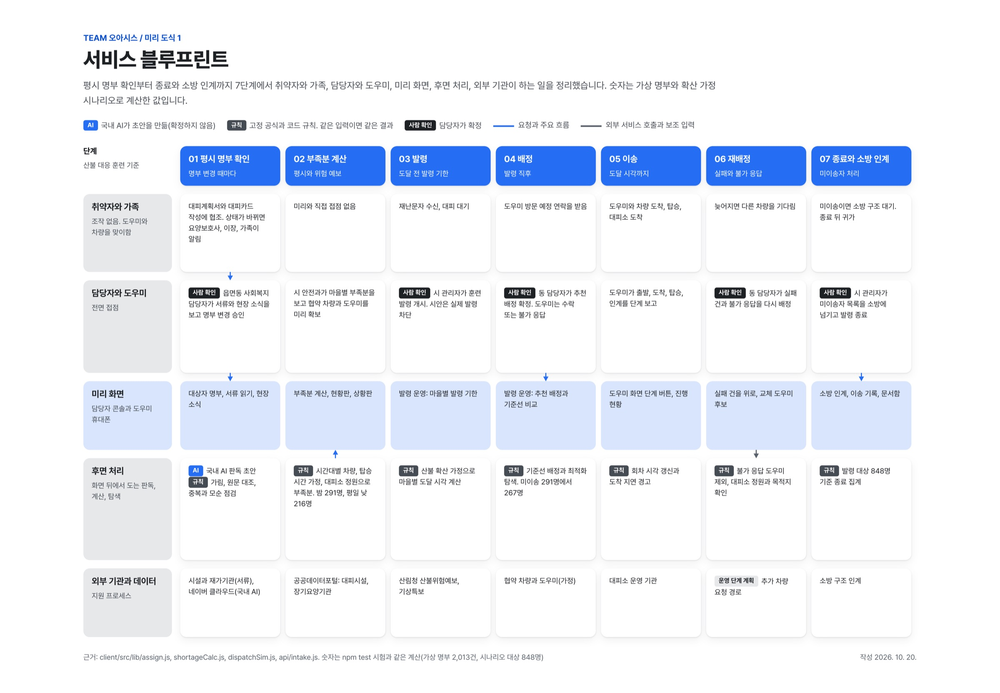
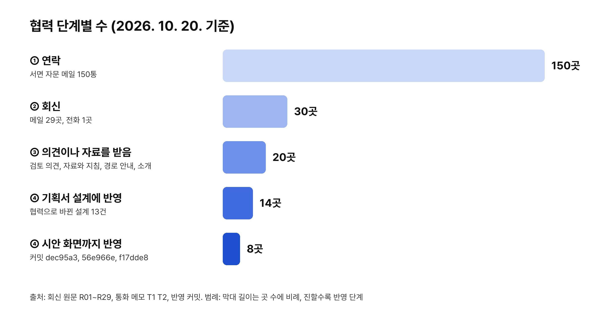
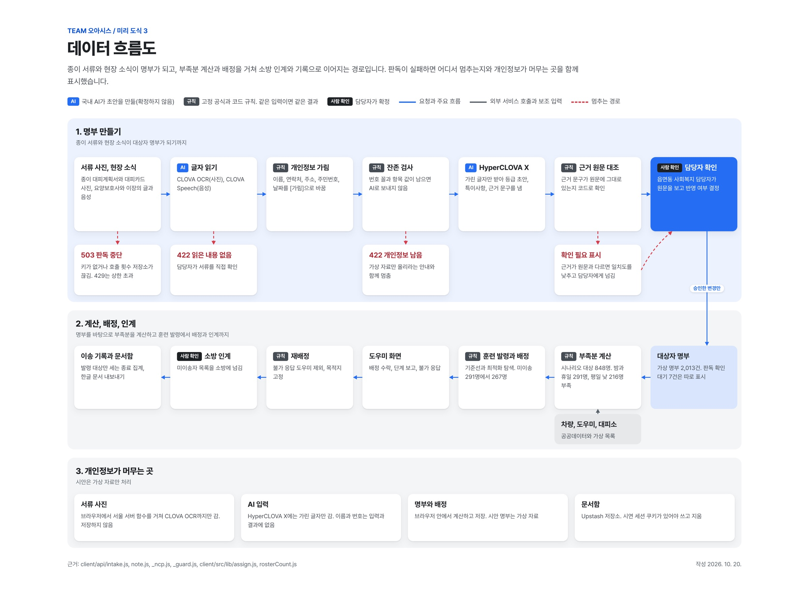
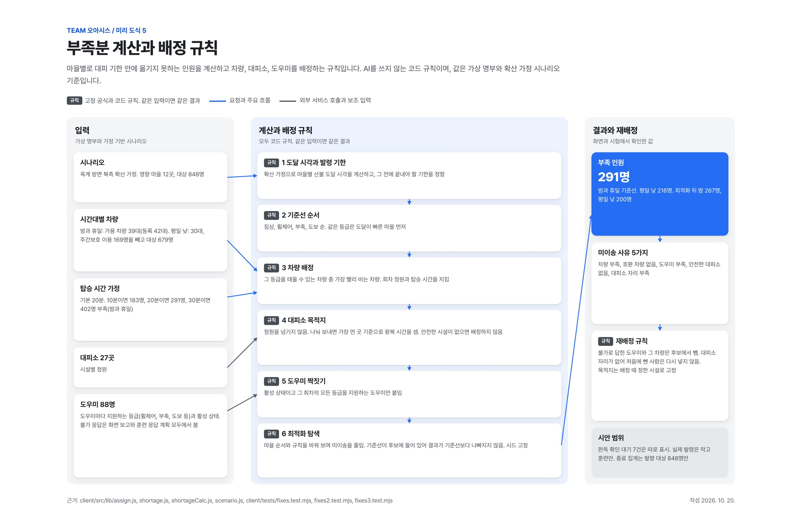
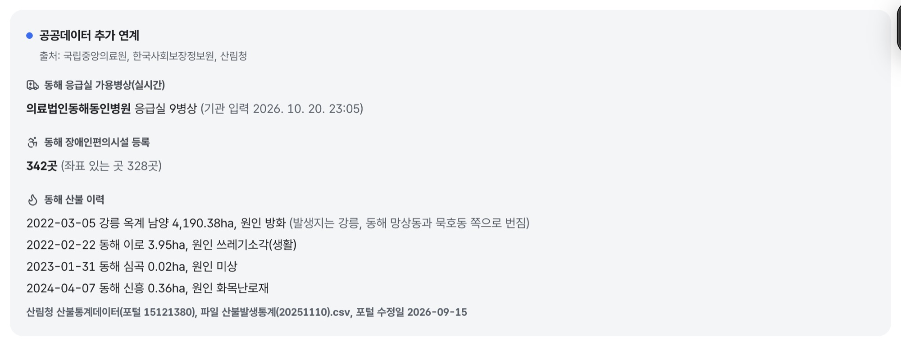
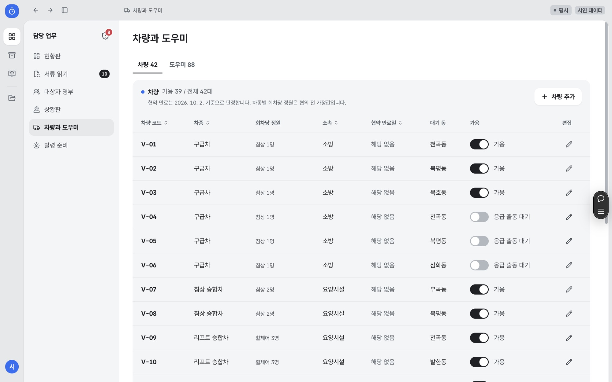
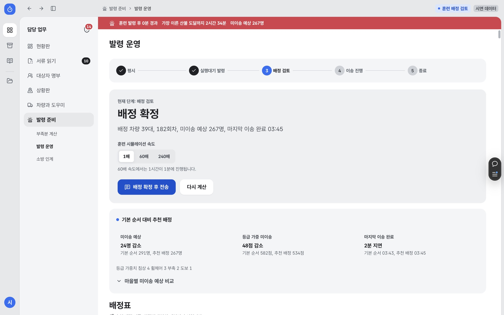
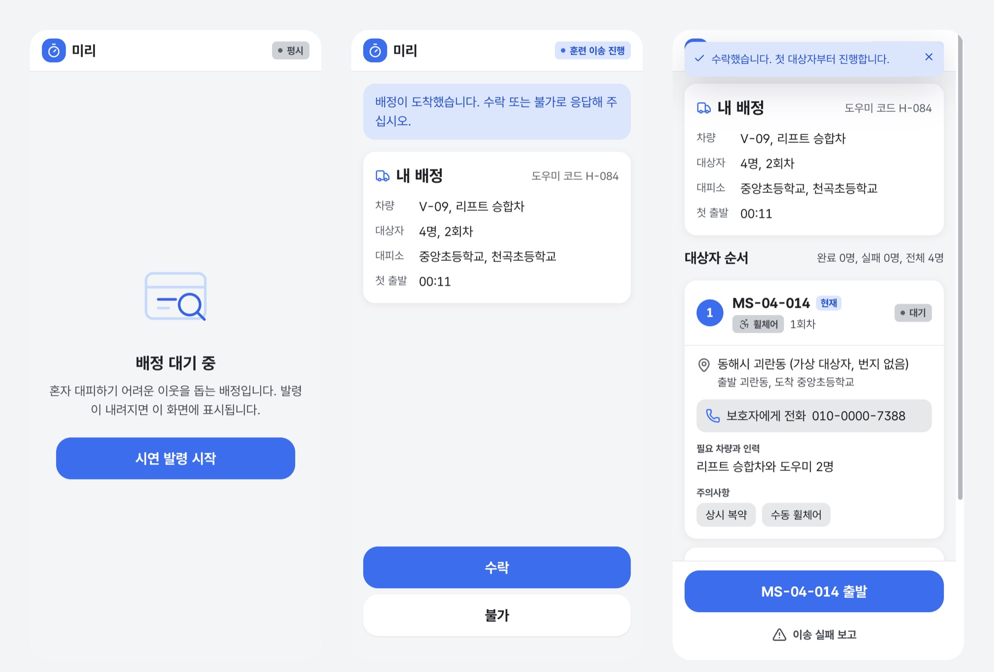
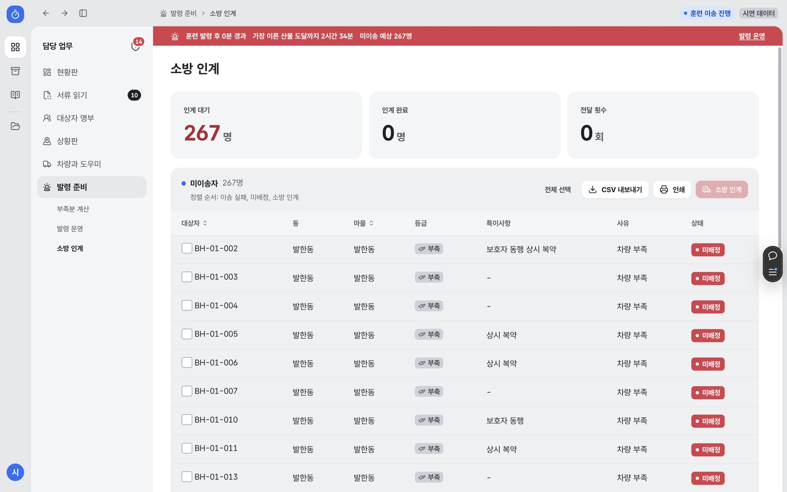

# ‘민관협력 지원 플랫폼 활용’ 기반 사회 현안 해결 ’서비스 개발’ 기획서

> 산불 때 혼자 대피하기 어려운 주민을 대피 기한 안에 옮길 차와 사람의 부족분을 평시에 계산하고, 발령 때 배정까지 돕는 지자체 담당자용 서비스 "미리"를 제안함

| 구분 | 내용 |
| --- | --- |
| 분야 | 분야1 서비스 개발 |
| 작품명 | 미리: 재난취약자 사전 이송 배정 서비스 |
| 팀명 | Team 오아시스 |
| 시안 | https://miri-indol.vercel.app (로그인 없이 열림, 화면 속 대상자와 차량과 계산 숫자는 모두 가상 자료) |
| 국내 배포 | http://miri-web-oasis.s3-website.kr.object.ncloudstorage.com (민관협력 지원 플랫폼 계정의 네이버 클라우드) |
| 소스 | https://github.com/hyunho2378/miri (기준 커밋 contest-eval 4692b0f, 2026. 10. 20.) |

### 예선 평가 항목과 근거 위치

| 평가 항목(배점) | 기획서의 근거 | 위치 |
| --- | --- | --- |
| 기획성(30) | 2022. 3. 옥계 산불이 동해에 닿기까지 4시간이 있었다는 기록에서 출발. 알림과 지정 체계는 있으나 기한 안에 옮길 차와 사람을 평시에 계산하는 단계가 없음을 보이고, 부족분 계산과 배정으로 메움 | Ⅰ장, Ⅱ장 |
| 활용성(20) | 플랫폼 네이버 클라우드의 CLOVA OCR, HyperCLOVA X, CLOVA Speech, API Gateway, Object Storage를 실제 서비스에 연결. 공공데이터 9종을 화면과 계산에 연결하고 47건 활용 신청, 재난안전데이터 8건 신청 | Ⅳ장, Ⅴ장, 그림 4~9, 11, 13 |
| 유용성(20) | 시민(재난취약자, 가족, 도우미), 기업, 정부(시와 읍면동, 소방)별로 회신에서 확인한 필요와 미리가 주는 것을 짝지음. 도입 전후 비교, 이용자 시나리오 | Ⅵ장, Ⅶ장, 그림 12~23 |
| 협력성(15) | 150곳 연락, 30곳 회신, 19곳에서 의견과 자료를 받고 14곳의 의견을 설계에 반영(8곳은 시안 화면까지 반영, 커밋 증빙). 동해 현장 일정과 체험 자료 준비 | Ⅲ장, 그림 2, 3 |
| 충실성(15) | 그림 23개마다 번호, 설명, 범례, 출처. 숫자는 시안 코드와 자동 시험으로 다시 확인하고 출처 목록 17건 정리 | 전 장, 별첨 출처 |

## Ⅰ. 추진배경 및 목적

### 시작한 계기: 4시간의 질문

- 팀장 주현호는 강릉 사람임. 2022. 3. 5. 강릉 옥계에서 시작된 산불 때 강릉에서 아르바이트를 하다 정전과 대피 소동을 직접 겪음
- 그날 주변 복지관과 이웃 가운데 혼자 움직이기 어려워 대피에 오래 걸린 어르신들이 있었다는 이야기를 들음
- 같은 새벽 옥계면 주민 한 분(86세)이 보행 보조기를 끌고 이웃을 따라 경로당으로 피신하다 밭에서 넘어졌고, 병원으로 옮겨졌으나 숨짐. 요양병원에서 나온 지 얼마 되지 않아 거동이 불편한 분이었음[1]
  - 산림 당국은 산불과 사망 사이의 연관성은 적다고 보고 사인을 조사함[1]
- 불은 01:08경 옥계면 남양리에서 나 05:10경에서 05:30경 사이 동해시 망상동 만우마을에 닿음[2][3]
  - 발화에서 이웃 도시의 마을에 닿기까지 약 4시간이 걸림
  - 같은 날 아침 동해노인요양원과 이례요양원 입소자를 포함한 주민 228명이 묵호고등학교 체육관 등으로 대피함[3]
- 이 산불로 동해시에서 주택 등 181채가 모두 타고 113채가 일부 탔으며, 이재민 53세대 111명이 생김(2022. 3. 13. 잠정 집계)[4]
- 불이 동해에 닿기까지 4시간이 있었는데, 걷기 어려운 사람의 대피는 왜 그날도 이웃의 손에 급하게 맡겨졌는지가 미리의 출발점임
- 그 4시간 안에 누구를 어떤 차로 옮길지 평시에 계산해 두면, 불이 난 뒤에 차와 사람을 찾는 시간을 줄일 수 있다고 보고 동해시를 첫 대상지로 정함

출처: 별첨 출처 [1]~[4]. 정전과 복지관 이야기는 팀장의 경험과 들은 이야기이며 숫자를 붙이지 않음

### 현황

- 정부는 초고속 산불에 대비해 위험구역 주민은 5시간 전, 재난취약자는 8시간 전에 대피하는 체계를 지자체에 제시함[5]
- 산불 피해는 스스로 이동하기 어려운 고령층에 집중됨
  - 2025. 3. 산불 사망자 30명 중 28명이 60대 이상임[6]
  - 같은 산불에서 복지시설 52개 기관 1,458명이 긴급 전원 조치됨[7]
  - 2022. 3. 울진 삼척 산불에서 마을 35곳 주민 6,126명이 대피함[8]
- 확산 속도가 빨라 발화 뒤에 이송 계획을 세우면 시간이 부족함
  - 2025. 3. 경북 산불은 시간당 8.2km로 확산됨[9]
- 동해시는 산불 확산 이력과 고령 인구가 함께 있는 지역임
  - 65세 이상 23,590명으로 전체 85,445명의 27.6%임(2026. 9.)[10]
  - 재가 장기요양 수급자는 약 2,005명으로 추정됨(2025년 급여이용수급자 2,668명에서 시설급여 663명 제외)[11]

출처: 별첨 출처 [5]~[11]

### 문제점

- 알리는 체계와 사람을 지정하는 체계는 갖춰졌으나, 정해진 시간 안에 옮길 차와 사람이 충분한지 평시에 계산하는 단계는 공개 자료에서 확인되지 않음

| 지금 있는 체계 | 하는 일 | 다루지 않는 일 |
| --- | --- | --- |
| 재난문자, 안전디딤돌 | 위험과 대피 장소 안내 | 걸을 수 없는 사람의 이송 |
| 대피 도우미 1:1 매칭(2024. 6.), 마을순찰대(2025. 5.) | 도울 사람을 미리 지정 | 기한 안에 옮길 수 있는지 계산 |
| 재난관리자원 통합관리시스템 | 기관 차량과 장비 관리 | 취약자 개인별 차량 배정 |

출처: 행정안전부 보도자료와 국민재난안전포털 공개 자료를 팀이 정리함(2026. 10.)

- 부족분을 모르면 봄철 산불 조심 기간 전에 민간 차량 협약 규모와 도우미 추가 지정 규모를 정할 근거가 없음
- 발령 직후에 가용 차량을 전화로 수배하면 대피 기한 안에 옮기지 못하는 인원을 사후에야 알게 됨

### 서비스 개발 목적

- 평시: 마을별 이송 부족분을 숫자로 만들어 차량 협약과 도우미 지정의 근거로 씀
- 발령 시: 차량, 도우미, 대상자를 묶은 배정표를 만들어 담당자 확인 뒤 도우미 휴대폰으로 보냄. 도우미 수와 지원 등급이 모자란 회차는 배정하지 않고 '도우미 부족'으로 표시함. 시안은 훈련 발령만 열려 있고, 실제 발령은 도우미 보고 서버 연결 뒤 엶
- 기한 초과 시: 옮기지 못하는 대상자 목록을 소방에 한꺼번에 넘겨 구조 자원을 집중하게 함
- 평소 업무: 협조 공문, 훈련 보고 같은 서식에 같은 숫자를 바로 넣어 담당자가 평시에도 서비스를 쓰게 함
- 민관협력 지원 플랫폼의 네이버 클라우드 AI와 저장소, 공공 위기 데이터로 개발하고 배포함

## Ⅱ. 개요

### 서비스 정의

- 혼자 대피하기 어려운 취약계층을 보호하기 위해, 복지와 재난 담당자가 함께 쓰는 이송 준비 웹 서비스임
- 이름 "미리"는 미리 계산하고 미리 옮긴다는 뜻임
- 기존 대피 도우미 지정 체계와 지역사회보장협의체를 대체하지 않고, 그 위에서 차량 부족분 계산과 배정표 생성을 맡는 계산판으로 설계함
- 서면 자문에서 "재난대비 목적보다 취약계층 보호 목적에 주안점"을 두라는 의견(R01)과 "단독 시스템보다 사회복지와 소방이 협력해 작동시키는 부분이 중요"하다는 의견(T2)을 받아 서비스 정의를 고침

### 사용자와 역할

| 사용자 | 미리에서 하는 일 |
| --- | --- |
| 동 맞춤형복지와 통합돌봄 담당자(주 사용자) | 대상자 명부 갱신, 당사자와 대피계획 확인, 확인 날짜 기록 |
| 시와 동 재난 담당자(주 사용자) | 부족분 확인, 차량 협약 규모 판단, 발령과 배정 검토, 공문 작성 |
| 대피 도우미 | 휴대폰으로 배정 수락 또는 불가 응답, 이송 단계 보고 |
| 요양보호사, 이장과 통장, 가족 | 거동 변화 같은 현장 소식 전달 |
| 요양시설과 재가기관 | 이송 등급 확인, 시설 차량 정보 제공 |
| 소방 | 기한 안에 옮기지 못한 대상자 목록을 일괄로 받음 |
| 재난취약자 본인 | 설치하거나 조작할 것이 없음 |

- 명부 갱신을 복지 담당자 몫으로 옮긴 근거: "결국 복지담당자가 이를 실행시켜야 합니다"(R01), 이사나 거주 변동은 사회복지 담당자가 알고 관리함(T2, 통화 메모)
- 실제 사용자는 읍면동 단위 4~5명 규모일 것이라는 자문(T2)에 따라 화면은 교육 없이 쓰는 단순한 구성으로 유지함
- 역할 구분은 2026. 10. 26.~10. 28. 동해 현장 인터뷰에서 다시 확인함

### 핵심 기능

| 기능 | 내용 | 상태(2026. 10. 20.) |
| --- | --- | --- |
| 부족분 계산 | 준비 시간, 이송 완료 기한, 마을별 도달 시각, 시간대, 추가 협약 차량을 바꿔 마을별 미이송 수와 차종별 필요 추가 차량 계산 | 구현 |
| 도달 시각 역산 | 확산 가정에서 마을별 도달 시각을 구하고 이송 완료 기한과 발령 기한을 거꾸로 계산 | 구현 |
| 추천 배정 | 차량 정원, 도우미 지원 등급, 대피소 정원, 회차 순서, 마을별 기한을 함께 고려해 기본 순서 배정과 비교 | 구현 |
| 서류 읽기 | 종이 대피계획서 사진을 국내 CLOVA OCR로 읽고, 이름과 연락처를 가린 글자만 국내 HyperCLOVA X에 보내 이송 등급 초안과 근거 문구를 받음. 담당자가 원문 대조 뒤 반영 | 구현(국내 처리), 실제 서류 검증 11월 |
| 현장 소식 | 요양보호사와 이장이 전한 글이나 녹음에서 거동 변화 후보를 찾아 사회복지 담당자 승인 뒤 명부 수정 | 구현, 시연용 |
| 상황판 | 실제 지형과 건물 위 평시 현황, 가정 시나리오, 발령 중 상황, 시간 축 재생 | 구현 |
| 발령 운영과 도우미 화면 | 발령 5단계, 배정 검토, 도우미 수락과 단계 보고, 불가 응답 시 재배정 | 구현, 훈련 발령 |
| 소방 인계와 이상 탐지 | 미이송자 일괄 전달, 동해 응급실 가용병상 참고, 이상 징후 규칙 | 구현 |
| 공공데이터 연계 | 산불위험지수, 기상특보, 단기예보, 대피시설, 장기요양기관, 응급환자이송업, 응급실 가용병상, 장애인편의시설, 산불 이력을 기준일과 함께 표시 | 구현 |
| 문서함 | 행정 서식 21종에 현황판 숫자를 넣어 한글(HWPX) 파일로 저장 | 구현 |
| 개방 API | 마을별 부족분과 대피소 수용 현황 조회 | 구현 |

그림 1. 서비스 블루프린트(평시 명부 확인, 부족분 계산, 발령, 배정, 이송, 재배정, 종료와 소방 인계) (출처: 미리 저장소 docs/diagrams/service-blueprint.html, 커밋 16ac7d8. 범례: 가로줄은 이용자별 행동, 세로 단계는 시간 순서, 사람 확인 표시는 담당자 확인 뒤 반영되는 지점)

## Ⅲ. 협력 방안

### 협력 원칙

- 협력 목적은 시안과 현장의 차이 확인, 계산 기준의 근거 확보, 운영 단계의 역할 분담 확인임
- 주민의 이름, 주소, 연락처, 건강 정보는 요청하지 않음
- 협력은 외부 주체가 미리를 위해 해 준 일로 기록함(자료 제공, 시안 검토 의견, 공식 답변, 소개)
- 기록 4단계: ① 연락 ② 회신(원본 보관) ③ 받은 것 ④ 미리에 반영한 것
- 이름과 기관명은 표기 동의 전이라 소속 유형으로 적음

### 연락과 회신 현황(2026. 10. 20. 기준)

| 구분 | 수 | 기준 |
| --- | --- | --- |
| 연락 | 150곳 | 서면 자문 메일 2026. 10. 19. 37곳, 10. 20. 113곳(받는 곳 1곳당 1통) |
| 회신 | 30곳 | 메일 29곳(R01~R29), 메일 없이 전화로만 자문한 곳 1곳(T2). 공공데이터 지원센터는 메일(R09)과 전화(T1)로 함께 답해 1곳으로 셈 |
| 의견이나 자료를 받음(③ 이상) | 19곳 | 검토 의견, 자료와 지침, 경로 안내, 전문가 소개 |
| 기획서 설계에 반영(④) | 14곳 | 아래 "협력으로 바뀐 설계"에 R번호로 표시 |
| 화면 반영(④ 구현 단계) | 8곳 | R01, R14, R17, R24, R27, R28, R29, T2. 시안 코드 커밋 dec95a3, 56e966e, f17dde8 |
| 감사와 반영 결과 회신 | 22곳 | 2026. 10. 20. 22:46~22:58 메일 22통 발송(받은 의견 한 가지와 반영 내용 명시) |
| 도달 실패 | 3곳 | 받는 곳 메일함 없음 2곳, 상대 서버 보류 1곳 |

- 수는 응답 주체(사람 또는 창구) 기준임
- R03은 원래 받을 곳과 다른 학회가 수신처를 안내한 회신이라 ③ 이상 집계에 넣지 않음
- R26은 면담 일정만 회신해 ②로 셈. 주체별 단계표는 공모전 협력숫자_기준표(2026. 10. 20.)와 같음

그림 2. 협력 단계별 수(출처: 공모전 회신 원문 R01~R29, 통화 메모 T1 T2, 감사 회신 발송 기록(2026. 10. 20.). 범례: 막대 길이는 곳 수, 진한 막대는 시안 코드까지 반영한 단계)

### 외부 주체별 협력 내용

| 주체 구분 | 회신 주체(동의 전 표기) | 받은 것 | 단계 |
| --- | --- | --- | --- |
| 공공기관 (3곳) | 공공데이터 활용 지원센터(R09, T1) | 인명피해우려지역 API 신청 경로, 갱신 주기와 좌표는 제공 부처 확인 필요, 재난취약계층 집계는 개인정보로 공개 제공이 어렵다는 안내 | ③ |
| | 광역시 출연 연구기관(R19) | 특별교통수단 수요 산정 담당 연구위원 소개 | ③ |
| | 소방 빅데이터 플랫폼 운영사업단(R02) | 해당 지수의 운영기관이 다르다는 안내 | ② |
| 학교 (16곳) | ○○대 행정학과 교수(R01) | 운영 주체와 부서 간 책임, 평가 질문 방향 | ④ |
| | ○○대 간호학과 교수, 응급 전문간호사(R06) | 도우미 역량 6가지, 이동 중 접점별 최소 대응, 안내 문구 | ④ |
| | ○○대 간호학부 교수(R08) | 보수적 인력 기준, 시뮬레이션 장면 3가지, 놓친 이해관계자 | ④ |
| | ○○대 봉사센터(R12) | 학생 봉사자 보험 확인 5가지, 도우미 화면 필요 기능 7가지, 학생 체험 검토 의사 | ④ |
| | ○○대 경영과학 분야 교수(R16) | 배정을 할당 문제로 정의, 규칙 기반 탐색과 민감도 점검 권고 | ④ |
| | ○○대 고령사회연구소 교수(R21) | 노인실태조사의 이동능력과 독거 지표, 전국 패널 자료 안내 | ③ |
| | ○○대 행정학과 교수(R27) | 대상자 구분, 야간과 휴일 시나리오, 도로 통제 보정, 경찰과 의료기관 추가 | ④ |
| | ○○대 사회복지학부 교수(R28) | 개인별 대피계획 확인 절차, 명부 확인 상태와 날짜 기록 | ④ |
| | ○○대 사회복지학과 교수(T2, 전화) | 지역 전달체계와 협의체 중심 운영, 명부 갱신은 복지 담당자 | ④ |
| | ○○대 공공안전행정학부 교수(R15) | 관련 법령 이름 안내 | ④ |
| | ○○대 디자인학부 교수(R04) | 서비스디자인 검토자 3명 소개 | ③ |
| | ○○대 인공지능 분야 교수(R20) | 판독 범위를 먼저 정해 달라는 질문 | ④ |
| | ○○대 의료정보 분야 교수(R26) | 면담 일정 회신. 개인정보와 AI 설계 면담 10. 22.(목) 확정, 의견은 면담에서 받음 | ② |
| | 그 밖의 학교 3곳(R22, R23, R25) | 내부 전달, 답변 보류 | ② |
| 민간기업 (1곳) | 모빌리티 API 제공 기업(R18) | 다중 경유지 길찾기 이용량 안내, 기술제휴 창구 소개 | ③ |
| 기타 (10곳) | 장애인 당사자 단체(R17) | 휠체어 특장차 탑승 조건, 당사자 직원의 시안 확인, 명부 특이사항 2가지 | ④ |
| | 시빅 개발자(R24) | 저장소와 개방 API 검토, 대상자 산정 보강 3가지, 결과 기준일과 규칙 버전 표시 제안 | ④ |
| | 데이터 기자, 시빅테크 커뮤니티 활동가(R29) | 일반인 개인정보는 공개하지 않고 합산 통계만 공개, 계속 바뀌는 정보는 기준일 명시, 대피소 좌표는 다른 자료와 대조, 같은 주제의 시빅테크 프로젝트 소개 | ④ |
| | 정보접근성 품질인증기관(R14) | 웹 접근성 표준심사 지침, 모바일 앱 접근성 지침 | ④ |
| | 동해 청년공간(R07) | 체험 안내 포스터를 조건으로 한 협조 제안 | ② |
| | 그 밖의 5곳(R03, R05, R10, R11, R13) | 수신처 안내, 후속 연락 약속, 공유 허락 문의, 범위 밖 안내 | ② |

- 단계: ② 회신 ③ 의견이나 자료를 받음 ④ 반영
- 회신 요지와 짧은 인용은 참고자료 3장, 협력 기록표는 참고자료 2장에 실음(원문 전체는 동의 후 첨부)

### 동해 현장 협력 일정과 준비물(2026. 10. 22.~10. 30.)

| 대상 | 방식과 상태 | 확인할 것 |
| --- | --- | --- |
| 의료정보 분야 교수(R26) | 대면 면담 확정(10. 22.(목)) | 서류 읽기 개인정보 가림 범위, 평가 지표 |
| 망상동 행정복지센터 재난 담당 | 대면 확정(10. 26. 10:00) | 평시 명단 관리, 발령 직후 배정 업무, 시안 반응 |
| 동해시 안전과 | 통화(10. 20.) 뒤 부서별 예상 질문을 메일로 전달, 부서별 협의 후 회신 예정 | 안전, 산림, 복지, 교통, 정보 부서별 질문 5~6개 |
| 동해 청년공간(R07) | 요청받은 체험 포스터(A4, SNS 정사각) 완성. 실제 화면 캡처와 4단계 체험 순서, QR 해독 확인 | 도우미 후보 집단의 5분 체험 |
| 대학 봉사센터(R12) | 학생 20분 과제형 체험 안내문(한글, PDF) 완성 | 도우미 화면 사용성 |
| 시빅테크 커뮤니티(R29 소개) | 같은 주제 프로젝트 팀에 체험과 코드 검토 요청 예정 | 개방 API와 계산 근거 검토 |
| 소방 현장 실무자 1인 | 질문 6개(가설 확인 3, 시안 후기 3) 전달 예정 | 이송 인원과 시간, 미이송자 인계 |

그림 3. 동해 청년공간 체험 안내 포스터(출처: 팀 제작 2026. 10. 20., 청년공간 요청(R07)에 따름. 범례: 왼쪽 QR은 도우미 화면 주소, 1~4는 체험 순서, 휴대폰 화면은 시안 실제 캡처)

- 본선 준비: 사용자 체험 진행표, 과제 성공 기준표, 기록지, 만족도 설문(SUS 10문항), 참여 동의서, 결과 집계표를 만들어 저장소 docs/usertest에 공개함(커밋 4692b0f). 과제 성공률, 걸린 시간, 만족도를 10. 26. 이후 체험에서 잼

### 협력으로 바뀐 설계

| 번호 | 처음 가정 | 받은 의견 | 바뀐 설계 | 화면과 증빙 |
| --- | --- | --- | --- | --- |
| 1 | 동 재난 담당자가 명부를 만들고 고침 | 거주 변동은 사회복지 담당자가 알고 관리함(T2). 실행은 결국 복지 담당자(R01). 명부의 현행화가 행정의 어려움(R27) | 명부 갱신 담당을 동 맞춤형복지 담당(사회복지 담당자)으로 옮기고, 재난 담당은 부족분 계산과 발령을 맡음 | 현장 소식 3단계를 "사회복지 담당자 승인"으로 변경, 명부 상세에 갱신 담당 표시(커밋 56e966e) |
| 2 | 휠체어는 리프트 승합차, 도우미 2명, 회차마다 승하차 20분 | 특장차는 운전자 1명으로 가능, 탑승과 벨트 체결은 숙련자 기준 5분 이내, 전동 휠체어는 경차 특장차 탑승이 어려울 수 있음(R17, 개인 경험 기준) | 근거가 한 곳뿐이라 가정값 20분은 유지하고 가정과 회신을 나란히 보여 주는 가정값 점검을 둠. 승하차 시간별 미이송 예상(밤이나 휴일): 10분 183명, 20분 291명, 30분 402명. 명부 특이사항에 전동 휠체어, 수동 휠체어, 욕창 확인 추가 | 부족분 계산 가정값 점검 카드, 명부(커밋 dec95a3, 56e966e, 그림 17) |
| 3 | 계산 결과는 숫자만 보여 줌 | 계산 결과마다 입력 기준일과 계산 규칙 버전을 같이 찍는 것이 기능이자 담당자의 방어(R24) | 계산 조건 아래에 입력 기준과 계산 규칙 판(1.2판, 2026. 10. 20.)을 표시 | 부족분 계산(그림 15) |
| 4 | 모두 집에 있고 모든 차량을 쓸 수 있는 한 가지 경우 | 야간이나 휴일은 별도 시나리오(R27). 주야간보호 이용자 417명은 낮에 센터에 있음(R24) | 발령 시간대(밤이나 휴일, 평일 낮)와 차량 가용률을 계산 조건에 추가. 평일 낮은 주야간보호 이용자를 센터 대피로 보고 마을 이송에서 뺌. 미이송 예상 밤이나 휴일 291명, 평일 낮 216명(휠체어 부족 40명이 새로 드러남) | 부족분 계산 시간대 비교(커밋 56e966e, 그림 16) |
| 5 | 명부는 등록 여부만 표시 | 당사자와 계획 확인 완료 구분, 마지막 확인 날짜, 거주 층수, 계단과 엘리베이터, 차량 접근 위치, 소통 방식(R28) | 명부 상세에 계획 확인 상태와 마지막 확인일, 층수, 계단과 엘리베이터, 차량 접근 위치, 소통 방식 추가(값은 가상) | 대상자 명부 상세(커밋 dec95a3, 그림 18) |
| 6 | 마을별 표에 왕복 시간, 대상자, 부족분만 있음 | 산불 발생 위험과 주민의 대피 취약성은 다른 개념이므로 구분(R27) | 마을별 부족분 표에 산불 도달(위험, 시나리오 가정)과 이동 취약 인원(침상과 휠체어)을 나눠 표시 | 부족분 계산 마을별 표(그림 15) |
| 7 | 대상자 수가 화면마다 2,005명과 2,013명으로 따로 나옴 | 두 수를 맞추거나 설명하라, 등록장애인이 빠져 있음(R24) | 명부 2,013건을 확인 2,005명, 판독 확인 대기 7건, 중복 의심 1건으로 나눠 같은 방식으로 표시. 등록장애인 가운데 장기요양을 받지 않는 분은 동해시 명부 확인 뒤 포함 | 현황판, 명부, 설정(그림 14) |
| 8 | 첫 문장이 계산 기능 설명 | 재난대비 목적보다 취약계층 보호 목적에 주안점(R01) | 로그인, 현황판, 도우미 화면 첫 문장을 "혼자 대피하기 어려운 주민을 보호하기 위해"로 시작 | 로그인, 현황판, 도우미 화면 |
| 9 | 접근성 점검 없음 | 인증기관 표준심사 지침 33개 항목 안내(R14) | 5개 화면 자체 점검, 본문 바로가기, 화면별 문서 제목, 버튼 이름 구분, 누르기 크기 24px, 입력 오류 설명 연결 | 자체 점검표, 본문 바로가기 |
| 10 | 데이터 숫자만 표시 | 계속 바뀌는 정보는 기준일 명시, 대피소 좌표는 다른 자료와 대조, 개인 정보는 공개하지 않고 합산 통계만(R29) | 공공데이터 카드마다 분석 시각, 기관 입력 시각, 포털 수정일을 표시. 개방 API와 화면은 마을 합계만 공개. 대피소 좌표 대조는 공공 자료끼리(통합대피소와 민방위대피시설) 하도록 설계 | 현황판 공공데이터 카드, 소방 인계(커밋 f17dde8, 그림 13) |
| 11 | 도우미 화면은 수락과 이송 단계 보고만 있음 | 이동 중단과 119 신고 흐름(R06), 의식과 호흡 변화 시 즉시 도움 요청(R08), 동의와 철회, 역할 선택, 보험 확인, 거절 불이익 없음 안내(R12) | 이송 실패 보고와 불가 응답, 불가 응답 도우미를 재배정 후보에서 빼는 규칙 구현. 이동 멈춤과 119 신고, 등록 동의와 보험 확인은 등록 화면 설계 | 도우미 화면(그림 21), 등록 화면 10. 29.~11. 2. |
| 12 | 소방 구급차를 지자체 가용 차량과 함께 계산 | 구급차는 소방의 작전 하에서 결정됨(R01) | 차량마다 소유(소방, 시설, 시, 협약)를 나눠 두고 소방 구급차 3대는 출동 대기로 계산에서 뺌 | 차량과 도우미 화면(그림 19) |
| 13 | 서류 사진을 AI 한 곳에 보내 판독 | 판독 범위를 먼저 정해 달라(R20) | 판독을 글자 인식, 개인정보 가림, 이송 등급 분류 세 단계로 나누고 단계마다 국내 서비스와 검사를 둠 | 서류 읽기(그림 6, 그림 20) |

- 숫자는 시안 코드의 자동 시험으로 다시 확인함(2026. 10. 20., 커밋 4692b0f)
- 반영 전후 화면은 참고자료 7장에 실음

## Ⅳ. 민관협력 지원 플랫폼 활용

### 사용 승인과 활용 현황(2026. 10. 20. 기준)

- 민관협력 지원 플랫폼 사용 신청 승인 완료(접수번호 217, 서비스 만료 2027. 1. 20.)
- 플랫폼 계정으로 들어간 네이버 클라우드에서 AI 서비스 4종과 저장소를 미리에 연결함. 이용 신청 때 결제수단 요구는 없었음

| 플랫폼 자원 | 한 일 | 결과 | 미리에서 쓰는 곳 |
| --- | --- | --- | --- |
| CLOVA OCR(일반 도메인) | 도메인 생성, API Gateway로 공개 호출 주소 연결 | 가상 대피계획서 5장 글자 인식 | 서류 읽기 1단계 |
| HyperCLOVA X HCX-005(CLOVA Studio) | 키 발급, 가린 글자로 이송 등급과 근거 문구 생성 | 대상자 11명 등급 11명 일치, 근거 문구 원문 대조 11건 통과, 평균 약 4.3초 | 서류 읽기 3단계, 현장 소식 글 |
| CLOVA Speech Recognition | 앱 등록, 받는 형식 mp3, aac, ogg, flac, wav(60초 이내) | 서버 연결 완료, 시험 음성 검증은 10. 29.~11. 2. | 현장 소식 녹음 |
| API Gateway | OCR 호출 주소를 외부에서 부를 수 있게 연결 | 서울 서버 함수에서 호출 확인 | 서류 읽기 |
| Object Storage | 버킷 생성, 정적 웹 호스팅, 시안 화면 업로드 | 국내 배포 주소 운영(약 17MB) | 시안 전체 국내 제공 |
| 위기 데이터 카탈로그 | 전체 609건 확인, 미리 관련 항목 195건 검토 | 공공데이터포털 활용 신청 47건(아래 표) | 현황판, 상황판, 소방 인계 |
| 바이브코딩, AI 협업 툴 | 실행 환경 확인(6 vCPU, RAM 8GB, Python 3) | 회원 등록 처리를 사무국과 진행 중 | 마을별 부족분 재계산 노트(등록 뒤) |
| 데이터 요청 게시판 | 동해시 마을 경계, 읍면동 재난취약계층 집계(개인 식별 없음), 마을 도달 시각 자료 요청 글 작성 | 게시 오류를 사무국에 신고하고 재등록 진행 중 | 대상자 산정 보강 |

그림 4. 네이버 클라우드 콘솔(출처: 민관협력 지원 플랫폼 계정 화면 캡처 2026. 10. 20. 범례: 위쪽 계정 표시는 플랫폼 SSO 계정)

그림 5. CLOVA OCR 도메인 설정(출처: 네이버 클라우드 콘솔 캡처 2026. 10. 20.)

그림 6. CLOVA Studio 시험 화면(출처: 네이버 클라우드 콘솔 캡처 2026. 10. 20. 가상 문구로 시험)

그림 7. 국내 배포본에서 연 도우미 화면(출처: miri-web-oasis 국내 배포 주소 캡처 2026. 10. 20.)

※ 민관 협력 지원 플랫폼 활용 내용: 그림 4~7, 참고자료 8장(플랫폼 승인, 카탈로그, 데이터 상세, 신청 기록)

### 공공데이터 연결 현황(2026. 10. 20. 기준)

| 데이터 | 제공기관 | 미리에서 쓰는 곳 | 호출 | 기준일 표시 |
| --- | --- | --- | --- | --- |
| 산불위험예보정보 | 산림청 국립산림과학원 | 현황판 오늘 산불 여건 | 실시간(10분 캐시) | 분석 시각 |
| 기상특보, 단기예보 | 기상청 | 현황판 특보, 상황판 풍향과 풍속 | 실시간 | 발표 시각 |
| 민방위대피시설 | 행정안전부 | 상황판 대피시설 수와 수용 인원 | 실시간 | 조회 시각 |
| 장기요양기관 검색 | 국민건강보험공단 | 상황판 동해 장기요양기관 | 실시간 | 조회 시각 |
| 응급환자이송업 | 행정안전부 | 차량 자원(민간 이송 구급차) | 실시간 | 조회 시각 |
| 응급실 실시간 가용병상(15000563) | 국립중앙의료원 | 현황판, 소방 인계 "인계 참고: 동해 응급실" | 실시간 | 기관 입력 시각 |
| 장애인편의시설 현황(15092317) | 한국사회보장정보원 | 현황판 동해 등록 시설 수와 좌표 있는 수 표시. 좌표는 대피소 접근성 대조에 쓸 계획 | 실시간 | 조회 시각 |
| 산불통계(15121380) | 산림청 | 현황판 동해 산불 이력(동해 발생 3건과 동해로 번진 2022. 3. 옥계 산불) | 파일 스냅샷 | 포털 수정일 2026. 9. 15. |
| CLOVA OCR, HyperCLOVA X, CLOVA Speech | 네이버클라우드(플랫폼 계정) | 서류 읽기, 현장 소식 | 실시간 | 처리 시각 |

| 신청과 승인 | 데이터 | 다음 단계 |
| --- | --- | --- |
| 승인, 연결 준비 | 국토교통부 건축물대장(15134735) | 대피소 건물의 층수와 승강기 수부터 표시(명부 주소 조회는 운영 단계 담당자 화면 안에서만) |
| 승인, 응답 확인 중 | 소방청 구급정보, 구급통계, 화재정보 | 동해 관할 단위 응답 확인 뒤 기준 시나리오 근거로 연결 |
| 심의 대기 | 보건복지부 응급안전안심 서비스 2건 | 승인 뒤 명부 갱신 경로 근거 |
| 신청, 승인 대기 | 재난안전데이터공유플랫폼 8건(인명피해우려지역, 이재민 임시주거시설, 긴급재난문자, 산불정보, 통합대피소, 이동통제초소, 실시간 병상, 특보통보문) | 승인 뒤 대피소 좌표 대조(R29), 인명피해우려지역 지도 겹치기, 이동통제초소로 경로 보정 |

출처: 공공데이터포털 활용신청 현황(활용 신청 47건, 2026. 10. 20. 확인), 재난안전데이터공유플랫폼 신청 기록(2026. 10. 20.), 미리 저장소 client/api/opendata.js(커밋 f17dde8)

- 인명피해우려지역은 갱신 주기 1일로 안내되나 데이터 갱신 일자가 2024. 5. 29.이라, 연결할 때 화면에 이 날짜를 그대로 적음(R29 기준일 명시)
- 공공데이터 키는 서버 함수에서만 쓰고 화면에 내보내지 않음. 호출이 실패하면 빈칸 대신 사유를 표시함

### 외부 자원 활용(플랫폼 밖)

| 자원 | 제공 기관 | 활용 | 근거 |
| --- | --- | --- | --- |
| 주민등록인구, 노인장기요양보험통계 | 행정안전부, 국민건강보험공단(KOSIS) | 마을별 대상자 추정 | 공개 통계[10][11] |
| 마을회관과 경로당 | 동해시(공공데이터포털) | 마을 집결지 37곳 | 공개 자료[13] |
| 이재민 임시주거시설(동해시) | 행정안전부 국민재난안전포털 | 대피소 27곳, 수용 5,601명 | 공개 자료[12] |
| GIS건물통합정보 | 국토교통부 브이월드 | 3D 건물 196,111동 | 공개 자료[14] |
| 도로망과 주행 시간 | OpenStreetMap, OSRM | 집결지와 대피소 사이 왕복 시간 | 오픈소스 |
| 법령 원문 | 법제처 국가법령정보 | 공문 속 법령 인용 확인 | 공개 자료 |

- 이동 시간은 공개 도로망과 오픈소스 경로 계산으로 구하고, 상업 지도 서비스는 쓰지 않음

## Ⅴ. 개발 환경 구성

### 구성 요소(2026. 10. 20.)

| 영역 | 사용 기술 | 역할 |
| --- | --- | --- |
| 화면 | React 18, Vite, Tailwind CSS, zustand | 담당자 화면, 도우미 화면, 공개 화면 |
| 지도와 3D | MapLibre GL, three.js | 지형과 건물 3D, 2D 지도 전환 |
| 계산 | 브라우저 안 규칙 계산(자바스크립트) | 부족분, 도달 시각 역산, 추천 배정, 가정값 점검 |
| 서버 함수 | 서버리스 함수(Node, 실행 지역 서울 icn1) | 서류 판독, 현장 소식 판독, 공공데이터 중계, 한글 파일 생성, 문서 저장, 법령 확인, 개방 API |
| AI | 네이버 클라우드 CLOVA OCR, HyperCLOVA X HCX-005, CLOVA Speech Recognition, API Gateway | 서류와 현장 소식에서 이송 등급 후보와 근거 문구 추출. 모두 국내 처리 |
| 보호 장치 | 서버 서명 쿠키 시연 세션, 공유 저장소 기반 AI 호출 상한(분당, 하루), 요청과 응답 형식 검사 | 공유 키 남용과 잘못된 응답 차단 |
| 국내 배포 | 네이버 클라우드 Object Storage 정적 웹 호스팅 | 시연 화면 전체를 국내 리전에서 제공 |
| 문서 | kordoc(MIT) | 행정 서식 HWPX 생성과 구조 검사 |
| 저장 | 키값 저장소(Upstash) | 문서함, 현장 소식 시연 데이터, AI 호출 횟수 |

그림 8. 시스템 구성도(출처: 미리 저장소 docs/diagrams/system-architecture.html, 커밋 16ac7d8. 범례: 실선은 지금 동작하는 연결, 점선은 단계 계획, 상자 묶음은 실행 위치(브라우저, 서울 서버 함수, 네이버 클라우드, 공공데이터))

※ 개발 환경 구성도: 그림 8

### 개인정보가 머무는 곳과 데이터 흐름

그림 9. 데이터 흐름도(출처: 미리 저장소 docs/diagrams/data-flow.html, 커밋 16ac7d8. 범례: 실선 화살표는 데이터 이동, 중단 표시는 503(호출 상한 저장소 없음)과 422(읽은 내용 없음) 경로, 강조 상자는 개인정보가 머무는 곳)

### 국내 클라우드 이전 단계

| 단계 | 내용 | 상태 |
| --- | --- | --- |
| 1단계 정적 화면 이전 | 플랫폼 계정의 네이버 클라우드 Object Storage 정적 호스팅으로 시연 화면을 국내에서 제공 | 완료(2026. 10. 20.) |
| 2단계 AI 국내 처리 | 서류와 소식 판독을 네이버 클라우드 CLOVA OCR, HyperCLOVA X, CLOVA Speech로 옮기고 서버 함수를 서울 지역에서 실행. 해외 AI 호출 제거 | 완료(2026. 10. 20., 커밋 67aa51c) |
| 3단계 서버 함수 이전 | 판독, 공공데이터 중계, 문서 생성 함수를 플랫폼 클라우드 서버나 컨테이너로 옮김 | 11월(서버 함수와 CDN 권한, 지원 한도를 사무국과 확인한 뒤 진행) |
| 4단계 운영 분리 | 동해시가 계약 주체가 되어 공공기관용(CSAP 인증) 환경으로 옮기고, 실명 명부는 지자체 내부 서버, 계산 화면에는 이름 없는 숫자만 전달 | 시범 운영 지자체 협의 뒤[16] |

- 시안 단계는 플랫폼이 준 민간 리전 계정에서 가상 자료만으로 운영함
- 공공기관은 보안인증 클라우드를 우선 고려하고 국가 클라우드 보안 지침에 따라 이용해야 하므로[16], 4단계에서 그 환경에서 쓸 수 있는 AI 서비스 범위를 네이버클라우드와 확인함
- 재난취약계층 집계 자료는 개인정보가 들어 있어 공개 API로 받기 어렵다는 공공데이터 지원센터 안내(T1)에 따라, 명부와 계산을 나누는 구조를 유지함

### 품질 확인

| 항목 | 방법 | 결과(2026. 10. 20.) |
| --- | --- | --- |
| 자동 시험 | 계산 규칙 15개, 코드 검토 회귀 시험 30개, 공공데이터 해석 4개 | 49개 통과(npm test), 서버와 평가기 시험 6개 통과(node --test), 압축 해제 빌드 통과 |
| 코드 점검 | 전체 코드 점검, 결함 재현 뒤 수정, 재점검을 4차례 반복 | 결함 30건(1차 15, 2차 7, 3차 4, 4차 경미 4) 중 28건 수정. 4차 판정은 공개 주소 반영 가능. 남은 2건(판독 확인 전 대상자의 발령 포함 여부, 휴대폰과 담당자 화면 간 실시간 공유)은 정책 결정과 서버 연결이 필요해 운영 단계 과제로 둠 |
| 계산 오류 수정 | 코드 검토에서 평일 낮 발령이 평시 계산과 다른 차량 목록을 쓰는 오류를 찾음 | 평일 낮 발령 기준선 176명을 평시와 같은 216명으로 바로잡음 |
| 서류 읽기 정확도 | 가상 서류 5장(대상자 11명)으로 국내 AI 판독 | 등급 11명 일치, 근거 문구 원문 대조 11건 통과, 가짜 이름과 번호가 AI 입력과 결과에 남지 않음 |
| 접근성 | 인증기관 안내 지침(R14)으로 5개 화면 자체 점검 | 본문 바로가기, 문서 제목, 버튼 이름, 누르기 크기, 오류 설명 연결 고침 |
| 계산 결과 표기 | 결과마다 입력 기준과 계산 규칙 판(1.2판) 표시 | 구현 |

출처: 미리 저장소 tests 폴더와 공모전 반영기록(코드 점검 1~3차, 수정 기록, 국내 AI 이전 시험 결과, 2026. 10. 20.)

## Ⅵ. 내용

### 이송 등급과 차량 기준

| 등급 | 상태 | 차량과 사람 | 시안의 차량별 정원(가정값) |
| --- | --- | --- | --- |
| 도보 | 안내만 받으면 스스로 이동 | 마을버스 또는 승용차, 인솔 1명 | 마을버스 20명, 승용차 4명 |
| 부축 | 부축을 받으면 승용차 탑승 가능 | 승용차, 도우미 1명 | 승용차 3명 |
| 휠체어 | 휠체어에 앉은 채 이동 | 리프트 승합차, 도우미 2명 | 리프트 승합차 3명 |
| 침상 | 누운 상태로만 이송 가능 | 구급차 또는 침상 승합차, 구급대원 | 구급차 1명, 침상 승합차 2명 |

- 등급별 차량과 정원, 타고 내리는 시간은 가정값이며, 공식 기준이 없어 인력을 넉넉히 잡는 보수적 기준(R08)으로 둠
- 최종 값은 훈련에서 잰 실제 승하차 시간으로 고침(R28)

### 데이터 분석 방법

- 마을별 대상자: 행정동별 65세, 75세, 85세 이상 인구와 장기요양 등급 분포로 마을 단위 대상자와 이송 등급을 추정함
- 대피소: 임시주거시설 27곳(수용 5,601명)을 기준으로 하고, 정원을 넘으면 나눠 보내며 정원이 찬 시설에는 넣지 않음
- 왕복 시간: 마을 집결지 37곳에서 대피소까지 실제 도로망 주행 시간을 계산함. 나눠 보낼 때는 가장 먼 목적지 기준으로 보수적으로 계산함
- 도달 시각: 마을별 산불 도달 예측 시각은 공개 데이터에 없어 확산 가정 시나리오로 계산함
- 우선순위: 산불 발생 위험과 주민의 대피 취약성은 다른 개념이므로 두 축으로 나눠 마을 우선순위를 정함(R27)
- 대상자 수 표기: 2025년 장기요양 재가 수급자 추정 2,005명[11]을 마을별로 나눠 가상 명부를 만듦. 명부는 2,013건이며 확인 2,005명, 판독 확인 대기 7건, 중복 의심 1건으로 구성됨. 기준 시나리오는 이 가운데 대피 대상 마을 12곳의 848명을 다룸
- 등록장애인 가운데 장기요양을 받지 않는 분은 동해시 명부 확인 뒤 포함함(R24)
- 시간대: 평일 낮에는 주야간보호 이용자 417명(국민건강보험공단 통계, 누가 이용자인지는 가상)을 센터 대피로 보고 마을 이송에서 뺌(R24, R27)

### 부족분 계산 알고리즘

- 이송 가능 시간(분) = (대피 창 시간 - 도달 전 완료 여유 시간) x 60 - 준비 시간
- 왕복 가능 횟수 = 이송 가능 시간 ÷ 왕복 시간(소수 버림)
- 이송 가능 인원 = 차량 수 x 왕복 가능 횟수 x 차량 정원
- 부족분 = 대상자 수 - 이송 가능 인원(0보다 작으면 0)
- 왕복 시간 = 집결지에서 대피소까지 주행 시간 x 2 + 타고 내리는 시간 20분(가정값)
- 계산 예시: 침상 대상자 12명, 침상 차량 2대(정원 1), 왕복 2시간, 대피 창 8시간, 준비 1시간이면 차량마다 3회 왕복해 6명을 옮기고 6명이 부족함

### 배정 알고리즘

- 기본 순서는 침상, 휠체어, 부축, 도보 순이며 같은 등급은 도달 시각이 빠른 마을부터 배정함
- 차량이 처음 쓰일 때 지원 등급이 맞는 도우미를 붙이고, 모자라면 그 차량을 쓰지 않고 남은 인원을 '도우미 부족'으로 표시함
- 추천 배정은 기본 순서를 시작점으로 마을 순서 교환과 배정 규칙 전환을 탐색함. 목표 순서는 등급 가중 미이송 최소, 미이송 인원 최소, 마지막 완료 시각 최소임
- 시작점을 후보에 넣으므로 추천 결과가 기본 순서보다 나빠지지 않음
- 재배정은 발령 때 확정한 시나리오 왕복, 시간대 차량, 완료 기한을 그대로 쓰고, 불가로 응답한 도우미와 그 차량, 대피소 자리가 없어 뺀 사람은 후보에서 뺌
- 학습 모델 없이 규칙 기반 탐색으로 처리해 결과를 설명할 수 있음(R16 경영과학 자문: 할당 문제로 정의, 학생 프로젝트 규모에서는 규칙 기반 탐색이 현실적, 민감도 점검 권고)

그림 10. 부족분 계산과 배정 규칙(출처: 미리 저장소 docs/diagrams/assign-logic.html, 커밋 16ac7d8, 숫자는 시안 코드 계산값. 범례: 왼쪽에서 오른쪽은 계산 순서, 아래 칸은 미이송 사유 5가지)

### AI 사용(서류 읽기, 현장 소식)

- 담당자가 올린 서류 사진은 국내 글자 인식(CLOVA OCR)에만 보냄
- 읽은 글자에서 성명, 연락처, 주소, 주민번호 항목과 전화번호 모양, "○○○ 어르신" 같은 이름 표기를 가림. 가린 뒤에도 이름이나 번호 모양이 남으면 언어 모델을 부르지 않고 멈춤
- 서류의 "거동 상태" 칸을 코드로 나눠 대상자 단위를 정해 판독 불가 칸도 빠지지 않게 함
- 가린 글자만 국내 AI(HyperCLOVA X)에 보내 대상자별 이송 등급, 특이사항, 근거 문구를 받음
- 근거 문구가 원문에 그대로 없으면 통과시키지 않고 "원문 불일치, 확인 필요"로 담당자 확인 목록 앞에 둠. 특이사항은 글자에 근거 낱말(예: 산소, 와상, 치매)이 있을 때만 남김
- 글자를 하나도 못 읽거나 대상자가 0명이면 성공으로 처리하지 않고 "읽은 내용 없음, 담당자가 서류를 직접 확인"으로 돌려줌
- 담당자가 확인, 수정, 제외하기 전에는 명부와 부족분 계산에 반영하지 않고, 확인자와 시각을 기록함
- 시안 단계에서는 가상 서류만 사용하고 업로드 화면에서 가상 자료 확인을 받음. 실제 서류 기준 등급 일치율은 11월 검증에서 측정함

그림 11. 국내 AI 서류 읽기 과정(출처: 미리 저장소 docs/diagrams/ai-pipeline.html, 커밋 16ac7d8. 범례: 진한 상자는 네이버 클라우드 서비스, 흐린 상자는 서버 함수의 검사 단계, 오른쪽 숫자는 중단 응답 코드)

| 서류(가상) | 대상자 | 등급 일치 | 근거 원문 대조 통과 | 걸린 시간 |
| --- | --- | --- | --- | --- |
| 망상동 심곡동 대피계획서(표 서식) | 4 | 4 | 4 | 약 6.7초 |
| 북삼동 지흥동 대피카드 | 1 | 1 | 1 | 약 3.5초 |
| 삼화동 이로동 대피계획서(흐린 사본, 판독 불가 칸 포함) | 2 | 2 | 2 | 약 3.9초 |
| 묵호동 어달동 대피카드 | 2 | 2 | 2 | 약 3.8초 |
| 천곡동 가림 시험 서류(가짜 성명, 연락처, 주소) | 2 | 2 | 2 | 약 3.8초 |
| 합계 | 11 | 11 | 11 | 평균 약 4.3초 |

출처: 공모전 반영기록 국내 AI 이전 시험 결과(2026. 10. 20.). 판독 불가 칸은 등급을 정하지 않고 일치도를 낮게 표시한 것을 일치로 셈

### 기준 시나리오와 초고속 확산 비교(가상 자료)

| 항목 | 기준 시나리오: 옥계 방면 북측 확산 | 초고속 확산: 옥계 방면 |
| --- | --- | --- |
| 확산 가정 | 시속 2km. 2022. 3. 옥계 산불이 발화 약 4시간 뒤 망상동에 닿은 기록[2][3]에 맞춘 값 | 시속 8.2km. 2025. 3. 경북 산불의 확산 속도[9]. 발화 3시간 전 사전 발령을 가정 |
| 대상 | 마을 12곳, 848명 | 마을 17곳, 1,340명 |
| 첫 도달 | 발령 후 2시간 35분 | 발령 후 약 3시간 20분 |
| 미이송 예상(기본 순서) | 291명(모두 부축 등급) | 744명(침상 16명, 부축 728명) |
| 추천 배정 | 267명(24명 감소) | 시나리오 화면에서 비교 |
| 미이송 0명을 위한 추가 차량 | 승용차 20대(부족이 모두 승용차로 옮길 수 있는 부축 등급이라 승용차로 해소) | 침상 승합차 2대로 침상 부족 해소. 부축은 승용차 300대를 더해도 기한 안에 다 옮기지 못함 |

출처: 미리 시안 계산(커밋 4692b0f, 2026. 10. 20.), 대상자와 차량과 도우미 수는 가상 자료이며 실제 협약 차량 현황을 넣으면 다시 계산됨

- 기준 시나리오는 동해가 실제로 겪은 확산 속도를, 초고속 확산은 최근 가장 빠른 확산을 놓고 같은 명부와 차량으로 계산함
- 초고속 확산에서는 차량을 늘려도 해결되지 않는 인원이 남으므로, 사전 발령 시각과 마을 안 대피(가까운 안전 시설) 같은 다른 수단이 필요하다는 것을 숫자로 보여 줌

| 조건(기준 시나리오) | 미이송 예상 |
| --- | --- |
| 밤이나 휴일, 승하차 20분(기본) | 291명 |
| 평일 낮(주야간보호 이용자 센터 대피, 차량 30대) | 216명(추천 배정 200명) |
| 승하차 10분 | 183명 |
| 승하차 30분 | 402명 |

출처: 미리 시안 부족분 계산과 가정값 점검(커밋 4692b0f). 차량 39대(전체 42대 중 소방 구급차 3대 출동 대기 제외), 도우미 88명, 대피소 27곳

### 서비스 구현 예시 화면

그림 12. 현황판(출처: 공개 시안 https://miri-indol.vercel.app 캡처 2026. 10. 20., 가상 자료. 범례: 빨간 숫자는 미이송 예상, 막대는 마을별 부족)

- 담당자가 아침에 가장 먼저 보는 화면으로 기한 안에 옮기기 어려운 인원, 부족한 마을, 확인할 서류와 현장 소식을 한 화면에 모음

그림 13. 공공데이터 추가 연계 카드(출처: 공개 시안 캡처 2026. 10. 20. 23시경, 국립중앙의료원, 한국사회보장정보원, 산림청 자료. 범례: 항목마다 제공기관과 기관 입력 시각 또는 포털 수정일)

- 조회 시각 기준 값(2026. 10. 20. 23:05 기관 입력): 동해 응급실 1곳(의료법인동해동인병원) 가용병상 9. 실시간 값이라 조회할 때마다 바뀜
- 동해 장애인편의시설 등록 342곳 중 좌표 있는 곳 328곳. 좌표는 아직 지도와 배정에 쓰지 않고 대피소 접근성 대조에 쓸 계획임

그림 14. 상황판(출처: 공개 시안 화면 캡처 2026. 10. 20., 가상 자료. 범례: 흰 말풍선은 마을별 대상자 수, 파란 원은 대피소, 검은 표시는 소방서와 주요 시설)

- 동해시 37개 마을 집결지와 대피소 27곳을 실제 지형과 건물 196,111동 위에 표시함
- 평시, 가정 시나리오, 발령 중 세 상황으로 나누고 시간 축으로 재생함

그림 15. 부족분 계산(출처: 공개 시안 화면 캡처 2026. 10. 20., 가상 자료. 범례: 빨간 숫자는 부족, 산불 도달은 시나리오 가정, 이동 취약은 침상과 휠체어 인원)

그림 16. 평일 낮 시간대 계산(출처: 시안 반영 확인 화면 캡처 2026. 10. 20., 커밋 56e966e, 가상 자료, 회신 R24 R27 반영)

그림 17. 가정값 점검 카드(출처: 공개 시안 화면 캡처 2026. 10. 20., 커밋 37985c9, 회신 R17 R24 R27 반영. 범례: 가정값과 회신 값을 나란히 놓고 값마다 미이송 예상을 표시. 도우미 수와 지원 등급도 계산 조건임)

그림 18. 대상자 명부 상세(출처: 공개 시안 화면 캡처 2026. 10. 20., 가상 대상자, 회신 R28 반영)

그림 19. 차량과 도우미(출처: 공개 시안 화면 캡처 2026. 10. 20., 가상 자료. 범례: 차량은 소유(소방, 시설, 시, 협약)와 가용 여부, 도우미는 지원 등급)

그림 20. 서류 읽기(출처: 공개 시안 화면 캡처 2026. 10. 20., 가상 서류. 범례: 원문 불일치는 근거 문구가 서류 원문에 없어 담당자 확인이 먼저 필요한 건)

그림 21. 발령 운영 배정 검토(출처: 공개 시안 훈련 발령 화면 캡처 2026. 10. 20., 가상 자료. 범례: 단계 표시 1~5, 배정표는 차량별 회차와 대상자 순서)

그림 22. 도우미 휴대폰 화면 세 단계(출처: 공개 시안 /h/demo 캡처 2026. 10. 20., 390px 폭, 가상 자료. 범례: 왼쪽부터 대기, 배정 도착과 수락 또는 불가, 수락 뒤 대상자 순서와 출발 보고)

- 도우미는 자기 배정만 보고 수락 또는 불가로 응답하며, 불가 응답은 재배정 후보에서 빠지고 발령 종료 때 정보가 지워짐

그림 23. 소방 인계(출처: 공개 시안 훈련 발령 화면 캡처 2026. 10. 20., 가상 자료. 범례: 사유는 차량 부족, 도우미 부족, 이송 실패 등)

출처: 미리 시안 화면 캡처(2026. 10. 20.), 화면 속 대상자, 차량, 도우미, 계산 숫자는 가상 자료임

### 이용자 서비스 시나리오

| 시점 | 이용자 | 장면 | 쓰는 화면 |
| --- | --- | --- | --- |
| 3월 초 평시 | 동 재난 담당자 | 부족분 291명이 모두 부축 등급임을 보고 승용차 추가 협약 20대를 판단함. 평일 낮으로 바꾸면 휠체어 부족 40명이 보여 리프트 승합차 협약도 함께 확인함 | 현황판, 부족분 계산 |
| 같은 날 | 동 재난 담당자 | 부족 숫자가 들어간 차량 협약 협조 공문을 한글 파일로 만듦 | 문서함 |
| 3월 중순 | 요양보호사, 사회복지 담당자 | "이번 주부터 누워서만 지내신다"는 소식이 거동 변화 후보로 올라오고 사회복지 담당자가 승인함 | 현장 소식 |
| 산불 발령 | 동 재난 담당자 | 마을별 발령 기한과 추천 배정 267명을 검토하고 도우미 휴대폰으로 배정을 보냄 | 발령 운영 |
| 이송 진행 | 대피 도우미 | 수락 뒤 출발, 도착, 탑승, 대피소 인계를 보고하고 현황판 숫자가 줄어듦. 갈 수 없으면 불가로 응답해 재배정됨 | 도우미 화면 |
| 기한 초과 | 소방 | 기한 안에 옮기지 못하는 대상자 목록을 특이사항과 함께 일괄로 받고 동해 응급실 가용병상을 참고함 | 소방 인계 |

※ 최종 솔루션 및 서비스 구성도: 그림 1(서비스 블루프린트), 그림 8(시스템 구성도)

### 도입 전(As-Is)과 도입 후(To-Be)

| 관점 | 도입 전 | 도입 후 |
| --- | --- | --- |
| 재난취약자 | 차량이 언제 오는지 알기 어려움 | 정해진 시각에 차와 도우미가 도착하도록 배정 |
| 시설과 도우미 | 발령 후 전화로 개별 요청 | 휴대폰 화면에서 배정 수락과 단계 보고 |
| 시와 동 담당자 | 발령 후 가용 차량을 수배하고 부족 인원은 사후 확인 | 평시 부족분 숫자로 차량 협약과 도우미 지정 근거 확보 |
| 문서 업무 | 협조 공문과 상황보고에 숫자를 옮겨 적음 | 현황판 숫자가 들어간 서식을 한글 파일로 저장 |
| 소방 | 개별 신고로 구조 요청 접수 | 미이송자 목록을 일괄로 받아 구조 자원 집중 |

- 서면 자문에서 확인한 도입 전 상황: 복지 부서와 재난 부서는 대비 단계에서 협력이 약함(R01), 명부의 현행화와 차량, 인력의 실제 가용 여부, 기관 간 정보 전달 지연이 어려움(R27)
- 동해시의 도입 전 업무 방식은 10. 26. 망상동 현장 인터뷰에서 확인해 고침

### 개인정보 보호 설계

- 화면에는 이름 대신 대상자 코드만 표시하고, 개방 API와 공개 화면은 마을 합계만 내보냄(R29)
- 도우미 휴대폰에는 본인 배정만 발령 기간에 표시하고 종료 때 지움
- 평시 부족분 계산은 이름 없는 숫자로 처리하고, 발령 시 실명 배정은 지자체 내부 서버에서 처리함
- 서류 사진은 국내 글자 인식에만 보내고, 이름과 연락처를 가린 글자만 국내 AI에 보냄. 가린 뒤 개인정보가 남으면 AI 호출을 멈춤(서울 지역 실행)
- 시안 단계에서는 가상 서류와 가상 소식만 사용함
- 운영 단계에서는 동해시가 계약 주체가 되어 판독 서버와 AI를 공공기관용(CSAP) 환경으로 옮기고 시 보안성 검토를 거침(개발 환경 4단계)

### 검토한 법령 쟁점과 확인 경로

| 쟁점 | 검토한 조문 | 확인 경로 |
| --- | --- | --- |
| 평시 재난취약자 명부 작성 근거 | 「재난 및 안전관리 기본법」 제74조의3 | 동해시 안전과, 개인정보 담당 부서 서면 질의 |
| 이송 등급의 민감정보 해당 여부와 동의 방식 | 「개인정보 보호법」 제23조 | 동해시 개인정보 담당 부서 |
| 발령 시 소방과 도우미에게 정보 제공 | 「개인정보 보호법」 제18조제2항 | 동해시 개인정보 담당 부서, 동해소방서 |
| 이름 없는 계산 자료의 처리 범위 | 「개인정보 보호법」 제28조의2 | 동해시 개인정보 담당 부서 |
| AI 판독 결과의 처분 성격 | 「행정기본법」 제20조 | 담당자 확인 뒤 반영 구조로 설계, 확인자와 시각 기록 |
| 명부 보관 위치와 클라우드 이용 | 「행정기관 및 공공기관의 클라우드컴퓨팅서비스 이용 기준 및 안전성 확보 등에 관한 고시」[16] | 동해시 정보화 담당 부서 |

- 법령 자문(R15): 이송의 법적 근거로 「재난 및 안전관리 기본법」과 산불 관련 법률, 개인정보 이용은 「개인정보 보호법」을 검토하라는 의견을 받음
- 동해시 정보와 개인정보 담당 부서에 예상 질문 5개를 전달했고(10. 20.), 회신 전까지는 가상 자료로만 운영함

### 검증 계획과 추진 일정

| 지표 | 목표 | 측정 방법 |
| --- | --- | --- |
| 담당자 인터뷰 | 동 재난 담당자와 시 담당 부서 | 업무 흐름 확인 뒤 마지막 10분 시안 과제 수행 |
| 사용자 체험(본선 준비) | 청년공간 5분 체험, 대학 봉사센터 20분 과제 6개 | 진행표와 기록지로 과제 성공률, 걸린 시간 기록, SUS 만족도 설문(도구 준비 완료, docs/usertest) |
| 접근성 자체 점검 | 웹 33개 검사 항목, 모바일 앱 지침 18개 | 휴대폰 실기기와 화면 낭독기 점검 추가 |
| 계산 민감도 점검 | 왕복 시간과 정원 변화 | 가장 좋은 배정을 중심으로 입력값을 바꿔 결과 변화 확인(R16) |
| 서류 읽기 등급 일치율 | 실제 양식 기준 측정 후 보고 | 담당자 확정 등급과 판독 등급 비교(R20 R26 자문 반영) |
| 시범 지역 부족분 산출 | 실제 차량 현황 1건 | 실제 협약 차량 수 입력 후 재계산 |
| 한글 파일 호환 | 서식 21종 | 한컴 한글에서 직접 열람 |

| 일정 | 내용 |
| --- | --- |
| 10. 19.~10. 20. | 서면 자문 150곳 요청, 회신 30곳 정리, 감사와 반영 결과 회신 22통, 동해시 안전과 통화 |
| 10. 20. | 회신 반영 화면 수정, 네이버 클라우드 국내 배포와 국내 AI 이전, 외부 AI 코드 검토 3차와 수정, 공공데이터 3종 추가 연결, 재난안전데이터 8건 신청, 체험 자료 완성 |
| 10. 22. | 의료정보 분야 교수 면담(서류 읽기 개인정보와 평가 지표) |
| 10. 21.~10. 25. | 체험 포스터와 안내문 전달, 플랫폼 회원 등록과 서버 함수 권한 확인, 재난안전데이터 승인 뒤 연결 |
| 10. 26.~10. 30. | 동해 현장 인터뷰와 시안 사용 관찰(10. 26. 10:00 망상동 행정복지센터), 사용자 체험 |
| 10. 29.~11. 2. | 인터뷰와 체험 결과 반영, 도우미 등록 화면, 플랫폼 클라우드로 서버 함수 이전 |
| 11. 3. | 상세기획서와 참고자료 제출 |
| 11월 중 | 실제 양식 판독 검증, 사용성 평가 결과 정리 |
| 12월 | 본선 발표와 시연 |

## Ⅶ. 기대효과

### 시민, 기업, 정부 입장의 유용성

| 입장 | 회신에서 확인된 필요 | 미리가 주는 것 |
| --- | --- | --- |
| 시민(재난취약자) | 당사자는 "오는 사람이 나에게 필요한 도움을 알고 있는가"를 걱정함(R28) | 명부 상세의 소통 방식, 층수와 계단, 차량 접근 위치, 특이사항이 배정과 소방 인계에 함께 감 |
| 시민(가족) | 가족의 이익은 차가 출발했다는 한 줄 알림이고, 걱정은 부모 정보가 어디까지 가느냐(R24) | 도우미에게는 맡은 대상자 정보만 발령 기간에 보이고 종료 때 지움. 가족 알림은 정보 범위와 함께 11월에 검토 |
| 시민(대피 도우미) | 긴급 참여에서 가장 중요한 것은 본인의 안전과 역할의 명확성(R12) | 자기 배정만 보고 수락이나 불가로 응답하고, 불가 응답은 불이익 없이 재배정됨 |
| 기업 | 군 단위에서 승용차를 한 번에 모을 수 있는 곳은 개인택시조합과 농협(R24) | 차종별 필요 대수(기준 시나리오 승용차 20대)를 평시에 알려 협약 참여 규모를 정하게 함. 국내 클라우드 AI를 공익 서비스에 쓰는 사례 |
| 정부(시와 읍면동) | 명부의 현행화, 차량과 인력의 실제 가용 여부, 기관 간 정보 전달 지연이 어려움(R27). 실제 사용자는 읍면동 4~5명(T2). 기준일과 규칙 판 표시는 담당자의 방어(R24) | 복지 담당자가 명부를 갱신하고 재난 담당자가 같은 숫자로 협약과 발령을 판단. 결과마다 기준일과 규칙 판이 남음 |
| 정부(소방) | 구급차는 소방의 작전 하에서 결정됨(R01). 의료진 인계 때 증상 발생 시각, 관찰 내용, 수행 조치 전달이 필요함(R06) | 소방 구급차를 지자체 차량과 나눠 계산하고, 기한 안에 옮기지 못한 대상자 목록을 특이사항과 함께 일괄 인계 |

### 파급 효과

- 재난취약자 이송 부족분이 평시 숫자가 되어 차량 협약과 도우미 지정의 근거가 됨. 기준 시나리오에서는 승용차 20대 협약으로 미이송 예상 291명을 0명으로 만들 수 있음을 보임(가상 자료)
- 추천 배정만으로 같은 차량과 도우미로 미이송 예상을 24명 줄임(291명에서 267명)
- 초고속 확산처럼 차량으로 풀리지 않는 경우를 미리 숫자로 드러내 사전 발령과 마을 안 대피 같은 다른 대책을 평시에 논의하게 함
- 평소 공문 업무에 같은 숫자를 써서 담당자가 평시에도 서비스를 열게 함

### 활용과 확산

- 시군 코드와 범위를 바꿔 공개 자료를 다시 가공하면 다른 시군에도 적용할 수 있음
- 자료 가공 스크립트, 계산 규칙, 출처 표, 시험, 도식, 체험 자료를 저장소에 함께 공개함
- 개방 API로 다른 기관이 같은 부족분 숫자를 조회할 수 있음
- 시안에는 산불 외에 지진해일, 태풍 호우 침수, 산사태, 대설 고립 시나리오가 같은 계산으로 들어 있어 대피 기한이 있는 재난으로 넓힐 수 있음

## 별첨. 출처

### 출처 목록

- [1] 연합뉴스, 「강릉옥계 산불 대피 중 넘어진 80대 숨져…"화재 연관성 적어"」, 2022. 3. 5., https://www.yna.co.kr/view/AKR20220305033300062, 확인 2026. 10. 20.
- [2] 연합뉴스, 「강릉옥계 산불 동해로 급속 확산…곳곳 대피령·시가지 위협」, 2022. 3. 5., https://www.yna.co.kr/view/AKR20220305041000062, 확인 2026. 10. 20.
- [3] 뉴스핌, 「[속보] 강릉시 옥계 산불 동해시 망상까지 확산...주민 228명 대피」, 2022. 3. 5., https://www.newspim.com/news/view/20220305000032, 확인 2026. 10. 20.
- [4] 연합뉴스, 「[동해안 산불] 봄날 앗아간 '산불 악몽'…열흘 만에 되찾은 일상」, 2022. 3. 13., https://www.yna.co.kr/view/AKR20220313020900062, 확인 2026. 10. 20.
- [5] 정부, 초고속 산불 대비 주민대피 체계 개선키로, 행정안전부 2025. 4. 16., 확인 2026. 10. 5.
- [6] 산불 사망자 30명 중 28명 60대 이상, 한국경제 2025. 3. 31., 확인 2026. 10. 5.
- [7] 복지시설 52개 기관 1,458명 전원 조치, 오마이뉴스 2025. 3. 26., 확인 2026. 10. 5.
- [8] 울진 삼척 산불 마을 35곳 6,126명 대피, 한겨레 2022. 3. 5., 확인 2026. 10. 5.
- [9] 경북 산불 시간당 8.2km 확산, 서부지방산림청 2025. 5. 30., 확인 2026. 10. 5.
- [10] 행정구역(읍면동)별 5세별 주민등록인구, 행정안전부(KOSIS) 2026. 9., 확인 2026. 10. 6.
- [11] 노인장기요양보험통계, 국민건강보험공단(KOSIS) 2025., 확인 2026. 10. 6.
- [12] 이재민 임시주거시설(동해시), 행정안전부 국민재난안전포털, 확인 2026. 10. 6.
- [13] 강원특별자치도 동해시 마을회관및경로당(15114136), 동해시 2025. 11. 4., 확인 2026. 10. 6.
- [14] GIS건물통합정보(강원), 국토교통부 브이월드 2026. 9. 9., 확인 2026. 10. 7.
- [15] 산불위험예보정보, 기상특보, 단기예보 오픈 API, 산림청과 기상청, 확인 2026. 10. 7.
- [16] 행정기관 및 공공기관의 클라우드컴퓨팅서비스 이용 기준 및 안전성 확보 등에 관한 고시(행정안전부고시 제2024-63호, 2024. 8. 20.), 국가법령정보센터, 확인 2026. 10. 20.
- [17] 공공데이터 연결 목록(응급실 가용병상 15000563, 장애인편의시설 15092317, 산불통계 15121380 등), 공공데이터포털, 확인 2026. 10. 20.

※ 기사 제목 안의 가운뎃점은 원문 제목 표기임
