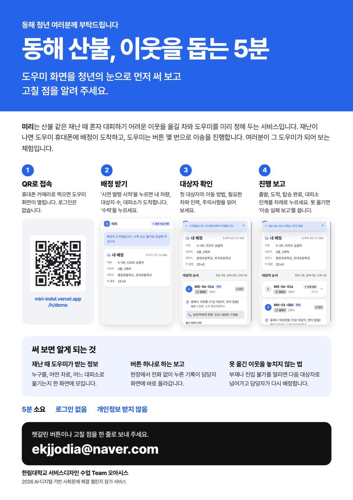
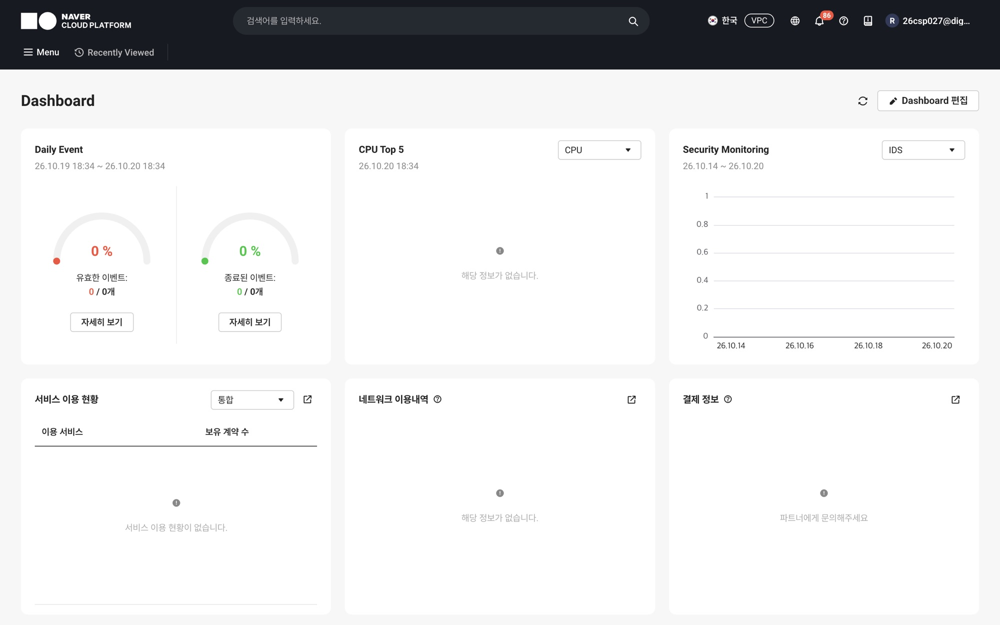
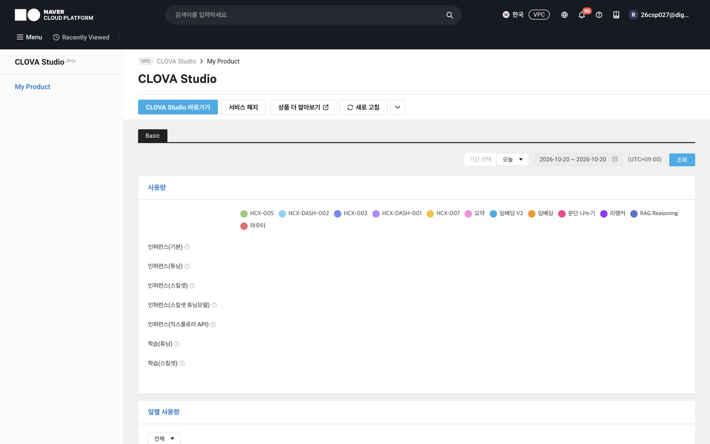
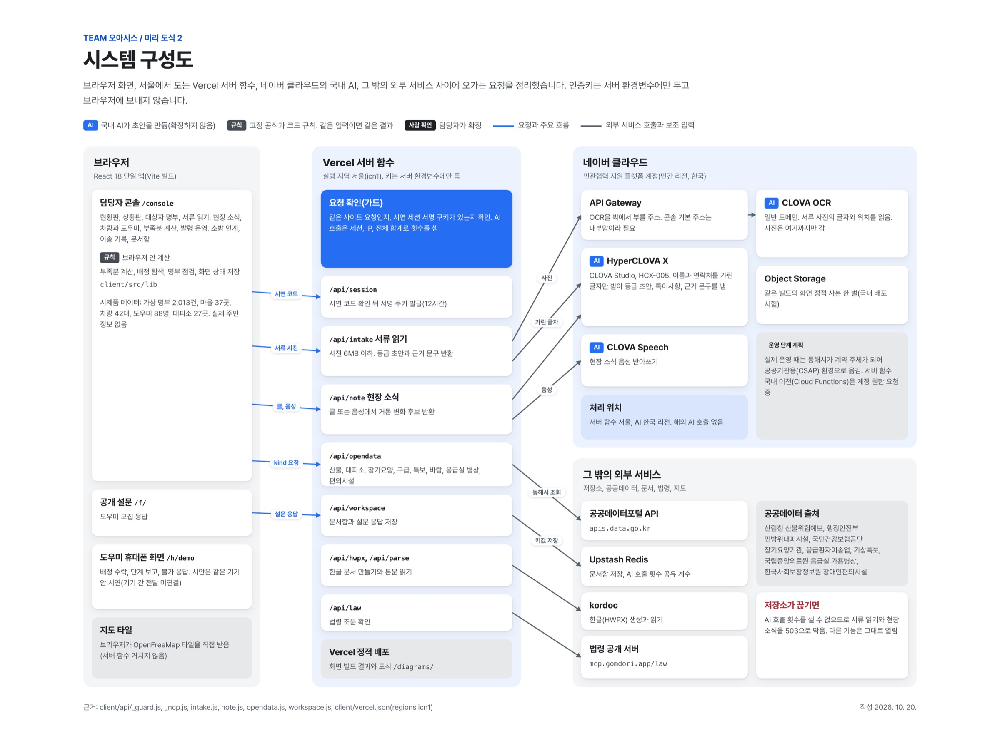
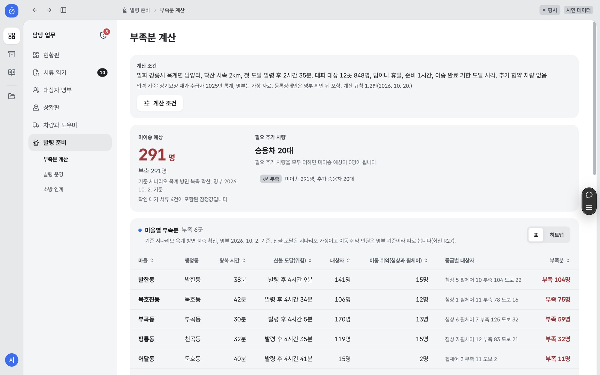
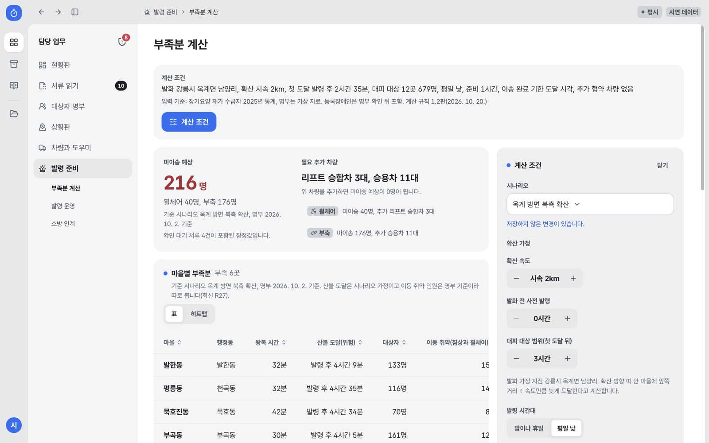
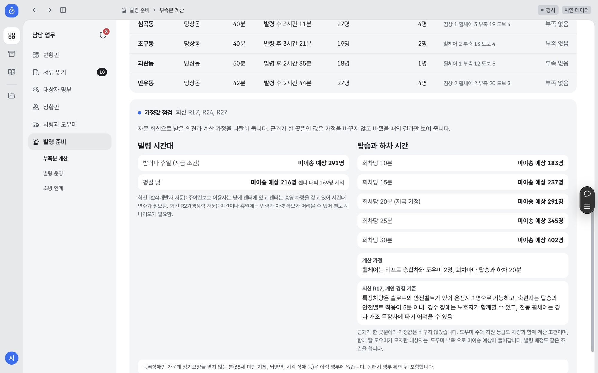
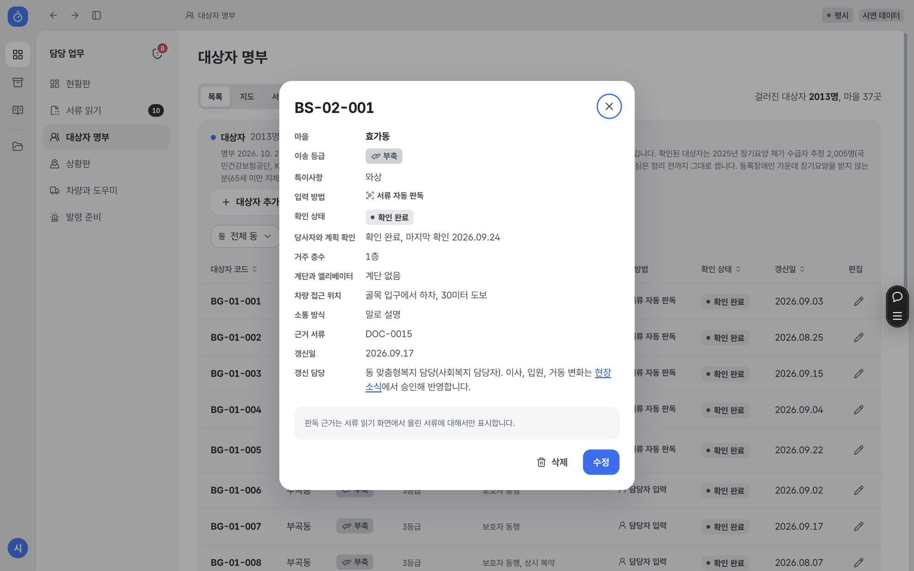

# ‘민관협력 지원 플랫폼 활용’ 기반 사회 현안 해결 ’서비스 개발’ 기획서

> 산불 때 혼자 대피하기 어려운 주민을 대피 기한 안에 옮길 차량과 도우미의 부족분을 평시에 계산하고, 발령 시 배정까지 지원하는 지자체 담당자용 서비스 "미리" 제안

| 구분 | 내용 |
| --- | --- |
| 분야 | 분야1 서비스 개발 |
| 작품명 | 미리: 재난취약자 사전 이송 배정 서비스 |
| 팀명 | Team 오아시스 |
| 시안 | https://miri-indol.vercel.app (로그인 없이 열람) |
| 국내 배포 | http://miri-web-oasis.s3-website.kr.object.ncloudstorage.com (민관협력 지원 플랫폼 계정 네이버 클라우드) |
| 소스 | https://github.com/hyunho2378/miri (기준 커밋 main 7d09384, 2026. 10. 20.) |
| 시연 자료 | 동해시 공개 통계 규모를 반영한 시연용 명부, 차량, 도우미 자료(실명 정보 없음) |

### 예선 평가 항목별 근거 위치

| 평가 항목(배점) | 핵심 근거 | 위치 |
| --- | --- | --- |
| 기획성(30) | 2022. 3. 옥계 산불의 동해 도달까지 약 4시간. 알림과 도우미 지정 체계 위에 비어 있는 평시 이송 부족분 계산과 발령 시 배정을 미리가 담당 | Ⅰ장, Ⅱ장 |
| 활용성(20) | 플랫폼 네이버 클라우드의 CLOVA OCR, HyperCLOVA X, CLOVA Speech, API Gateway, Object Storage를 서비스에 연결. 공공데이터 9종 화면 연결, 활용 신청 47건, 재난안전데이터 8건 신청 | Ⅳ장, Ⅴ장, 그림 4~9, 11, 13 |
| 유용성(20) | 시민(재난취약자, 가족, 도우미), 기업, 정부(시와 읍면동, 소방)별 필요와 제공 가치 연결. 도입 전후 비교, 이용자 시나리오 | Ⅵ장, Ⅶ장, 그림 12~23 |
| 협력성(15) | 연락 150곳, 회신 30곳, 의견과 자료 19곳, 설계 반영 14곳, 화면 반영 8곳(커밋 증빙). 동해 현장 일정과 체험 자료 | Ⅲ장, 그림 2, 3 |
| 충실성(15) | 그림 23개 전부 번호, 설명, 범례, 출처 표기. 숫자는 시안 코드와 자동 시험으로 재확인, 출처 17건 | 전 장, 별첨 출처 |

## Ⅰ. 추진배경 및 목적

### 1-1. 시작한 계기

**4시간의 질문: 2022. 3. 5. 옥계 산불**

- 팀장 주현호의 직접 경험에서 출발한 문제의식
  - 강릉 출신. 2022. 3. 5. 옥계 산불 당시 강릉에서 아르바이트 중 정전과 대피 소동 경험
  - 주변 복지관과 이웃 가운데 혼자 움직이기 어려워 대피에 오래 걸린 어르신들의 사례 청취
- 같은 새벽 거동이 불편한 고령 주민의 대피 중 사고 발생
  - 옥계면 주민 한 분(86세)이 보행 보조기를 끌고 경로당으로 피신하다 밭에서 넘어져 병원 이송 후 숨짐. 요양병원 퇴원 직후로 거동이 불편한 상태였음[1]
  - 산림 당국은 산불과 사망 사이의 연관성을 적게 보고 사인 조사[1]
- 발화에서 동해 도달까지 약 4시간
  - 01:08경 옥계면 남양리 발화, 05:10~05:30경 동해시 망상동 만우마을 도달[2][3]
  - 같은 날 아침 동해노인요양원, 이례요양원 입소자를 포함한 주민 228명이 묵호고등학교 체육관 등으로 대피[3]
  - 동해시 주택 등 181채 전소, 113채 일부 소실, 이재민 53세대 111명(2022. 3. 13. 잠정 집계)[4]
- 미리의 출발점: 4시간 안에 누구를 어떤 차로 옮길지 평시에 계산해 두는 체계
  - 걷기 어려운 주민의 대피가 그날에도 이웃의 손에 급하게 맡겨진 구조에 대한 질문
  - 발화 뒤 차량과 사람을 찾는 시간 단축을 목표로 동해시를 첫 대상지로 선정

출처: 별첨 출처 [1]~[4]. 정전과 복지관 사례는 팀장의 경험과 청취 내용

### 1-2. 현황

**정부 대피 기준 강화와 고령층 피해 집중**

- 정부는 초고속 산불에 대비해 대피 시점을 앞당긴 체계를 지자체에 제시함
  - 위험구역 주민 5시간 전, 재난취약자 8시간 전 대피 체계[5]
- 산불 피해는 스스로 이동하기 어려운 고령층에 집중됨
  - 산불 사망자 30명 중 28명 60대 이상(2025. 3.)[6]
  - 같은 산불에서 복지시설 52개 기관 1,458명 긴급 전원 조치[7]
  - 울진 삼척 산불 마을 35곳 주민 6,126명 대피(2022. 3.)[8]
- 확산 속도가 빨라 발화 뒤 이송 계획 수립으로는 시간이 부족함
  - 경북 산불 시간당 8.2km 확산(2025. 3.)[9]

**동해시: 산불 확산 이력과 고령 인구의 공존**

- 동해시는 이송 지원이 필요한 고령 인구 비중이 높은 산불 확산 지역임
  - 65세 이상 23,590명, 전체 85,445명의 27.6%(2026. 9.)[10]
  - 재가 장기요양 수급자 약 2,005명 추정(2025년 급여이용수급자 2,668명에서 시설급여 663명 제외)[11]

출처: 별첨 출처 [5]~[11]

### 1-3. 문제점

**알림과 지정 체계 사이의 빈 단계**

- 기존 체계는 알리고 사람을 지정하는 데까지 갖춰져 있으나, 기한 안에 옮길 차량과 사람이 충분한지 평시에 계산하는 단계는 공개 자료에서 확인되지 않음

| 지금 있는 체계 | 하는 일 | 다루지 않는 일 |
| --- | --- | --- |
| 재난문자, 안전디딤돌 | 위험과 대피 장소 안내 | 걸을 수 없는 사람의 이송 |
| 대피 도우미 1:1 매칭(2024. 6.), 마을순찰대(2025. 5.) | 도울 사람 사전 지정 | 기한 안 이송 가능 여부 계산 |
| 재난관리자원 통합관리시스템 | 기관 차량과 장비 관리 | 취약자 개인별 차량 배정 |

출처: 행정안전부 보도자료, 국민재난안전포털 공개 자료 팀 정리(2026. 10.)

- 부족분을 모르는 상태의 행정 공백
  - 봄철 산불 조심 기간 전 민간 차량 협약 규모와 도우미 추가 지정 규모의 근거 부재
  - 발령 직후 전화 수배 방식으로는 기한 안 미이송 인원을 사후에야 파악

### 1-4. 서비스 개발 목적

**평시 계산에서 발령 시 배정, 소방 인계까지 한 흐름으로 연결**

- 평시: 마을별 이송 부족분 산출, 차량 협약과 도우미 지정의 근거 제공
- 발령 시: 차량, 도우미, 대상자를 묶은 배정표 생성, 담당자 확인 뒤 도우미 휴대폰 전송
  - 도우미 수와 지원 등급이 모자란 회차는 '도우미 부족'으로 분리 표시
- 기한 초과 시: 미이송 대상자 목록을 소방에 일괄 인계, 구조 자원 집중
- 평소 업무: 협조 공문, 훈련 보고 서식에 같은 숫자 자동 입력, 평시 활용도 확보
- 개발 기반: 민관협력 지원 플랫폼의 네이버 클라우드 AI와 저장소, 공공 위기 데이터

## Ⅱ. 개요

### 2-1. 서비스 정의

**복지와 재난 담당자가 함께 쓰는 이송 준비 웹 서비스**

- 혼자 대피하기 어려운 취약계층 보호를 위한 이송 준비 웹 서비스
  - 이름 "미리": 미리 계산하고 미리 옮긴다는 의미
  - 기존 대피 도우미 지정 체계와 지역사회보장협의체 위에서 차량 부족분 계산과 배정표 생성을 맡는 계산판
- 서면 자문을 반영한 정의
  - "재난대비 목적보다 취약계층 보호 목적에 주안점"(R01)
  - "단독 시스템보다 사회복지와 소방이 협력해 작동시키는 부분이 중요"(T2)

### 2-2. 사용자와 역할

**주 사용자는 읍면동 복지 담당자와 재난 담당자**

| 사용자 | 미리에서 하는 일 |
| --- | --- |
| 동 맞춤형복지와 통합돌봄 담당자(주 사용자) | 대상자 명부 갱신, 당사자와 대피계획 확인, 확인 날짜 기록 |
| 시와 동 재난 담당자(주 사용자) | 부족분 확인, 차량 협약 규모 판단, 발령과 배정 검토, 공문 작성 |
| 대피 도우미 | 휴대폰으로 배정 수락 또는 불가 응답, 이송 단계 보고 |
| 요양보호사, 이장과 통장, 가족 | 거동 변화 같은 현장 소식 전달 |
| 요양시설과 재가기관 | 이송 등급 확인, 시설 차량 정보 제공 |
| 소방 | 기한 안 미이송 대상자 목록 일괄 수신 |
| 재난취약자 본인 | 설치와 조작 불필요 |

- 명부 갱신 주체를 복지 담당자로 둔 근거
  - "결국 복지담당자가 이를 실행시켜야 합니다"(R01)
  - 이사와 거주 변동은 사회복지 담당자가 파악하고 관리(T2, 통화 메모)
- 실제 사용 규모는 읍면동 단위 4~5명(T2), 교육 없이 쓰는 단순한 화면 구성 유지

### 2-3. 핵심 기능

**계산, 판독, 배정, 인계, 문서 기능 11종**

| 기능 | 내용 | 준비 현황(2026. 10. 20.) |
| --- | --- | --- |
| 부족분 계산 | 준비 시간, 완료 기한, 마을별 도달 시각, 시간대, 추가 협약 차량에 따른 마을별 미이송 수와 차종별 필요 추가 차량 계산 | 완료 |
| 도달 시각 역산 | 확산 시나리오별 마을 도달 시각에서 이송 완료 기한과 발령 기한 역산 | 완료 |
| 추천 배정 | 차량 정원, 도우미 지원 등급, 대피소 정원, 회차 순서, 마을별 기한을 함께 고려한 배정과 기본 순서 비교 | 완료 |
| 서류 읽기 | 종이 대피계획서를 국내 CLOVA OCR로 인식, 이름과 연락처를 가린 글자만 국내 HyperCLOVA X로 보내 이송 등급 초안과 근거 문구 추출, 담당자 원문 대조 뒤 반영 | 완료(국내 처리), 실서류 검증 11월 예정 |
| 현장 소식 | 요양보호사와 이장의 글과 녹음에서 거동 변화 후보 추출, 사회복지 담당자 승인 뒤 명부 수정 | 완료 |
| 상황판 | 실제 지형과 건물 위 평시 현황, 가정 시나리오, 발령 중 상황, 시간 축 재생 | 완료 |
| 발령 운영과 도우미 화면 | 발령 5단계, 배정 검토, 도우미 수락과 단계 보고, 불가 응답 시 재배정 | 완료(훈련 발령) |
| 소방 인계와 이상 탐지 | 미이송자 일괄 전달, 동해 응급실 가용병상 참고, 이상 징후 규칙 | 완료 |
| 공공데이터 연계 | 산불위험지수, 기상특보, 단기예보, 대피시설, 장기요양기관, 응급환자이송업, 응급실 가용병상, 장애인편의시설, 산불 이력을 기준일과 함께 표시 | 완료 |
| 문서함 | 행정 서식 21종에 현황판 숫자를 넣어 한글(HWPX) 저장 | 완료 |
| 개방 API | 마을별 부족분과 대피소 수용 현황 조회 | 완료 |

그림 1. 서비스 블루프린트: 평시 명부 확인, 부족분 계산, 발령, 배정, 이송, 재배정, 종료와 소방 인계 7단계(출처: 미리 저장소 docs/diagrams/service-blueprint.html, 커밋 16ac7d8. 범례: 가로줄은 이용자별 행동, 세로 단계는 시간 순서, 사람 확인 표시는 담당자 확인 뒤 반영 지점)

## Ⅲ. 협력 방안

### 3-1. 협력 원칙

**외부 주체가 미리를 위해 한 일을 4단계로 기록**

- 협력 목적: 시안과 현장의 차이 확인, 계산 기준의 근거 확보, 운영 단계 역할 분담 확인
- 기록 4단계: ① 연락 ② 회신(원본 보관) ③ 의견이나 자료 수령 ④ 미리에 반영
- 주민의 이름, 주소, 연락처, 건강 정보는 요청하지 않음
- 이름과 기관명은 표기 동의 전이므로 소속 유형으로 표기

### 3-2. 연락과 회신 현황(2026. 10. 20. 기준)

**150곳 연락, 30곳 회신, 14곳 설계 반영**

| 구분 | 수 | 기준 |
| --- | --- | --- |
| 연락 | 150곳 | 서면 자문 메일 2026. 10. 19. 37곳, 10. 20. 113곳(1곳당 1통) |
| 회신 | 30곳 | 메일 29곳(R01~R29), 전화 자문 1곳(T2). 공공데이터 지원센터는 메일(R09)과 전화(T1)를 1곳으로 집계 |
| 의견이나 자료 수령(③ 이상) | 19곳 | 검토 의견, 자료와 지침, 경로 안내, 전문가 소개 |
| 기획서 설계 반영(④) | 14곳 | 3-5 "협력으로 바뀐 설계"에 R번호 표시 |
| 화면 반영(④ 구현) | 8곳 | R01, R14, R17, R24, R27, R28, R29, T2. 커밋 dec95a3, 56e966e, f17dde8 |
| 감사와 반영 결과 회신 | 22곳 | 2026. 10. 20. 22:46~22:58 메일 22통(받은 의견과 반영 내용 명시) |
| 도달 실패 | 3곳 | 받는 곳 메일함 없음 2곳, 상대 서버 보류 1곳 |

- 집계 기준: 응답 주체(사람 또는 창구) 단위
  - R03(다른 학회의 수신처 안내)은 ③ 이상 집계 제외, R26(면담 일정 회신)은 ②로 집계
  - 주체별 단계표는 공모전 협력숫자 기준표(2026. 10. 20.)와 동일

그림 2. 협력 단계별 수: 연락 150곳에서 화면 반영 8곳까지(출처: 회신 원문 R01~R29, 통화 메모 T1 T2, 감사 회신 발송 기록 2026. 10. 20. 범례: 막대 길이는 곳 수, 진한 막대는 시안 코드 반영 단계)

### 3-3. 외부 주체별 협력 내용

**공공기관 3곳, 학교 16곳, 민간기업 1곳, 기타 10곳**

| 주체 구분 | 회신 주체(동의 전 표기) | 받은 것 | 단계 |
| --- | --- | --- | --- |
| 공공기관 (3곳) | 공공데이터 활용 지원센터(R09, T1) | 인명피해우려지역 API 신청 경로, 갱신 주기와 좌표의 제공 부처 확인 경로, 재난취약계층 집계의 비공개 사유 안내 | ③ |
| | 광역시 출연 연구기관(R19) | 특별교통수단 수요 산정 담당 연구위원 소개 | ③ |
| | 소방 빅데이터 플랫폼 운영사업단(R02) | 해당 지수 운영기관 안내 | ② |
| 학교 (16곳) | ○○대 행정학과 교수(R01) | 운영 주체와 부서 간 책임, 평가 질문 방향 | ④ |
| | ○○대 간호학과 교수, 응급 전문간호사(R06) | 도우미 역량 6가지, 이동 중 접점별 최소 대응, 안내 문구 | ④ |
| | ○○대 간호학부 교수(R08) | 보수적 인력 기준, 시뮬레이션 장면 3가지, 추가 이해관계자 | ④ |
| | ○○대 봉사센터(R12) | 학생 봉사자 보험 확인 5가지, 도우미 화면 필요 기능 7가지, 학생 체험 검토 의사 | ④ |
| | ○○대 경영과학 분야 교수(R16) | 배정의 할당 문제 정의, 규칙 기반 탐색과 민감도 점검 권고 | ④ |
| | ○○대 고령사회연구소 교수(R21) | 노인실태조사 이동능력과 독거 지표, 전국 패널 자료 안내 | ③ |
| | ○○대 행정학과 교수(R27) | 대상자 구분, 야간과 휴일 시나리오, 도로 통제 보정, 경찰과 의료기관 추가 | ④ |
| | ○○대 사회복지학부 교수(R28) | 개인별 대피계획 확인 절차, 명부 확인 상태와 날짜 기록 | ④ |
| | ○○대 사회복지학과 교수(T2, 전화) | 지역 전달체계와 협의체 중심 운영, 복지 담당자의 명부 갱신 | ④ |
| | ○○대 공공안전행정학부 교수(R15) | 관련 법령 안내 | ④ |
| | ○○대 디자인학부 교수(R04) | 서비스디자인 검토자 3명 소개 | ③ |
| | ○○대 인공지능 분야 교수(R20) | 판독 범위 우선 정의 요청 | ④ |
| | ○○대 의료정보 분야 교수(R26) | 개인정보와 AI 설계 면담 10. 22.(목) 확정 | ② |
| | 그 밖의 학교 3곳(R22, R23, R25) | 내부 전달, 답변 보류 | ② |
| 민간기업 (1곳) | 모빌리티 API 제공 기업(R18) | 다중 경유지 길찾기 이용량 안내, 기술제휴 창구 소개 | ③ |
| 기타 (10곳) | 장애인 당사자 단체(R17) | 휠체어 특장차 탑승 조건, 당사자 직원의 시안 확인, 명부 특이사항 2가지 | ④ |
| | 시빅 개발자(R24) | 저장소와 개방 API 검토, 대상자 산정 보강 3가지, 기준일과 규칙 버전 표시 제안 | ④ |
| | 데이터 기자, 시빅테크 커뮤니티 활동가(R29) | 합산 통계만 공개하는 기준, 기준일 명시, 대피소 좌표 대조, 같은 주제의 시빅테크 프로젝트 소개 | ④ |
| | 정보접근성 품질인증기관(R14) | 웹 접근성 표준심사 지침, 모바일 앱 접근성 지침 | ④ |
| | 동해 청년공간(R07) | 체험 안내 포스터를 조건으로 한 협조 제안 | ② |
| | 그 밖의 5곳(R03, R05, R10, R11, R13) | 수신처 안내, 후속 연락 약속, 공유 허락 문의, 범위 안내 | ② |

- 단계: ② 회신 ③ 의견이나 자료 수령 ④ 반영
- 회신 요지와 인용: 참고자료 3장, 협력 기록표: 참고자료 2장, 회신 메일 화면: 참고자료 10장

### 3-4. 동해 현장 협력 일정(2026. 10. 22.~10. 30.)

**공공기관, 학교, 청년 도우미 후보와 현장 확인**

| 대상 | 방식과 상태 | 확인 항목 |
| --- | --- | --- |
| 의료정보 분야 교수(R26) | 대면 면담 확정(10. 22.(목)) | 서류 읽기 개인정보 가림 범위, 평가 지표 |
| 망상동 행정복지센터 재난 담당 | 대면 확정(10. 26. 10:00) | 평시 명단 관리, 발령 직후 배정 업무, 시안 반응 |
| 동해시 안전과 | 통화(10. 20.) 뒤 부서별 질문 전달, 부서 협의 후 회신 예정 | 안전, 산림, 복지, 교통, 정보 부서별 질문 5~6개 |
| 동해 청년공간(R07) | 체험 포스터(A4, SNS 정사각) 완성, QR 해독 확인 | 도우미 후보 집단 5분 체험 |
| 대학 봉사센터(R12) | 학생 20분 과제형 체험 안내문(한글, PDF) 완성 | 도우미 화면 사용성 |
| 시빅테크 커뮤니티(R29 소개) | 같은 주제 프로젝트 팀에 체험과 코드 검토 요청 예정 | 개방 API와 계산 근거 검토 |
| 소방 현장 실무자 1인 | 질문 6개(가설 확인 3, 시안 후기 3) 전달 예정 | 이송 인원과 시간, 미이송자 인계 |

그림 3. 동해 청년공간 체험 안내 포스터(A4)(출처: 팀 제작 2026. 10. 20., 청년공간 요청(R07). 범례: 왼쪽 QR은 도우미 화면 주소, 1~4는 체험 순서, 휴대폰 화면은 시안 실제 캡처)

- 본선 준비: 사용자 체험 도구 일체 공개(저장소 docs/usertest, 커밋 4692b0f)
  - 진행표, 과제 성공 기준표, 기록지, 만족도 설문(SUS 10문항), 참여 동의서, 결과 집계표
  - 10. 26. 이후 체험에서 과제 성공률, 소요 시간, 만족도 측정

### 3-5. 협력으로 바뀐 설계

**받은 의견 13건의 설계와 화면 반영**

| 번호 | 처음 가정 | 받은 의견 | 바뀐 설계 | 화면과 증빙 |
| --- | --- | --- | --- | --- |
| 1 | 동 재난 담당자의 명부 작성과 수정 | 거주 변동은 사회복지 담당자가 관리(T2). 실행은 복지 담당자(R01). 명부 현행화가 행정의 어려움(R27) | 명부 갱신 담당을 동 맞춤형복지 담당으로 이전, 재난 담당은 부족분 계산과 발령 담당 | 현장 소식 3단계 "사회복지 담당자 승인", 명부 상세 갱신 담당 표시(커밋 56e966e) |
| 2 | 휠체어는 리프트 승합차, 도우미 2명, 회차당 승하차 20분 | 특장차는 운전자 1명 가능, 숙련자 기준 탑승과 벨트 체결 5분 이내, 전동 휠체어는 경차 특장차 탑승 곤란 가능(R17) | 가정값 20분과 회신 값을 나란히 비교하는 가정값 점검 구현. 승하차 시간별 미이송 예상(밤이나 휴일): 10분 183명, 20분 291명, 30분 402명. 명부 특이사항에 전동 휠체어, 수동 휠체어, 욕창 확인 추가 | 가정값 점검 카드, 명부(커밋 dec95a3, 56e966e, 그림 17) |
| 3 | 계산 결과 숫자만 표시 | 결과마다 입력 기준일과 계산 규칙 버전 표기가 담당자의 방어(R24) | 계산 조건 아래 입력 기준과 계산 규칙 판(1.2판, 2026. 10. 20.) 표시 | 부족분 계산(그림 15) |
| 4 | 전원 재택, 전 차량 가용의 단일 경우 | 야간과 휴일 별도 시나리오(R27). 주야간보호 이용자 417명은 낮에 센터 체류(R24) | 발령 시간대(밤이나 휴일, 평일 낮)와 차량 가용률을 계산 조건에 추가. 미이송 예상 밤이나 휴일 291명, 평일 낮 216명(휠체어 부족 40명 신규 확인) | 부족분 계산 시간대 비교(커밋 56e966e, 그림 16) |
| 5 | 명부의 등록 여부만 표시 | 계획 확인 구분, 마지막 확인 날짜, 거주 층수, 계단과 엘리베이터, 차량 접근 위치, 소통 방식(R28) | 명부 상세에 6개 항목 추가 | 대상자 명부 상세(커밋 dec95a3, 그림 18) |
| 6 | 마을별 표에 왕복 시간, 대상자, 부족분만 표시 | 산불 발생 위험과 주민 대피 취약성의 구분(R27) | 산불 도달(위험)과 이동 취약 인원(침상과 휠체어)을 나눠 표시 | 부족분 계산 마을별 표(그림 15) |
| 7 | 화면마다 2,005명과 2,013명 혼재 | 두 수의 정합과 등록장애인 반영(R24) | 명부 2,013건을 확인 2,005명, 판독 확인 대기 7건, 중복 의심 1건으로 일원화. 장기요양 미수급 등록장애인은 동해시 명부 확인 뒤 포함 | 현황판, 명부, 설정(그림 14) |
| 8 | 첫 문장이 계산 기능 설명 | 취약계층 보호 목적에 주안점(R01) | 로그인, 현황판, 도우미 화면 첫 문장을 "혼자 대피하기 어려운 주민을 보호하기 위해"로 변경 | 로그인, 현황판, 도우미 화면 |
| 9 | 접근성 점검 체계 부재 | 표준심사 지침 33개 항목(R14) | 5개 화면 자체 점검, 본문 바로가기, 화면별 문서 제목, 버튼 이름 구분, 누르기 크기 24px, 입력 오류 설명 연결 | 자체 점검표, 본문 바로가기 |
| 10 | 데이터 숫자만 표시 | 기준일 명시, 대피소 좌표 대조, 합산 통계만 공개(R29) | 공공데이터 카드마다 분석 시각, 기관 입력 시각, 포털 수정일 표시. 개방 API와 화면은 마을 합계만 공개. 대피소 좌표는 공공 자료끼리 대조(통합대피소, 민방위대피시설) | 현황판 공공데이터 카드, 소방 인계(커밋 f17dde8, 그림 13) |
| 11 | 도우미 화면은 수락과 단계 보고만 제공 | 이동 중단과 119 신고(R06), 의식과 호흡 변화 시 즉시 도움 요청(R08), 동의와 철회, 역할 선택, 보험 확인, 거절 불이익 없음 안내(R12) | 이송 실패 보고와 불가 응답, 불가 응답 도우미의 재배정 후보 제외 구현. 등록 화면(이동 멈춤과 119, 동의와 보험 확인) 10. 29.~11. 2. 구현 | 도우미 화면(그림 22) |
| 12 | 소방 구급차를 지자체 가용 차량으로 합산 | 구급차는 소방 작전 하에서 결정(R01) | 차량 소유(소방, 시설, 시, 협약) 구분, 소방 구급차 3대는 출동 대기로 계산 제외 | 차량과 도우미 화면(그림 19) |
| 13 | 서류 사진의 단일 AI 판독 | 판독 범위 우선 정의(R20) | 글자 인식, 개인정보 가림, 이송 등급 분류 3단계 분리, 단계별 국내 서비스와 검사 적용 | 서류 읽기(그림 11, 20) |

- 숫자 검증: 시안 코드 자동 시험으로 재확인(2026. 10. 20., 커밋 4692b0f)
- 반영 전후 화면: 참고자료 7장

## Ⅳ. 민관협력 지원 플랫폼 활용

### 4-1. 플랫폼 사용 승인과 활용 현황(2026. 10. 20. 기준)

**네이버 클라우드 AI 4종과 저장소를 미리에 연결**

- 민관협력 지원 플랫폼 사용 신청 승인(접수번호 217, 서비스 만료 2027. 1. 20.)
- 플랫폼 계정 네이버 클라우드에서 AI 서비스 4종과 저장소 연결, 결제수단 등록 없이 이용

| 플랫폼 자원 | 수행 내용 | 결과 | 미리에서 쓰는 곳 |
| --- | --- | --- | --- |
| CLOVA OCR 일반 도메인 | 도메인 생성, API Gateway 공개 호출 주소 연결 | 대피계획서 5장 글자 인식 | 서류 읽기 1단계 |
| HyperCLOVA X HCX-005(CLOVA Studio) | 키 발급, 가린 글자로 이송 등급과 근거 문구 생성 | 대상자 11명 등급 11명 일치, 근거 문구 원문 대조 11건 통과, 평균 약 4.3초 | 서류 읽기 3단계, 현장 소식 글 |
| CLOVA Speech Recognition | 앱 등록, 수신 형식 mp3, aac, ogg, flac, wav(60초 이내) | 서버 연결 완료, 음성 검증 10. 29.~11. 2. | 현장 소식 녹음 |
| API Gateway | OCR 호출 주소 외부 연결 | 서울 서버 함수 호출 확인 | 서류 읽기 |
| Object Storage | 버킷 생성, 정적 웹 호스팅, 시안 업로드 | 국내 배포 주소 운영(약 17MB) | 시안 전체 국내 제공 |
| 위기 데이터 카탈로그 | 전체 609건 확인, 관련 항목 195건 검토 | 공공데이터포털 활용 신청 47건 | 현황판, 상황판, 소방 인계 |
| 바이브코딩, AI 협업 툴 | 실행 환경 확인(6 vCPU, RAM 8GB, Python 3) | 회원 등록 사무국 처리 진행 중 | 마을별 부족분 재계산 노트 |
| 데이터 요청 게시판 | 동해시 마을 경계, 읍면동 재난취약계층 집계(개인 식별 없음), 마을 도달 시각 자료 요청 | 게시 재등록 사무국 처리 진행 중 | 대상자 산정 보강 |

그림 4. 네이버 클라우드 콘솔(출처: 민관협력 지원 플랫폼 계정 화면 2026. 10. 20. 범례: 위쪽 계정 표시는 플랫폼 SSO 계정)

그림 5. CLOVA OCR 도메인과 API Gateway 연동 설정(출처: 네이버 클라우드 콘솔 2026. 10. 20.)

그림 6. CLOVA Studio(HyperCLOVA X HCX-005) 이송 등급 분류 시험(출처: 네이버 클라우드 콘솔 2026. 10. 20.)

그림 7. Object Storage 국내 배포본의 도우미 화면(출처: miri-web-oasis 국내 배포 주소 2026. 10. 20.)

※ 민관 협력 지원 플랫폼 활용 내용: 그림 4~7, 참고자료 8장(플랫폼 승인, 카탈로그, 데이터 상세, 신청 기록)

### 4-2. 공공데이터 연결 현황(2026. 10. 20. 기준)

**공공데이터 9종 화면 연결, 모든 항목에 기준일 표기**

| 데이터 | 제공기관 | 미리에서 쓰는 곳 | 호출 | 기준일 표시 |
| --- | --- | --- | --- | --- |
| 산불위험예보정보 | 산림청 국립산림과학원 | 현황판 오늘 산불 여건 | 실시간(10분 캐시) | 분석 시각 |
| 기상특보, 단기예보 | 기상청 | 현황판 특보, 상황판 풍향과 풍속 | 실시간 | 발표 시각 |
| 민방위대피시설 | 행정안전부 | 상황판 대피시설 수와 수용 인원 | 실시간 | 조회 시각 |
| 장기요양기관 검색 | 국민건강보험공단 | 상황판 동해 장기요양기관 | 실시간 | 조회 시각 |
| 응급환자이송업 | 행정안전부 | 차량 자원(민간 이송 구급차) | 실시간 | 조회 시각 |
| 응급실 실시간 가용병상(15000563) | 국립중앙의료원 | 현황판, 소방 인계 "인계 참고: 동해 응급실" | 실시간 | 기관 입력 시각 |
| 장애인편의시설 현황(15092317) | 한국사회보장정보원 | 현황판 동해 등록 시설 수와 좌표 보유 수 | 실시간 | 조회 시각 |
| 산불통계(15121380) | 산림청 | 현황판 동해 산불 이력(동해 발생 3건, 동해로 번진 2022. 3. 옥계 산불) | 파일 스냅샷 | 포털 수정일 2026. 9. 15. |
| CLOVA OCR, HyperCLOVA X, CLOVA Speech | 네이버클라우드(플랫폼 계정) | 서류 읽기, 현장 소식 | 실시간 | 처리 시각 |

출처: 공공데이터포털 활용신청 현황(47건, 2026. 10. 20.), 미리 저장소 client/api/opendata.js(커밋 f17dde8)

- 공공데이터 키는 서버 함수에서만 사용, 호출 실패 시 사유 표시

### 4-3. 데이터 연결 로드맵

**승인 데이터의 단계별 연결 계획**

| 단계 | 데이터 | 연결 내용 | 시기 |
| --- | --- | --- | --- |
| 1단계 | 국토교통부 건축물대장(15134735, 승인) | 대피소 건물의 층수와 승강기 수 표시 | 11월 |
| 1단계 | 장애인편의시설 좌표(328곳) | 대피소 접근성 대조 | 11월 |
| 2단계 | 소방청 구급정보, 구급통계, 화재정보(승인) | 동해 관할 단위 응답 확인 뒤 기준 시나리오 근거 연결 | 11월 |
| 2단계 | 재난안전데이터공유플랫폼 8건(신청, 승인 대기): 인명피해우려지역, 이재민 임시주거시설, 긴급재난문자, 산불정보, 통합대피소, 이동통제초소, 실시간 병상, 특보통보문 | 대피소 좌표 공공 자료 간 대조(R29), 인명피해우려지역 지도 겹치기, 이동통제초소 경로 보정 | 승인 뒤 |
| 3단계 | 보건복지부 응급안전안심 서비스 2건(심의 대기) | 명부 갱신 경로 근거 | 승인 뒤 |

출처: 재난안전데이터공유플랫폼 신청 기록(2026. 10. 20.), 공모전 데이터 활용현황(2026. 10. 20.)

- 인명피해우려지역 연결 시 데이터 갱신 일자(2024. 5. 29.)를 화면에 그대로 표기(R29 기준일 명시)

### 4-4. 외부 자원 활용(플랫폼 밖)

**공개 통계와 오픈소스 도로망 기반 계산**

| 자원 | 제공 기관 | 활용 | 근거 |
| --- | --- | --- | --- |
| 주민등록인구, 노인장기요양보험통계 | 행정안전부, 국민건강보험공단(KOSIS) | 마을별 대상자 추정 | 공개 통계[10][11] |
| 마을회관과 경로당 | 동해시(공공데이터포털) | 마을 집결지 37곳 | 공개 자료[13] |
| 이재민 임시주거시설(동해시) | 행정안전부 국민재난안전포털 | 대피소 27곳, 수용 5,601명 | 공개 자료[12] |
| GIS건물통합정보 | 국토교통부 브이월드 | 3D 건물 196,111동 | 공개 자료[14] |
| 도로망과 주행 시간 | OpenStreetMap, OSRM | 집결지와 대피소 사이 왕복 시간 | 오픈소스 |
| 법령 원문 | 법제처 국가법령정보 | 공문 속 법령 인용 확인 | 공개 자료 |

- 이동 시간 계산: 공개 도로망과 오픈소스 경로 계산 사용

## Ⅴ. 개발 환경 구성

### 5-1. 구성 요소(2026. 10. 20.)

**국내 AI와 서울 서버 함수 기반 구성**

| 영역 | 사용 기술 | 역할 |
| --- | --- | --- |
| 화면 | React 18, Vite, Tailwind CSS, zustand | 담당자 화면, 도우미 화면, 공개 화면 |
| 지도와 3D | MapLibre GL, three.js | 지형과 건물 3D, 2D 지도 전환 |
| 계산 | 브라우저 안 규칙 계산(자바스크립트) | 부족분, 도달 시각 역산, 추천 배정, 가정값 점검 |
| 서버 함수 | 서버리스 함수(Node, 실행 지역 서울 icn1) | 서류 판독, 현장 소식 판독, 공공데이터 중계, 한글 파일 생성, 문서 저장, 법령 확인, 개방 API |
| AI | 네이버 클라우드 CLOVA OCR, HyperCLOVA X HCX-005, CLOVA Speech Recognition, API Gateway | 서류와 현장 소식의 이송 등급 후보와 근거 문구 추출, 전 과정 국내 처리 |
| 보호 장치 | 서버 서명 쿠키 시연 세션, 공유 저장소 기반 AI 호출 상한(분당, 하루), 요청과 응답 형식 검사 | 공유 키 남용과 잘못된 응답 차단 |
| 국내 배포 | 네이버 클라우드 Object Storage 정적 웹 호스팅 | 시연 화면 국내 리전 제공 |
| 문서 | kordoc(MIT) | 행정 서식 HWPX 생성과 구조 검사 |
| 저장 | 키값 저장소(Upstash) | 문서함, 현장 소식 시연 데이터, AI 호출 횟수 |

그림 8. 시스템 구성도: 브라우저, 서울 서버 함수, 네이버 클라우드 AI, 공공데이터(출처: 미리 저장소 docs/diagrams/system-architecture.html, 커밋 16ac7d8. 범례: 실선은 운영 중인 연결, 점선은 단계 계획, 상자 묶음은 실행 위치)

※ 개발 환경 구성도: 그림 8

### 5-2. 개인정보 위치와 데이터 흐름

**가림, 잔존 검사, 원문 대조, 담당자 확인의 4중 장치**

그림 9. 데이터 흐름도: 가림, 잔존 검사, 원문 대조, 담당자 확인, 중단 경로(출처: 미리 저장소 docs/diagrams/data-flow.html, 커밋 16ac7d8. 범례: 실선 화살표는 데이터 이동, 중단 표시는 503(호출 상한 저장소 미연결)과 422(읽은 내용 없음) 경로, 강조 상자는 개인정보 보관 위치)

### 5-3. 국내 클라우드 이전 단계

**4단계 이전 계획 중 2단계 완료**

| 단계 | 내용 | 준비 현황 |
| --- | --- | --- |
| 1단계 정적 화면 이전 | Object Storage 정적 호스팅으로 시연 화면 국내 제공 | 완료(2026. 10. 20.) |
| 2단계 AI 국내 처리 | 서류와 소식 판독을 CLOVA OCR, HyperCLOVA X, CLOVA Speech로 이전, 서버 함수 서울 실행, 해외 AI 호출 제거 | 완료(2026. 10. 20., 커밋 67aa51c) |
| 3단계 서버 함수 이전 | 판독, 공공데이터 중계, 문서 생성 함수의 플랫폼 클라우드 서버나 컨테이너 이전 | 11월(서버 함수와 CDN 권한 사무국 협의 뒤) |
| 4단계 운영 분리 | 동해시 계약 주체의 공공기관용(CSAP 인증) 환경 이전, 실명 명부는 지자체 내부 서버, 계산 화면은 이름 없는 숫자만 전달 | 시범 운영 지자체 협의 뒤[16] |

- 시안 단계: 플랫폼 제공 민간 리전 계정 운영
- 운영 단계: 보안인증 클라우드 우선 고려와 국가 클라우드 보안 지침 준수[16], 해당 환경의 AI 서비스 범위 네이버클라우드 협의
- 명부와 계산의 분리 구조: 재난취약계층 집계의 개인정보 포함에 따른 공개 API 제공 제한 안내(T1) 반영

### 5-4. 품질 확인

**자동 시험 49개, 외부 AI 코드 검토 4차**

| 항목 | 방법 | 결과(2026. 10. 20.) |
| --- | --- | --- |
| 자동 시험 | 계산 규칙 15개, 코드 검토 회귀 시험 30개, 공공데이터 해석 4개 | npm test 49개 통과, 서버와 평가기 시험 6개 통과(node --test), 빌드 통과 |
| 외부 AI 코드 검토 | 별도 AI(GPT)의 전체 코드 검토, 지적 재현 뒤 수정, 재검토 4차례 반복 | 지적 30건(1차 15, 2차 7, 3차 4, 4차 경미 4) 중 28건 수정, 4차 판정 공개 주소 반영 가능 |
| 계산 오류 수정 | 평일 낮 발령의 차량 목록 불일치 발견 | 평일 낮 발령 기준선 176명을 평시 계산과 같은 216명으로 정정 |
| 서류 읽기 정확도 | 대피계획서 5장(대상자 11명) 국내 AI 판독 | 등급 11명 일치, 근거 문구 원문 대조 11건 통과, 시험용 이름과 번호의 AI 입력과 결과 잔존 0건 |
| 접근성 | 인증기관 지침(R14) 기준 5개 화면 자체 점검 | 본문 바로가기, 문서 제목, 버튼 이름, 누르기 크기, 오류 설명 연결 개선 |
| 계산 결과 표기 | 결과마다 입력 기준과 계산 규칙 판(1.2판) 표시 | 완료 |

출처: 미리 저장소 tests 폴더, 공모전 반영기록(GPT 코드 검토 1~4차, 수정 기록, 국내 AI 이전 시험 결과, 2026. 10. 20.)

## Ⅵ. 내용

### 6-1. 이송 등급과 차량 기준

**거동 상태 4등급별 차량과 인력 기준**

| 등급 | 상태 | 차량과 사람 | 차량별 정원(시안 기준값) |
| --- | --- | --- | --- |
| 도보 | 안내만으로 스스로 이동 | 마을버스 또는 승용차, 인솔 1명 | 마을버스 20명, 승용차 4명 |
| 부축 | 부축 시 승용차 탑승 가능 | 승용차, 도우미 1명 | 승용차 3명 |
| 휠체어 | 휠체어 착석 상태 이동 | 리프트 승합차, 도우미 2명 | 리프트 승합차 3명 |
| 침상 | 누운 상태로만 이송 가능 | 구급차 또는 침상 승합차, 구급대원 | 구급차 1명, 침상 승합차 2명 |

- 정원과 승하차 시간: 인력을 넉넉히 잡는 보수적 기준(R08) 적용
- 기준값 갱신: 훈련 실측 승하차 시간 반영(R28)

### 6-2. 데이터 분석 방법

**공개 통계 기반 마을 단위 대상자와 왕복 시간 산출**

- 마을별 대상자: 행정동별 65세, 75세, 85세 이상 인구와 장기요양 등급 분포 기반 마을 단위 대상자와 이송 등급 추정
- 대피소: 임시주거시설 27곳(수용 5,601명) 기준, 정원 초과 시 분산, 정원이 찬 시설 배정 제외
- 왕복 시간: 마을 집결지 37곳에서 대피소까지 실제 도로망 주행 시간, 분산 시 가장 먼 목적지 기준
- 도달 시각: 확산 시나리오 기반 마을별 산불 도달 시각 계산
- 우선순위: 산불 발생 위험과 주민 대피 취약성의 2축 구분(R27)
- 대상자 수: 재가 수급자 추정 2,005명[11]의 마을별 배분
  - 명부 2,013건: 확인 2,005명, 판독 확인 대기 7건, 중복 의심 1건
  - 기준 시나리오: 대피 대상 마을 12곳 848명
  - 장기요양 미수급 등록장애인: 동해시 명부 확인 뒤 포함(R24)
- 시간대: 평일 낮 주야간보호 이용자 417명(국민건강보험공단 통계)의 센터 대피 처리, 마을 이송 제외(R24, R27)

### 6-3. 부족분 계산 알고리즘

**대피 창 시간 안 왕복 횟수 기반 이송 가능 인원 계산**

- 이송 가능 시간(분) = (대피 창 시간 - 도달 전 완료 여유 시간) x 60 - 준비 시간
- 왕복 가능 횟수 = 이송 가능 시간 ÷ 왕복 시간(소수 버림)
- 이송 가능 인원 = 차량 수 x 왕복 가능 횟수 x 차량 정원
- 부족분 = 대상자 수 - 이송 가능 인원(0 미만은 0)
- 왕복 시간 = 집결지에서 대피소까지 주행 시간 x 2 + 승하차 20분(기준값)
- 계산 예시: 침상 대상자 12명, 침상 차량 2대(정원 1), 왕복 2시간, 대피 창 8시간, 준비 1시간 → 차량당 3회 왕복, 6명 이송, 6명 부족

### 6-4. 배정 알고리즘

**설명 가능한 규칙 기반 탐색**

- 기본 순서: 침상, 휠체어, 부축, 도보 순, 같은 등급은 도달 시각이 빠른 마을 우선
- 도우미 결합: 차량 첫 사용 시 지원 등급이 맞는 도우미 배정, 부족 시 해당 차량 미사용과 '도우미 부족' 표시
- 추천 배정: 기본 순서를 시작점으로 마을 순서 교환과 배정 규칙 전환 탐색
  - 목표 순서: 등급 가중 미이송 최소, 미이송 인원 최소, 마지막 완료 시각 최소
  - 시작점을 후보에 포함해 기본 순서 대비 결과 악화 없음
- 재배정: 발령 시 확정한 왕복, 시간대 차량, 완료 기한 유지. 불가 응답 도우미와 그 차량, 대피소 자리 부족 대상자는 후보 제외
- 경영과학 자문(R16) 반영: 할당 문제 정의, 규칙 기반 탐색, 민감도 점검

그림 10. 부족분 계산과 배정 규칙: 시간대 차량, 탑승 시간 기준값, 대피소 정원, 도우미 등급, 재배정 규칙(출처: 미리 저장소 docs/diagrams/assign-logic.html, 커밋 16ac7d8, 숫자는 시안 코드 계산값. 범례: 왼쪽에서 오른쪽은 계산 순서, 아래 칸은 미이송 사유 5가지)

### 6-5. AI 활용: 서류 읽기와 현장 소식

**서류 사진은 국내 OCR에만, 언어 모델에는 가린 글자만 전달**

- 1단계 글자 인식: 담당자가 올린 서류 사진을 국내 CLOVA OCR로만 전송
- 2단계 개인정보 가림: 성명, 연락처, 주소, 주민번호 항목과 전화번호 모양, "○○○ 어르신" 표기 가림
  - 가림 뒤 이름이나 번호 모양 잔존 시 언어 모델 호출 중단
- 3단계 대상자 분할: "거동 상태" 칸의 코드 분할로 판독 불가 칸까지 대상자 단위 확보
- 4단계 등급 분류: 가린 글자만 국내 HyperCLOVA X로 전송, 대상자별 이송 등급, 특이사항, 근거 문구 수신
- 5단계 원문 대조
  - 근거 문구가 원문에 없으면 "원문 불일치, 확인 필요"로 담당자 확인 목록 상단 배치
  - 특이사항은 근거 낱말(예: 산소, 와상, 치매)이 있을 때만 유지
  - 인식 글자 0자 또는 대상자 0명은 "읽은 내용 없음, 담당자 직접 확인"으로 반환
- 6단계 담당자 확정: 확인, 수정, 제외 전까지 명부와 부족분 계산 미반영, 확인자와 시각 기록

그림 11. 국내 AI 서류 읽기 과정: OCR, 가림, 잔존 검사, HyperCLOVA X, 형식 검사, 원문 대조, 담당자 확인(출처: 미리 저장소 docs/diagrams/ai-pipeline.html, 커밋 16ac7d8. 범례: 진한 상자는 네이버 클라우드 서비스, 흐린 상자는 서버 함수 검사 단계, 오른쪽 숫자는 중단 응답 코드)

| 시험 서류 | 대상자 | 등급 일치 | 근거 원문 대조 통과 | 소요 시간 |
| --- | --- | --- | --- | --- |
| 망상동 심곡동 대피계획서(표 서식) | 4 | 4 | 4 | 약 6.7초 |
| 북삼동 지흥동 대피카드 | 1 | 1 | 1 | 약 3.5초 |
| 삼화동 이로동 대피계획서(흐린 사본, 판독 불가 칸 포함) | 2 | 2 | 2 | 약 3.9초 |
| 묵호동 어달동 대피카드 | 2 | 2 | 2 | 약 3.8초 |
| 천곡동 가림 시험 서류(시험용 성명, 연락처, 주소) | 2 | 2 | 2 | 약 3.8초 |
| 합계 | 11 | 11 | 11 | 평균 약 4.3초 |

출처: 공모전 반영기록 국내 AI 이전 시험 결과(2026. 10. 20.). 판독 불가 칸은 등급 미지정과 낮은 일치도 표시를 일치로 집계

### 6-6. 기준 시나리오와 초고속 확산 비교

**같은 명부와 차량으로 두 확산 속도 비교**

| 항목 | 기준 시나리오: 옥계 방면 북측 확산 | 초고속 확산: 옥계 방면 |
| --- | --- | --- |
| 확산 속도 | 시속 2km. 2022. 3. 옥계 산불의 망상동 도달 기록(발화 약 4시간 뒤)[2][3] 반영 | 시속 8.2km. 2025. 3. 경북 산불 확산 속도[9], 발화 3시간 전 사전 발령 |
| 대상 | 마을 12곳, 848명 | 마을 17곳, 1,340명 |
| 첫 도달 | 발령 후 2시간 35분 | 발령 후 약 3시간 20분 |
| 미이송 예상(기본 순서) | 291명(전원 부축 등급) | 744명(침상 16명, 부축 728명) |
| 추천 배정 | 267명(24명 감소) | 시나리오 화면 비교 |
| 미이송 0명 조건 | 승용차 20대 추가(부족 인원 전원 승용차 이송 가능 등급) | 침상 승합차 2대로 침상 부족 해소, 부축은 승용차 300대 추가로도 미해소 |

출처: 미리 시안 계산(커밋 4692b0f, 2026. 10. 20.)

- 초고속 확산의 차량 외 대책 필요성 수치화: 사전 발령 시각 조정, 마을 안 가까운 안전 시설 대피

| 조건(기준 시나리오) | 미이송 예상 |
| --- | --- |
| 밤이나 휴일, 승하차 20분(기본) | 291명 |
| 평일 낮(주야간보호 이용자 센터 대피, 차량 30대) | 216명(추천 배정 200명) |
| 승하차 10분 | 183명 |
| 승하차 30분 | 402명 |

출처: 미리 시안 부족분 계산과 가정값 점검(커밋 4692b0f). 차량 39대(전체 42대 중 소방 구급차 3대 출동 대기 제외), 도우미 88명, 대피소 27곳

### 6-7. 서비스 구현 화면

**평시 현황에서 소방 인계까지 12개 화면**

그림 12. 현황판: 미이송 예상, 마을별 부족, 확인할 일(출처: 공개 시안 https://miri-indol.vercel.app 2026. 10. 20. 범례: 빨간 숫자는 미이송 예상, 막대는 마을별 부족)

- 담당자의 아침 첫 화면: 기한 내 이송 곤란 인원, 부족 마을, 확인할 서류와 현장 소식 통합

그림 13. 현황판 공공데이터 연계 카드: 응급실 병상, 장애인편의시설, 산불 이력과 기준일(출처: 공개 시안 2026. 10. 20. 23시경, 국립중앙의료원, 한국사회보장정보원, 산림청 자료. 범례: 항목별 제공기관과 기관 입력 시각 또는 포털 수정일)

- 조회 시각 기준 값(2026. 10. 20. 23:05 기관 입력): 동해 응급실 1곳(의료법인동해동인병원) 가용병상 9
- 동해 장애인편의시설 등록 342곳, 좌표 보유 328곳(대피소 접근성 대조 예정)

그림 14. 상황판: 실제 지형과 건물 위 마을별 대상자와 대피소(출처: 공개 시안 2026. 10. 20. 범례: 흰 말풍선은 마을별 대상자 수, 파란 원은 대피소, 검은 표시는 소방서와 주요 시설)

- 동해시 마을 집결지 37곳과 대피소 27곳, 건물 196,111동 표시
- 평시, 가정 시나리오, 발령 중 3개 상황과 시간 축 재생

그림 15. 부족분 계산: 계산 조건, 필요 추가 차량, 마을별 부족분(출처: 공개 시안 2026. 10. 20. 범례: 빨간 숫자는 부족, 산불 도달은 시나리오 값, 이동 취약은 침상과 휠체어 인원)

그림 16. 평일 낮 시간대 계산: 센터 대피 제외, 휠체어 부족 표시(출처: 시안 화면 2026. 10. 20., 커밋 56e966e, 회신 R24 R27 반영)

그림 17. 가정값 점검 카드: 발령 시간대와 승하차 시간 기준값의 회신 값 비교(출처: 공개 시안 2026. 10. 20., 커밋 37985c9, 회신 R17 R24 R27 반영. 범례: 기준값과 회신 값별 미이송 예상, 도우미 수와 지원 등급 포함)

그림 18. 대상자 명부 상세: 확인 상태, 마지막 확인일, 층수와 계단, 소통 방식(출처: 공개 시안 2026. 10. 20., 회신 R28 반영)

그림 19. 차량과 도우미: 소유별 차량, 가용 여부, 도우미 지원 등급(출처: 공개 시안 2026. 10. 20. 범례: 차량은 소유(소방, 시설, 시, 협약)와 가용 여부, 도우미는 지원 등급)

그림 20. 서류 읽기: 원본 서류, 근거 문구, 원문 불일치 표시(출처: 공개 시안 2026. 10. 20. 범례: 원문 불일치는 근거 문구가 원문에 없는 건으로 담당자 확인 우선)

그림 21. 발령 운영 배정 검토: 기본 순서 291명 대비 추천 배정 267명과 배정표(출처: 공개 시안 훈련 발령 2026. 10. 20. 범례: 단계 표시 1~5, 배정표는 차량별 회차와 대상자 순서)

그림 22. 도우미 휴대폰 화면 3단계: 대기, 배정 도착과 수락, 이송 진행(출처: 공개 시안 /h/demo 2026. 10. 20., 390px 폭. 범례: 왼쪽부터 대기, 수락 또는 불가 응답, 대상자 순서와 출발 보고)

- 도우미 화면: 본인 배정만 표시, 불가 응답 시 재배정 후보 제외, 발령 종료 시 정보 삭제

그림 23. 소방 인계: 미이송자 일괄 목록, 특이사항과 사유(출처: 공개 시안 훈련 발령 2026. 10. 20. 범례: 사유는 차량 부족, 도우미 부족, 이송 실패 등)

### 6-8. 이용자 서비스 시나리오

**3월 평시 준비에서 발령, 소방 인계까지**

| 시점 | 이용자 | 장면 | 쓰는 화면 |
| --- | --- | --- | --- |
| 3월 초 평시 | 동 재난 담당자 | 부족분 291명 전원 부축 등급 확인, 승용차 추가 협약 20대 판단. 평일 낮 전환 시 휠체어 부족 40명 확인, 리프트 승합차 협약 검토 | 현황판, 부족분 계산 |
| 같은 날 | 동 재난 담당자 | 부족 숫자가 들어간 차량 협약 협조 공문 한글 파일 작성 | 문서함 |
| 3월 중순 | 요양보호사, 사회복지 담당자 | "이번 주부터 누워서만 지내신다"는 소식의 거동 변화 후보 등록과 승인 | 현장 소식 |
| 산불 발령 | 동 재난 담당자 | 마을별 발령 기한과 추천 배정 267명 검토, 도우미 휴대폰 배정 전송 | 발령 운영 |
| 이송 진행 | 대피 도우미 | 수락 뒤 출발, 도착, 탑승, 대피소 인계 보고, 현황판 숫자 감소. 불가 응답 시 재배정 | 도우미 화면 |
| 기한 초과 | 소방 | 미이송 대상자 목록과 특이사항 일괄 수신, 동해 응급실 가용병상 참고 | 소방 인계 |

※ 최종 솔루션 및 서비스 구성도: 그림 1(서비스 블루프린트), 그림 8(시스템 구성도)

### 6-9. 도입 전(As-Is)과 도입 후(To-Be)

**발령 후 수배에서 평시 준비로의 전환**

| 관점 | 도입 전 | 도입 후 |
| --- | --- | --- |
| 재난취약자 | 차량 도착 시점 예측 곤란 | 정해진 시각의 차량과 도우미 도착 배정 |
| 시설과 도우미 | 발령 후 전화 개별 요청 | 휴대폰 화면 배정 수락과 단계 보고 |
| 시와 동 담당자 | 발령 후 차량 수배, 부족 인원 사후 확인 | 평시 부족분 기반 차량 협약과 도우미 지정 |
| 문서 업무 | 협조 공문과 상황보고 숫자 수기 전기 | 현황판 숫자 포함 서식 한글 파일 저장 |
| 소방 | 개별 신고 기반 구조 요청 접수 | 미이송자 목록 일괄 수신, 구조 자원 집중 |

- 서면 자문에서 확인한 도입 전 상황
  - 복지 부서와 재난 부서의 대비 단계 협력 부족(R01)
  - 명부 현행화, 차량과 인력의 실제 가용 여부, 기관 간 정보 전달 지연(R27)
- 동해시 현행 업무 방식: 10. 26. 망상동 현장 인터뷰에서 확인 예정

### 6-10. 개인정보 보호 설계

**이름 없는 계산, 본인 배정만 표시, 국내 처리**

- 화면: 이름 대신 대상자 코드 표시, 개방 API와 공개 화면은 마을 합계만 제공(R29)
- 도우미 휴대폰: 본인 배정만 발령 기간에 표시, 종료 시 삭제
- 평시 부족분: 이름 없는 숫자 처리, 발령 시 실명 배정은 지자체 내부 서버 처리
- 서류 판독: 사진은 국내 OCR에만, 가린 글자만 국내 AI 전송, 잔존 시 호출 중단(서울 실행)
- 운영 단계: 동해시 계약 주체의 공공기관용(CSAP) 환경 이전과 시 보안성 검토(5-3 4단계)

### 6-11. 법령 쟁점과 확인 경로

**6개 쟁점별 조문과 확인 부서**

| 쟁점 | 검토 조문 | 확인 경로 |
| --- | --- | --- |
| 평시 재난취약자 명부 작성 근거 | 「재난 및 안전관리 기본법」 제74조의3 | 동해시 안전과, 개인정보 담당 부서 서면 질의 |
| 이송 등급의 민감정보 해당 여부와 동의 방식 | 「개인정보 보호법」 제23조 | 동해시 개인정보 담당 부서 |
| 발령 시 소방과 도우미 정보 제공 | 「개인정보 보호법」 제18조제2항 | 동해시 개인정보 담당 부서, 동해소방서 |
| 이름 없는 계산 자료의 처리 범위 | 「개인정보 보호법」 제28조의2 | 동해시 개인정보 담당 부서 |
| AI 판독 결과의 처분 성격 | 「행정기본법」 제20조 | 담당자 확인 뒤 반영 구조, 확인자와 시각 기록 |
| 명부 보관 위치와 클라우드 이용 | 「행정기관 및 공공기관의 클라우드컴퓨팅서비스 이용 기준 및 안전성 확보 등에 관한 고시」[16] | 동해시 정보화 담당 부서 |

- 법령 자문(R15): 이송 근거는 「재난 및 안전관리 기본법」과 산불 관련 법률, 개인정보 이용은 「개인정보 보호법」 검토
- 동해시 정보와 개인정보 담당 부서에 예상 질문 5개 전달(10. 20.)

### 6-12. 검증 계획

**가설별 지표와 측정 방법**

| 가설 | 지표 | 목표 | 검증 방법 |
| --- | --- | --- | --- |
| H1 평시 부족분 숫자가 차량 협약 판단 근거가 됨 | 담당자 판단 가능 여부, 실제 협약 차량 입력 재계산 | 시범 지역 재계산 1건 | 망상동 행정복지센터 인터뷰, 실제 협약 차량 수 입력 |
| H2 도우미가 교육 없이 배정을 수락하고 보고함 | 과제 성공률, 소요 시간, SUS 만족도 | 측정 후 보고 | 청년공간 5분 체험, 봉사센터 20분 과제 6개(docs/usertest) |
| H3 국내 AI 판독이 담당자 확정 등급과 일치함 | 등급 일치율, 근거 원문 대조 통과율 | 실서류 기준 측정 후 보고 | 담당자 확정 등급과 판독 등급 비교(R20, R26 자문) |
| H4 배정 결과가 입력 변화에 안정적임 | 왕복 시간과 정원 변화별 미이송 변화 | 민감도 표 작성 | 추천 배정 중심 입력값 변화(R16) |
| H5 담당자와 도우미 화면이 접근성 기준을 충족함 | 웹 33개 항목, 모바일 앱 지침 18개 | 자체 점검 통과 | 휴대폰 실기기와 화면 낭독기 점검 |
| H6 행정 서식이 한컴 한글에서 그대로 열림 | 서식 21종 열람 | 21종 | 한컴 한글 직접 열람 |

### 6-13. 추진 일정과 마일스톤

**10월 협력과 이전, 11월 실증, 12월 본선**

| 일정 | 내용 | 산출물 |
| --- | --- | --- |
| 10. 19.~10. 20. | 서면 자문 150곳, 회신 30곳 정리, 감사 회신 22통, 동해시 안전과 통화 | 협력 기록표, 회신 원문 |
| 10. 20. | 회신 반영 화면 수정, 국내 배포와 국내 AI 이전, 코드 검토 4차, 공공데이터 3종 추가, 재난안전데이터 8건 신청, 체험 자료 | 커밋 7d09384, 체험 도구 |
| 10. 22. | 의료정보 분야 교수 면담 | 서류 읽기 개인정보 기준, 평가 지표 |
| 10. 21.~10. 25. | 체험 포스터와 안내문 전달, 플랫폼 회원 등록과 서버 함수 권한 협의, 승인 데이터 연결 | 데이터 연결 1단계 |
| 10. 26.~10. 30. | 동해 현장 인터뷰와 시안 사용 관찰(10. 26. 10:00 망상동 행정복지센터), 사용자 체험 | 인터뷰 기록, 체험 집계 |
| 10. 29.~11. 2. | 인터뷰와 체험 결과 반영, 도우미 등록 화면, 서버 함수 플랫폼 클라우드 이전 | 등록 화면, 국내 서버 함수 |
| 11. 3. | 상세기획서와 참고자료 제출 | 제출본 |
| 11월 | 실서류 판독 검증, 사용성 평가 정리, 데이터 연결 2단계 | 검증 보고 |
| 12월 | 본선 발표와 시연 | 발표 자료 |

### 6-14. 고도화 로드맵

**시안에서 동해시 시범 운영까지 3단계**

| 단계 | 시기 | 주요 추진 내용 |
| --- | --- | --- |
| 1단계 시안 고도화 | 2026. 10.~11. | 도우미 등록 화면, 도우미 보고 서버 연동, 실제 발령 기능 개방, 서버 함수 국내 이전, 승인 데이터 연결 |
| 2단계 동해시 시범 운영 | 2027. 봄철 산불 조심 기간 전 | 실제 협약 차량과 명부 기준 부족분 산출, 공공기관용(CSAP) 환경 이전, 시 보안성 검토 |
| 3단계 확산 | 시범 운영 뒤 | 강원권 시군 적용(시군 코드와 공개 자료 재가공), 지진해일, 태풍 호우 침수, 산사태, 대설 고립 시나리오 운영 |

## Ⅶ. 기대효과

### 7-1. 시민, 기업, 정부 입장의 유용성

**입장별 필요와 미리의 제공 가치**

| 입장 | 회신에서 확인된 필요 | 미리가 주는 것 |
| --- | --- | --- |
| 시민(재난취약자) | "오는 사람이 나에게 필요한 도움을 알고 있는가"(R28) | 소통 방식, 층수와 계단, 차량 접근 위치, 특이사항의 배정과 소방 인계 연동 |
| 시민(가족) | 차량 출발 알림, 부모 정보 전달 범위에 대한 우려(R24) | 도우미에게 맡은 대상자 정보만 발령 기간 표시, 종료 시 삭제. 가족 알림은 정보 범위와 함께 11월 설계 |
| 시민(대피 도우미) | 본인 안전과 역할의 명확성(R12) | 본인 배정만 확인, 수락 또는 불가 응답, 불가 응답의 불이익 없는 재배정 |
| 기업 | 군 단위 승용차 동원처는 개인택시조합과 농협(R24) | 차종별 필요 대수(기준 시나리오 승용차 20대) 평시 제시, 협약 규모 결정 근거. 국내 클라우드 AI의 공익 서비스 적용 사례 |
| 정부(시와 읍면동) | 명부 현행화, 차량과 인력 가용 여부, 기관 간 정보 전달 지연(R27). 실사용 읍면동 4~5명(T2). 기준일과 규칙 판 표기(R24) | 복지 담당자 명부 갱신, 재난 담당자의 같은 숫자 기반 협약과 발령 판단, 결과별 기준일과 규칙 판 기록 |
| 정부(소방) | 구급차는 소방 작전 하에서 결정(R01). 증상 발생 시각, 관찰 내용, 수행 조치 인계(R06) | 소방 구급차의 별도 계산, 미이송 대상자 목록과 특이사항 일괄 인계 |

### 7-2. 파급 효과

**평시 숫자에 기반한 이송 준비 체계**

- 재난취약자 이송 부족분의 평시 수치화, 차량 협약과 도우미 지정의 근거 확보
  - 기준 시나리오: 승용차 20대 협약으로 미이송 예상 291명 해소
- 같은 차량과 도우미로 추천 배정만으로 미이송 예상 24명 감소(291명에서 267명)
- 차량으로 해소되지 않는 초고속 확산 상황의 사전 수치화, 사전 발령과 마을 안 대피 대책의 평시 논의
- 평소 공문 업무에 같은 숫자 활용, 평시 서비스 이용 정착

### 7-3. 활용과 확산

**시군 코드 교체로 다른 지역과 재난에 적용**

- 시군 코드와 범위 교체, 공개 자료 재가공으로 다른 시군 적용
- 자료 가공 스크립트, 계산 규칙, 출처 표, 시험, 도식, 체험 자료 저장소 공개
- 개방 API를 통한 다른 기관의 부족분 숫자 조회
- 산불 외 지진해일, 태풍 호우 침수, 산사태, 대설 고립 시나리오의 같은 계산 적용, 대피 기한이 있는 재난으로 확장

## 별첨. 출처

### 출처 목록

- [1] 연합뉴스, 「강릉옥계 산불 대피 중 넘어진 80대 숨져…"화재 연관성 적어"」, 2022. 3. 5., https://www.yna.co.kr/view/AKR20220305033300062, 확인 2026. 10. 20.
- [2] 연합뉴스, 「강릉옥계 산불 동해로 급속 확산…곳곳 대피령·시가지 위협」, 2022. 3. 5., https://www.yna.co.kr/view/AKR20220305041000062, 확인 2026. 10. 20.
- [3] 뉴스핌, 「[속보] 강릉시 옥계 산불 동해시 망상까지 확산...주민 228명 대피」, 2022. 3. 5., https://www.newspim.com/news/view/20220305000032, 확인 2026. 10. 20.
- [4] 연합뉴스, 「[동해안 산불] 봄날 앗아간 '산불 악몽'…열흘 만에 되찾은 일상」, 2022. 3. 13., https://www.yna.co.kr/view/AKR20220313020900062, 확인 2026. 10. 20.
- [5] 정부, 초고속 산불 대비 주민대피 체계 개선키로, 행정안전부 2025. 4. 16., 확인 2026. 10. 5.
- [6] 산불 사망자 30명 중 28명 60대 이상, 한국경제 2025. 3. 31., 확인 2026. 10. 5.
- [7] 복지시설 52개 기관 1,458명 전원 조치, 오마이뉴스 2025. 3. 26., 확인 2026. 10. 5.
- [8] 울진 삼척 산불 마을 35곳 6,126명 대피, 한겨레 2022. 3. 5., 확인 2026. 10. 5.
- [9] 경북 산불 시간당 8.2km 확산, 서부지방산림청 2025. 5. 30., 확인 2026. 10. 5.
- [10] 행정구역(읍면동)별 5세별 주민등록인구, 행정안전부(KOSIS) 2026. 9., 확인 2026. 10. 6.
- [11] 노인장기요양보험통계, 국민건강보험공단(KOSIS) 2025., 확인 2026. 10. 6.
- [12] 이재민 임시주거시설(동해시), 행정안전부 국민재난안전포털, 확인 2026. 10. 6.
- [13] 강원특별자치도 동해시 마을회관및경로당(15114136), 동해시 2025. 11. 4., 확인 2026. 10. 6.
- [14] GIS건물통합정보(강원), 국토교통부 브이월드 2026. 9. 9., 확인 2026. 10. 7.
- [15] 산불위험예보정보, 기상특보, 단기예보 오픈 API, 산림청과 기상청, 확인 2026. 10. 7.
- [16] 행정기관 및 공공기관의 클라우드컴퓨팅서비스 이용 기준 및 안전성 확보 등에 관한 고시(행정안전부고시 제2024-63호, 2024. 8. 20.), 국가법령정보센터, 확인 2026. 10. 20.
- [17] 공공데이터 연결 목록(응급실 가용병상 15000563, 장애인편의시설 15092317, 산불통계 15121380 등), 공공데이터포털, 확인 2026. 10. 20.

※ 기사 제목 안의 가운뎃점은 원문 제목 표기
