# 미리 디자인 및 개발보고서

산불 때 혼자 대피하기 어려운 주민을 대피 기한 안에 옮길 차와 사람의 부족분을 평시에 계산하고, 발령 때 배정까지 돕는 지자체 담당자용 서비스 "미리"의 화면 구성, 기능, 상태, 데이터, AI 처리, 구현 수준을 한 문서로 정리함. 기획서 보완, 자문 미팅, 발표 자료 제작에 바로 쓰도록 사실, 근거, 한계를 함께 적음

| 항목 | 내용 |
| --- | --- |
| 작성일 | 2026. 10. 20. |
| 작성 | 한림대학교 서비스디자인 수업 Team 오아시스 |
| 대상 버전 | 저장소 main 37985c9 (contest-eval과 같음) |
| 운영 주소 | https://miri-indol.vercel.app |
| 소스 저장소 | https://github.com/hyunho2378/miri (MIT) |
| 캡처 조건 | 2026. 10. 20. 22:55~23:30, 공개 주소(main 138211e 배포본)에서 촬영. 그림 2, 11, 14는 화면 숫자 범위 통일(80a88bb, 37985c9) 뒤 같은 조건으로 다시 촬영. 데스크톱은 1440x900 창(화면 배율 2배), 도우미 화면은 같은 배포본을 390x844 틀에 넣어 촬영. 화면 속 대상자, 차량, 도우미, 서류는 모두 가상 자료 |

## 1 개요

### 1.1 목적

- 처음 보는 사람(자문 교수, 심사위원, 이어받을 팀원)이 미리의 화면, 기능, 상태, 데이터 구조, 구현 수준을 한 번에 파악하도록 정리함
- 기획서의 주장마다 "실제로 코드에 있는지, 무엇으로 확인했는지"를 함께 적음

| 구분 | 내용 | 근거 |
| --- | --- | --- |
| 서비스 정의 | 혼자 대피하기 어려운 주민을 보호하기 위해, 대피 기한 안에 옮길 차와 사람이 몇 명분 부족한지 평시에 계산하고 발령 때 차량, 도우미, 대상자를 묶어 배정하는 읍면동 담당자용 웹 서비스 | README 첫 단락 |
| 시범 지역 | 강원특별자치도 동해시(법정동 37곳, 임시주거시설 27곳) | client/src/mock/donghaeData.js |
| 사용자 | 읍면동 사회복지 담당자(평시 명부), 재난 담당자(발령과 배정), 도우미(휴대폰), 소방(인계 목록) | docs/IA.md |
| 디자인 기준 | KRDS(디지털 정부 디자인 시스템) 색과 Pretendard GOV, 무보더 그림자 3단 | client/src/tokens.js |
| 배포 | Vercel(정적 화면과 서버 함수, 실행 지역 서울 icn1), 네이버 클라우드 Object Storage(정적 화면 국내 사본) | client/vercel.json, 플랫폼 활용 기록 |

### 1.2 범위

| 영역 | 포함 | 제외 |
| --- | --- | --- |
| 담당자 화면 | 현황판, 서류 읽기, 현장 소식, 대상자 명부, 상황판(3D, 2D), 차량과 도우미, 부족분 계산, 발령 운영, 소방 인계, 이송 기록, 문서함, 설정 | 실제 계정과 권한 체계, 행정망 연계 |
| 도우미 화면 | 배정 수락과 불가, 대상자 순서, 출발, 도착, 탑승, 인계, 실패 보고 | 문자 발송, 휴대폰과 담당자 화면 사이 실시간 전달 |
| 서버 | 서류 읽기, 현장 소식, 공공데이터 중계, 법령 확인, 한글 문서 생성, 문서함 저장, 개방 API, 시연 세션 | 실제 명부 저장, 실제 발령 |
| 데이터 | 동해시 공개 자료(인구, 장기요양, 대피소, 집결지, 건물, 지형), 실시간 공공데이터 8종, 가상 명부 2,013건 | 실제 주민 개인정보 |

### 1.3 구현 수준 구분

| 구분 | 상태 | 확인 방법 |
| --- | --- | --- |
| 부족분 계산과 배정 | 구현 및 배포 | 자동 시험 49개(npm test) 통과, 배포 화면에서 291명과 267명 확인 |
| 서류 읽기(국내 AI) | 구현 및 배포. CLOVA OCR, HyperCLOVA X HCX-005 | 가상 서류 5장 11명 등급 일치 11건, 배포 화면에서 샘플 서류 실제 판독 |
| 현장 소식 | 구현 및 배포. 글은 HyperCLOVA X, 음성은 CLOVA Speech | 글 3건 시험 일치. 음성은 실제 호출 미확인 |
| 발령 운영 | 훈련 발령만 구현. 실제 발령은 막아 둠 | 배포 화면에서 훈련 발령 개시부터 이송 진행까지 확인 |
| 도우미 화면 | 같은 화면 안 시연(/h/demo) | 390 폭 틀에서 수락, 인계, 실패 보고 확인 |
| 공공데이터 | 실시간 8종 화면 연결, 스냅샷 1종 | 공개 주소에서 응급실 병상과 편의시설 실제 응답 확인 |
| 문서함 | 서식 21종, 한글(HWPX) 저장 | 파일 구조 검사 통과. 한컴 한글 직접 열람은 미확인 |
| 로그인, 실제 명부, 문자 발송 | 미구현 | README 한계 절 |

## 2 서비스 구성

### 2.1 사용자별 제공 가치

| 사용자 | 쓰는 방식 | 제공하는 것 | 현재 상태 |
| --- | --- | --- | --- |
| 사회복지 담당자 | 평시 명부 확인, 서류와 현장 소식 확인 | 서류 사진에서 이송 등급 초안과 근거 문구, 명부 변경 후보 | 구현 및 배포 |
| 재난 담당자 | 평시 부족분 확인, 발령 때 배정 | 마을별 부족분, 필요 추가 차량, 배정표, 재배정, 소방 인계 목록, 공문 | 구현 및 배포(훈련 발령) |
| 도우미 | 휴대폰 화면 | 내 배정, 대상자 순서, 단추 하나 보고 | 같은 화면 안 시연 |
| 소방 | 인계 목록 | 미이송자 목록, CSV, 동해 응급실 가용병상 | 구현 및 배포 |
| 다른 기관 | 개방 API | 마을별 부족분, 대피소 수용 | 구현 및 배포 |

### 2.2 서비스 원칙과 화면 반영 방식

| 원칙 | 화면에 반영된 방식 |
| --- | --- |
| AI는 계산하지 않음 | 부족분과 배정은 규칙 코드(shortageCalc.js, assign.js)로 계산. AI는 서류와 현장 소식에서 근거 문구를 뽑는 단계에만 씀 |
| 사람이 확인해야 반영 | 판독 결과는 확인 대기 목록에 쌓이고 담당자가 확인, 수정, 제외해야 명부와 계산에 들어감 |
| 근거는 원문과 대조 | 근거 문구가 서류 원문에 그대로 없으면 "원문 불일치"로 표시하고 목록 맨 위에 둠 |
| 개인정보는 최소로 | 화면에는 대상자 코드만 표시. AI에는 이름, 연락처, 주소를 가린 글자만 보냄 |
| 출처와 기준일 표시 | 공공데이터 카드마다 기관, 기관 입력 시각, 포털 수정일을 적음(김강민 회신 R29) |
| 가정은 가정으로 표시 | 부족분 화면에 계산 규칙 판(1.2판)과 입력 기준을 적고, 가정값 점검 카드로 바꿨을 때 결과를 보여 줌 |
| 실패는 숨기지 않음 | 공공데이터나 AI 호출이 실패하면 빈 값 대신 사유를 표시 |

### 2.3 시점별 사용 흐름

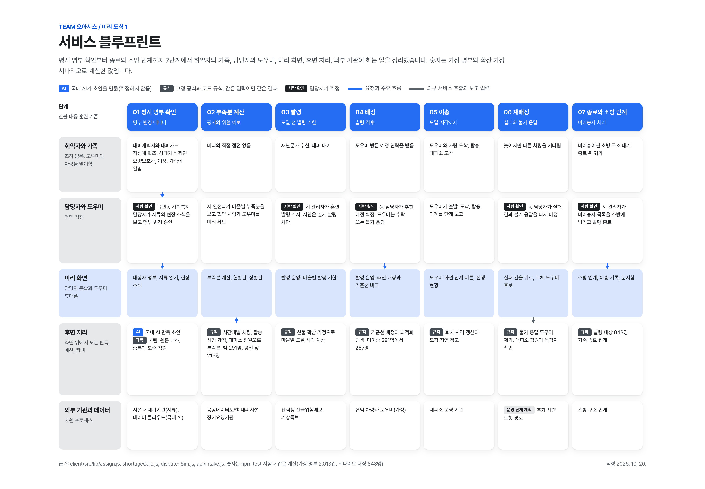

그림 1. 서비스 블루프린트: 평시 명부 확인부터 종료와 소방 인계까지 7단계
범례: 세로 열은 단계 01~07, 가로 줄은 취약자와 가족, 담당자와 도우미, 미리 화면, 후면 처리, 외부 기관. 표시 "AI"는 국내 AI가 만든 초안(확정하지 않음), "규칙"은 고정 공식과 코드 규칙(같은 입력이면 같은 결과), "사람 확인"은 담당자가 확정하는 지점. 진한 화살표는 요청과 주요 흐름, 연한 화살표는 외부 서비스 호출과 보조 입력
출처: 저장소 docs/diagrams/service-blueprint.html(16ac7d8), 팀 작성

## 3 정보 구조와 화면 목록

### 3.1 경로별 화면

| 경로 | 화면 | 대상 | 비고 |
| --- | --- | --- | --- |
| /console | 현황판 | 담당자 | 미이송 예상, 마을별 막대, 확인할 일, 오늘 산불 여건, 공공데이터 추가 연계 |
| /console/intake | 서류 읽기 | 사회복지 담당자 | 3단계(올리기, AI 읽기, 담당자 확인) |
| /console/notes | 현장 소식 | 사회복지 담당자 | 글과 음성에서 명부 변경 후보 |
| /console/roster | 대상자 명부 | 담당자 | 목록, 지도, 서식 출력. 대상자 코드만 표시 |
| /console/map | 상황판 | 담당자 | 3D 지형과 건물 196,111동, 2D 전환, 평시와 가정 시나리오 |
| /console/resources | 차량과 도우미 | 재난 담당자 | 차량 42대, 도우미 88명 |
| /console/shortage | 부족분 계산 | 재난 담당자 | 계산 조건, 마을별 표와 히트맵, 가정값 점검 |
| /console/dispatch | 발령 운영 | 재난 담당자 | 평시, 실행대기, 배정 검토, 이송 진행, 종료 5단계 |
| /console/handover | 소방 인계 | 시 담당자 | 미이송자 목록, CSV, 응급실 병상 |
| /console/records | 이송 기록 | 담당자 | 종료한 발령 기록 |
| /console/workspace | 문서함 | 담당자 | 서식 21종, 문서, 시트, 설문 |
| /h/:token (/h/demo) | 도우미 화면 | 도우미 | 로그인 없음, 배정 기간만 표시 |
| /privacy, /open | 개인정보 처리방침, 개방 API | 공개 | |

출처: client/src/App.jsx, docs/ROUTES.md

### 3.2 내비게이션 구조

| 묶음 | 메뉴 |
| --- | --- |
| 담당 업무 | 현황판, 서류 읽기(서류 사진, 현장 소식), 대상자 명부, 상황판, 차량과 도우미, 발령 준비(부족분 계산, 발령 운영, 소방 인계) |
| 기록과 설정 | 이송 기록, 설정 |
| 공개 화면 | 개방 API, 개인정보 처리방침 |
| 문서함 | 왼쪽 아이콘 줄 맨 아래 |

- 상단 띠에 현재 위치, 평시 또는 발령 상태, "시연 데이터" 표시를 둠
- 발령 중에는 모든 화면 위에 빨간 발령 띠(경과 시간, 가장 이른 도달, 미이송 예상)가 붙음

## 4 화면별 설명

### 4.1 현황판 /console

| 항목 | 내용 |
| --- | --- |
| 목적 | 아침에 한 번 열어 "오늘 발령이 나면 몇 명을 못 옮기나"를 확인 |
| 구성 | 미이송 예상(291명, 추천 배정 적용 시 267명), 마을별 미이송 막대(등급 칩으로 거르기), 확인할 일 15건, 부족 상위 마을, 오늘 산불 여건, 부족 마을 6곳, 가용 차량 39대, 공공데이터 추가 연계 |
| 데이터 | 명부 2,013건(확인 2,005명, 판독 확인 대기 7건, 중복 의심 1건). 기준 시나리오 옥계 방면 북측 확산 |
| 실시간 | 산림청 산불위험지수, 기상청 특보와 바람, 동해 응급실 가용병상, 장애인편의시설 |

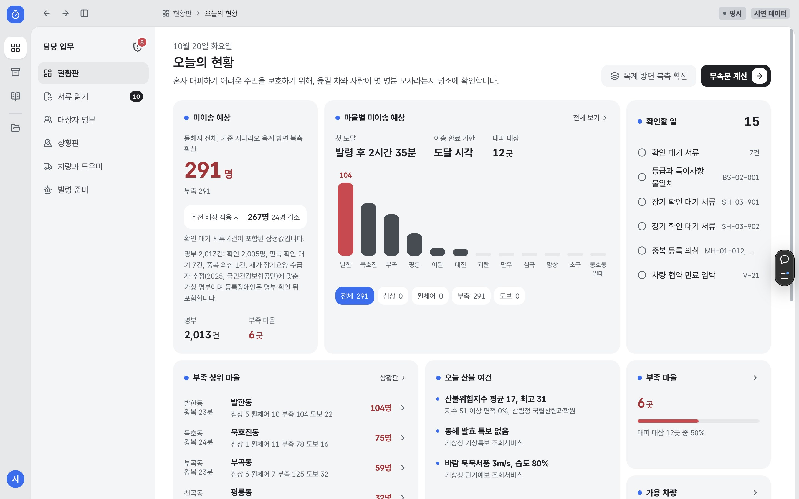

그림 2. 현황판 첫 화면(1440 폭)
범례: 빨강 숫자와 막대는 부족, 파랑은 선택과 주요 행동
출처: https://miri-indol.vercel.app/console 촬영(2026. 10. 20.)

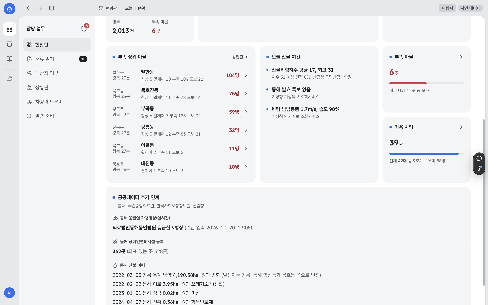

그림 3. 현황판 아래쪽: 오늘 산불 여건과 공공데이터 추가 연계
범례: 카드마다 출처 기관과 기관 입력 시각 또는 포털 수정일 표시
출처: 같은 화면. 응급실 1곳 9병상(기관 입력 2026. 10. 20. 23:05), 장애인편의시설 342곳(좌표 328곳), 산불 이력 4건(산림청 15121380 스냅샷)

### 4.2 서류 읽기 /console/intake

| 항목 | 내용 |
| --- | --- |
| 목적 | 동 담당자가 받은 종이 대피계획서와 대피카드에서 이송 등급 초안과 근거 문구를 뽑음 |
| 단계 | 1 서류 올리기(가상 자료 확인 체크 필수) 2 AI가 읽기(글자 인식, 등급 판정, 근거 추출, 원문 대조) 3 담당자 확인(확인, 수정, 제외) |
| 목록 | 원문 불일치를 맨 위에, 그다음 확인 권장, 원문 일치 순. 원문 일치 건은 한 번에 확인 가능 |
| 처리 위치 | 서류 사진은 CLOVA OCR에만, 가린 글자만 HyperCLOVA X에. 서버 함수 실행 지역 서울 |

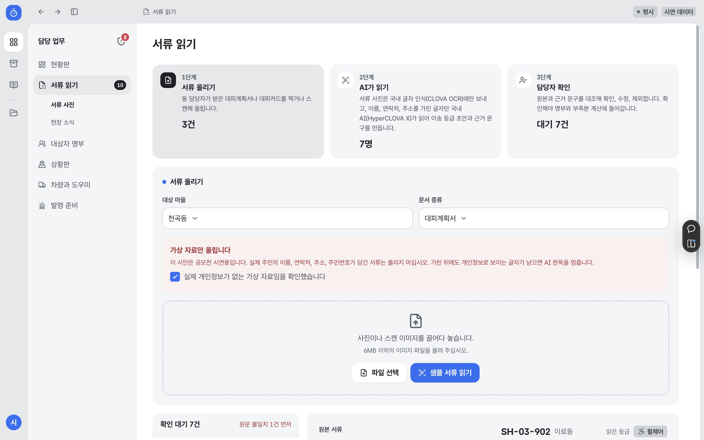

그림 4. 서류 올리기: 가상 자료 확인 체크와 샘플 서류 읽기
출처: 공개 주소 촬영

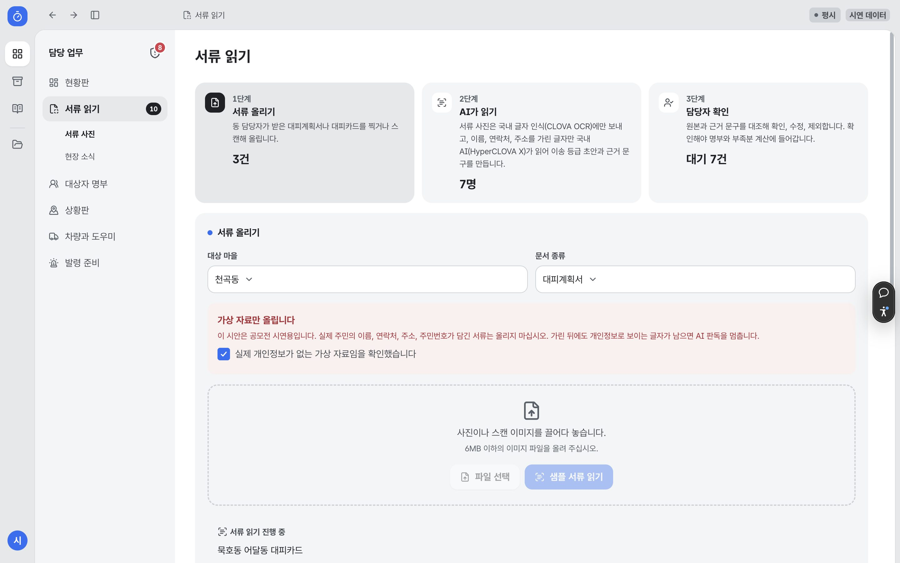

그림 5. AI가 읽는 중: 글자 인식, 등급 판정, 근거 추출, 원문 대조 4단계 표시
출처: 공개 주소 촬영. 샘플 서류(묵호동 어달동 대피카드)를 실제 CLOVA OCR과 HyperCLOVA X로 판독

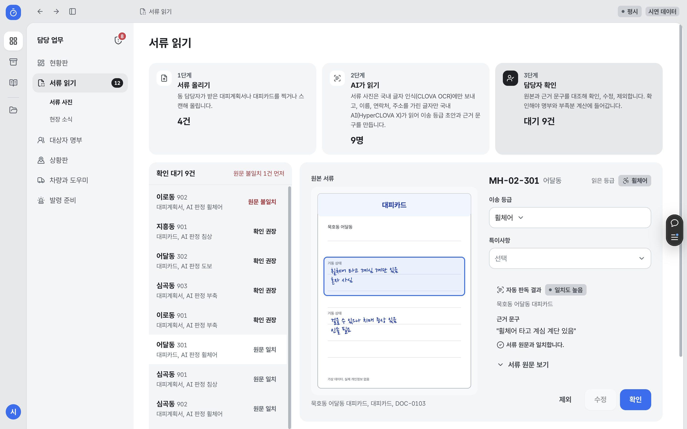

그림 6. 판독 결과(원문 일치): 어달동 301 휠체어, 근거 문구 "휠체어 타고 계심 계단 있음"
출처: 공개 주소 촬영. 위 실제 판독으로 새로 생긴 2건 가운데 1건

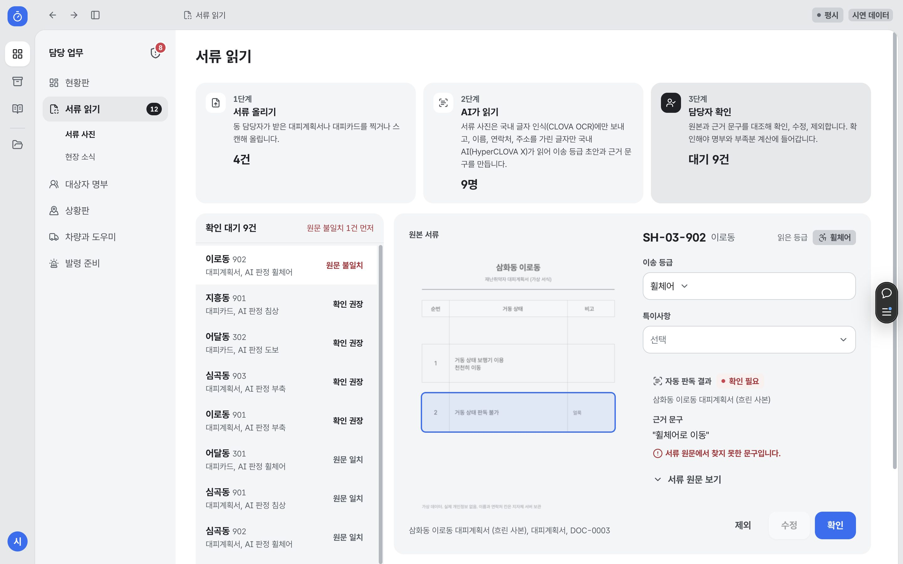

그림 7. 판독 결과(원문 불일치): 근거 문구가 서류 원문에 없어 "확인 필요"로 표시
출처: 공개 주소 촬영. 시연용 흐린 사본

### 4.3 현장 소식 /console/notes

| 항목 | 내용 |
| --- | --- |
| 목적 | 요양보호사, 이장, 가족이 전한 글이나 음성에서 거동 변화를 읽어 명부 변경 후보를 만듦 |
| 동작 | 담당자가 승인해야 명부가 바뀜. 등급을 낮추는 제안은 일치도를 한 단계 내려 보여 줌. 글 소식은 담당자가 입력한 원문으로 근거를 대조 |

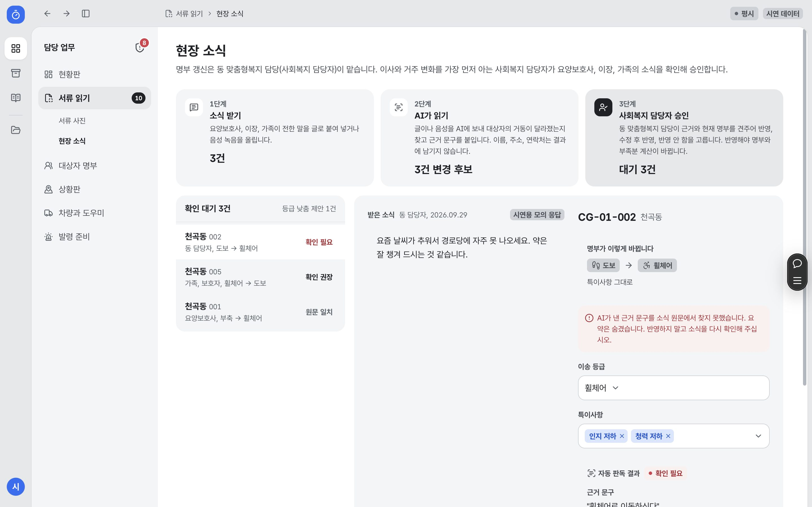

그림 8. 현장 소식
출처: 공개 주소 촬영

### 4.4 대상자 명부 /console/roster

| 항목 | 내용 |
| --- | --- |
| 구성 | 목록, 지도, 서식 출력. 이름 대신 대상자 코드(예: SH-03-902) |
| 상세 | 이송 등급, 특이사항(전동과 수동 휠체어, 욕창 확인 필요 등), 당사자와 계획 확인 상태와 마지막 확인일, 층수와 계단, 차량 접근 위치, 소통 방식, 갱신 담당 |
| 근거 | 회신 R17(척수장애인 이동), R28(층수와 계단, 소통 방식) 반영(dec95a3) |

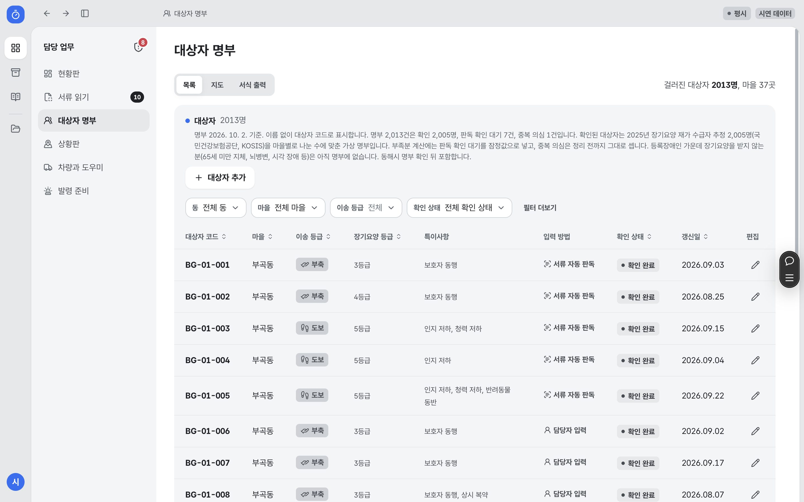

그림 9. 대상자 명부
출처: 공개 주소 촬영. 대상자 2,013건은 가상

### 4.5 부족분 계산 /console/shortage

| 항목 | 내용 |
| --- | --- |
| 목적 | 봄철 산불 조심 기간 전에 차량 협약 규모와 도우미 추가 지정 규모를 숫자로 정함 |
| 계산 조건 | 발화 강릉시 옥계면 남양리, 확산 시속 2km, 첫 도달 발령 후 2시간 35분, 대피 대상 12곳 848명, 밤이나 휴일, 준비 1시간, 추가 협약 차량 없음 |
| 결과 | 미이송 예상 291명(부축 291명), 필요 추가 차량 승용차 20대, 부족 6곳(발한동 104명, 묵호진동 75명, 부곡동 59명, 평릉동 32명, 어달동 11명, 대진동 10명) |
| 가정값 점검 | 발령 시간대: 밤이나 휴일 291명, 평일 낮 216명(센터 대피 169명 제외). 탑승과 하차 시간: 10분 183명, 15분 237명, 20분(지금 가정) 291명, 25분 345명, 30분 402명 |
| 표시 | 계산 규칙 1.2판(2026. 10. 20.), 입력 기준(장기요양 재가 수급자 2025년 통계, 명부는 가상) |

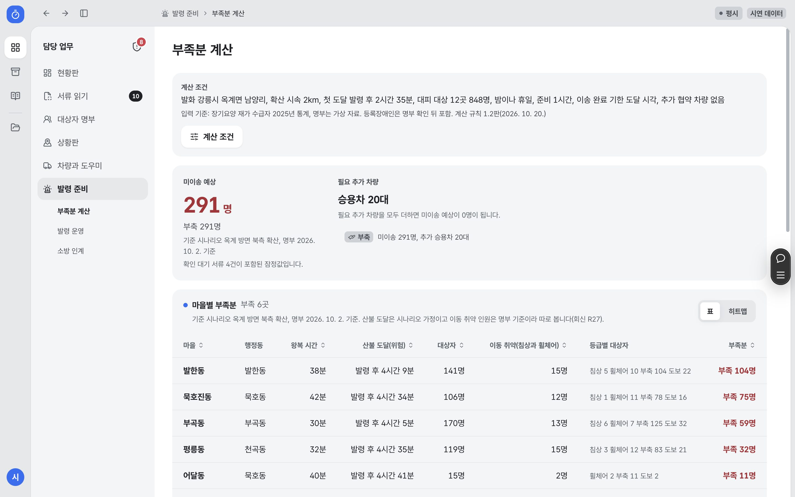

그림 10. 부족분 계산: 계산 조건, 미이송 예상, 마을별 부족분 표
범례: 빨강은 부족 인원, 등급은 침상, 휠체어, 부축, 도보
출처: 공개 주소 촬영

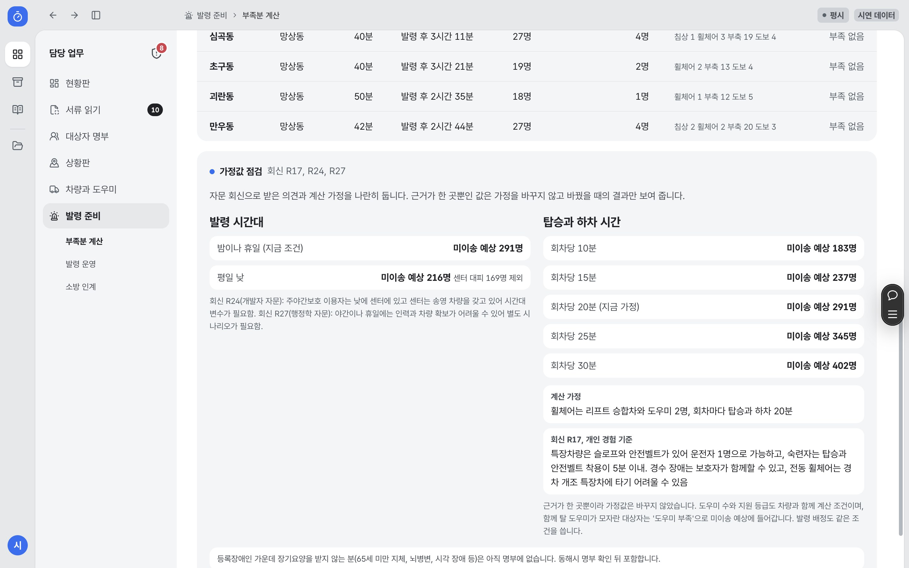

그림 11. 가정값 점검 카드: 발령 시간대와 탑승 시간 가정을 바꿨을 때의 미이송 예상
출처: 공개 주소 촬영. 회신 R17, R24, R27 반영(56e966e). 아래 설명 문장은 실제 계산대로 "도우미 수와 지원 등급도 차량과 함께 계산 조건"으로 정정(80a88bb)

### 4.6 상황판 /console/map

| 항목 | 내용 |
| --- | --- |
| 목적 | 명부, 부족분, 발령 숫자를 지도 위에서 보여 줌 |
| 평시 | 대상자 2,013명, 마을 37곳, 임시주거시설 수용 5,601명, 가용 차량 39/42대, 등급별 침상 75, 휠체어 152, 부축 1,462, 도보 324 |
| 지형과 건물 | 실제 고도 지형 위에 국토교통부 GIS건물통합정보 196,111동 |
| 가정 시나리오 | 확산 가정 방향과 도달 시각, 시간 축 재생 |

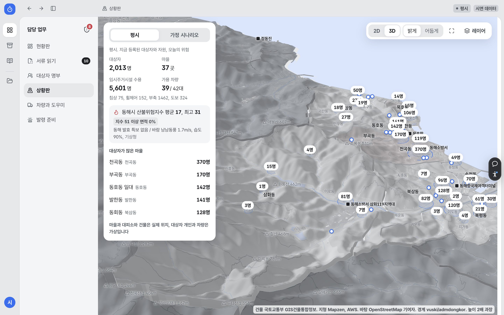

그림 12. 상황판 평시(3D)
범례: 숫자 원은 마을별 대상자 수, 검은 네모는 시설
출처: 공개 주소 촬영. 건물 국토교통부 GIS건물통합정보, 지형 Mapzen과 AWS, 바탕 OpenStreetMap 기여자, 경계 vuski/admdongkor

### 4.7 차량과 도우미 /console/resources

| 항목 | 내용 |
| --- | --- |
| 구성 | 차량 42대(구급차, 리프트 승합차, 승용차 등)와 도우미 88명의 가용 상태, 대기 동, 민간 협약 만료일 |
| 동작 | 차량 추가와 수정 창은 화면 가운데에 뜸 |

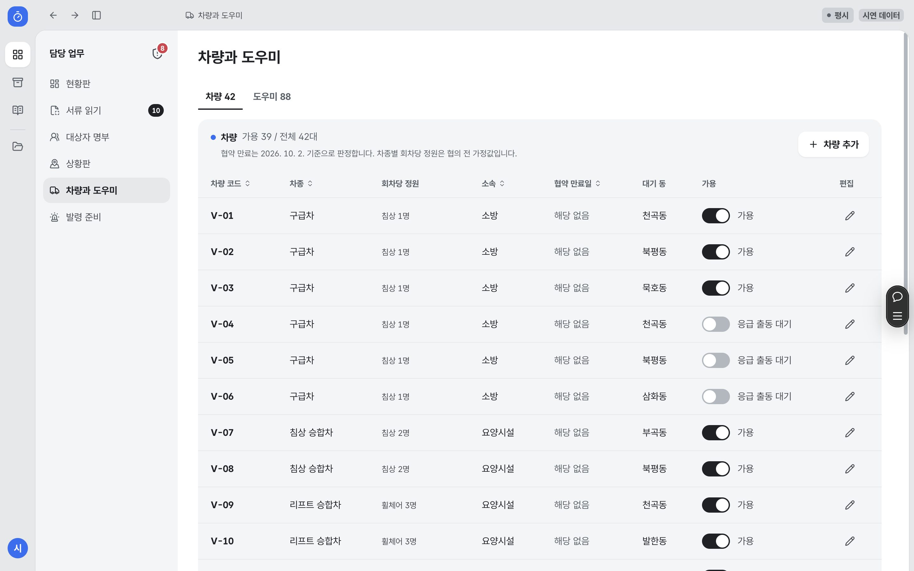

그림 13. 차량과 도우미
출처: 공개 주소 촬영. 차량과 도우미는 가상

### 4.8 발령 운영 /console/dispatch

| 단계 | 화면 | 하는 일 |
| --- | --- | --- |
| 1 평시 | 발령 개시 | 훈련 발령과 실제 발령 구분(실제 발령 비활성), 속도 1배, 60배, 240배 |
| 2 실행대기 | 추천 배정 계산 | 준비 60분, 이송 완료 기한 도달 시각 조건으로 계산. 마을별 도달 시계 |
| 3 배정 검토 | 배정 확정 | 배정 차량 39대, 174회차, 기본 순서 대비 추천 배정 비교, 차량별 배정표, 회차 이동(재배정) |
| 4 이송 진행 | 진행 상황 | 대기, 출발, 도착, 탑승, 인계 완료, 실패, 소방 인계, 미배정 인원과 대상자별 단계 |
| 5 종료 | 기록 | 이번 발령 대상(848명)만 집계해 이송 기록에 저장 |

- 촬영 때 배정 검토 화면의 미이송 예상은 284명임. 훈련 시간이 60배로 흐르는 동안 계산해 0분 경과 기준값 267명보다 늘어남(GPT 지적 수정기록 3차 미리보기 확인과 같은 현상)

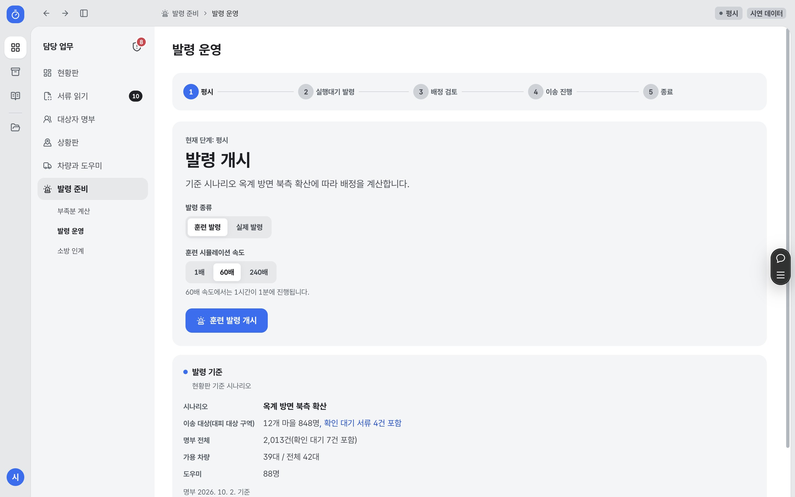

그림 14. 발령 운영 1단계: 발령 개시(훈련 발령, 60배). 발령 기준 칸은 배정 대상인 대피 대상 구역 12개 마을 848명(확인 대기 서류 4건 포함)과 명부 전체 2,013건(확인 대기 7건 포함)을 나눠 보여 줌
출처: 공개 주소 촬영(37985c9)

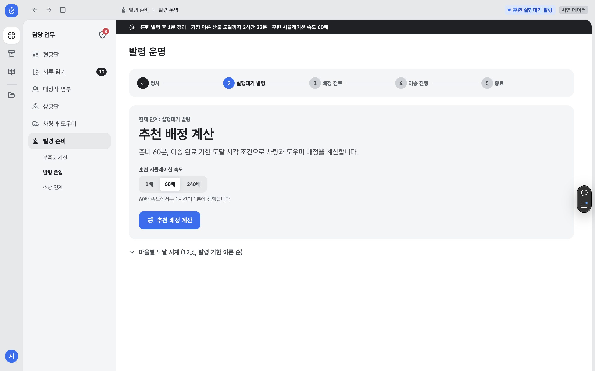

그림 15. 2단계: 추천 배정 계산과 마을별 도달 시계
출처: 공개 주소 촬영

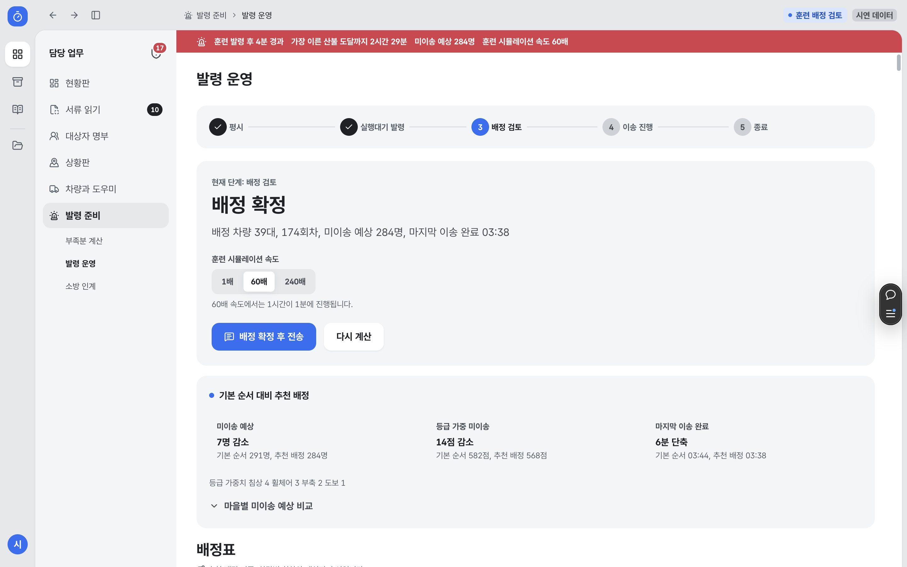

그림 16. 3단계: 배정 검토(기본 순서 대비 추천 배정, 차량별 배정표)
출처: 공개 주소 촬영

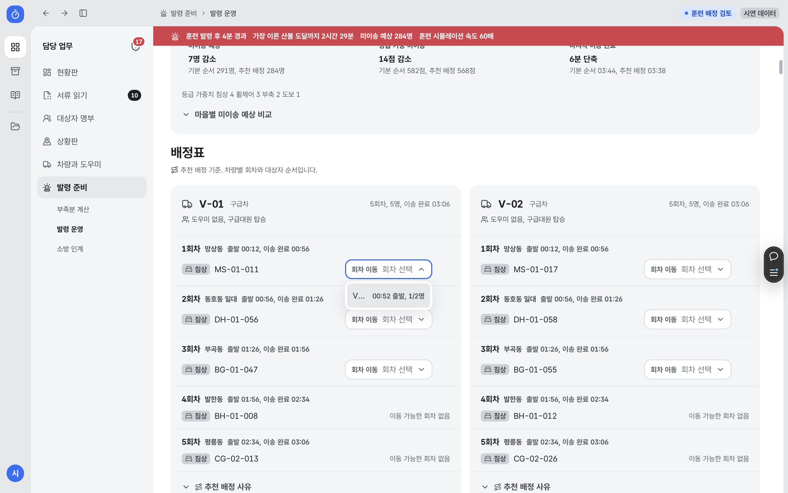

그림 17. 재배정: 회차 이동 목록(자리가 있는 회차만 표시)
출처: 공개 주소 촬영

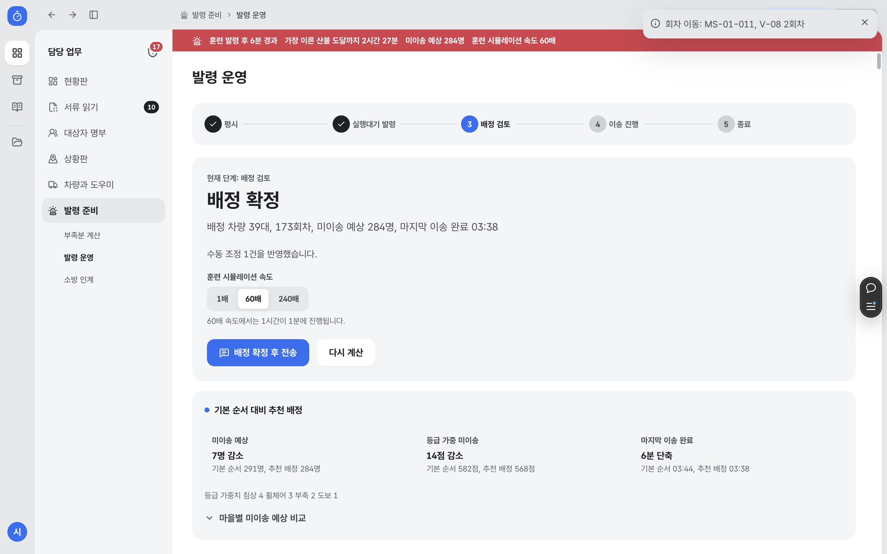

그림 18. 재배정 반영: "수동 조정 1건을 반영했습니다"
출처: 공개 주소 촬영

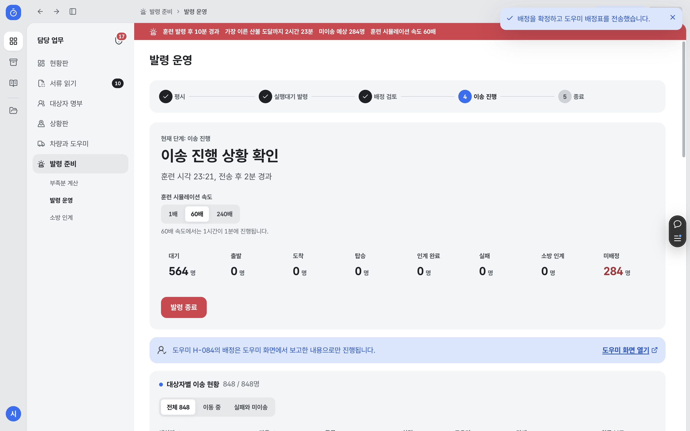

그림 19. 4단계: 이송 진행 상황(대기 564명, 미배정 284명, 대상자별 단계)
출처: 공개 주소 촬영

### 4.9 소방 인계 /console/handover

| 항목 | 내용 |
| --- | --- |
| 목적 | 기한 안에 옮기지 못할 것으로 계산된 대상자를 소방에 한꺼번에 넘김 |
| 구성 | 인계 대기, 인계 완료, 전달 횟수, 미이송자 목록(이송 실패, 미배정, 소방 인계 순), CSV 내보내기, 인쇄, 인계 참고 동해 응급실, 전달 기록 |
| 데이터 | 국립중앙의료원 응급실 실시간 가용병상(15000563). 촬영 때 의료법인동해동인병원 9병상(기관 입력 2026. 10. 20. 23:05) |

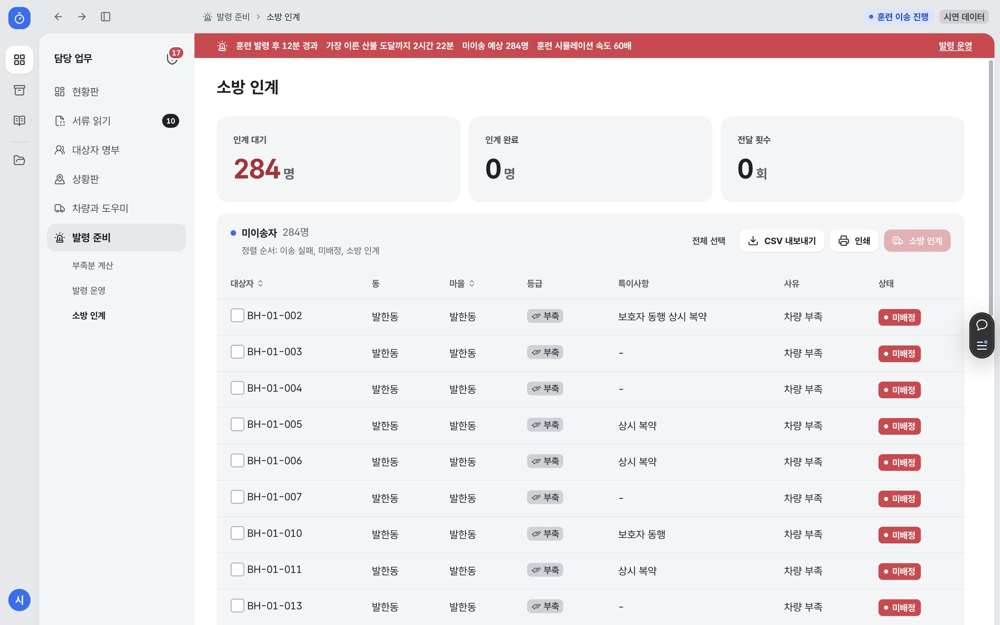

그림 20. 소방 인계 미이송자 목록
출처: 공개 주소 촬영(훈련 발령 중)

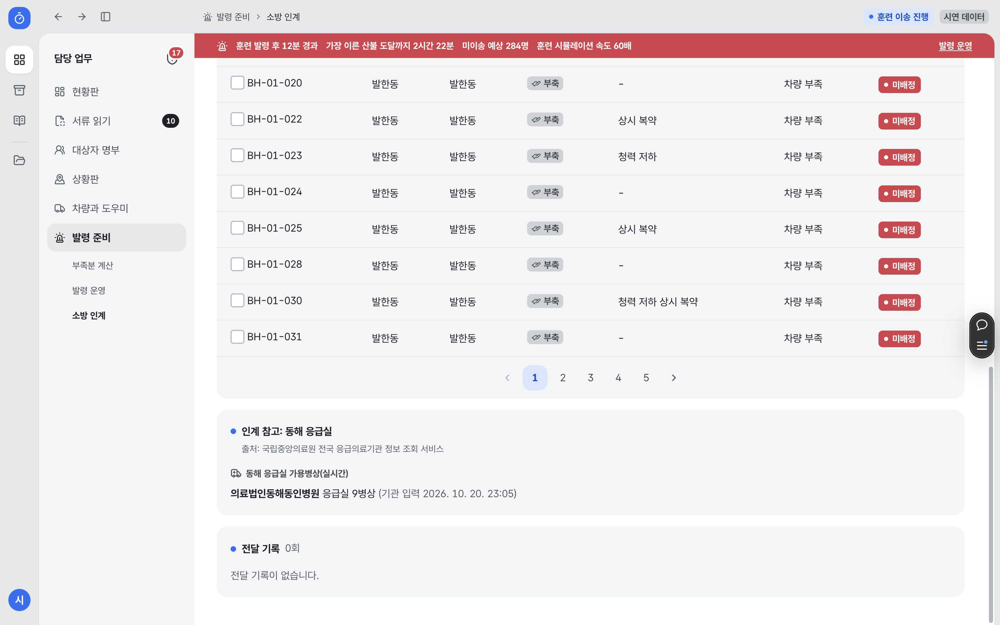

그림 21. 인계 참고: 동해 응급실 가용병상(실시간)
출처: 국립중앙의료원 전국 응급의료기관 정보 조회 서비스, 공개 주소 촬영

### 4.10 도우미 화면 /h/demo

| 단계 | 화면 |
| --- | --- |
| 대기 | "배정 대기 중", 시연 발령 시작 |
| 배정 도착 | 내 배정(도우미 코드, 차량, 대상자 수와 회차, 대피소, 첫 출발), 수락과 불가 |
| 진행 | 대상자 순서, 현재 대상자 카드(등급, 출발과 도착, 보호자 전화, 필요 차량과 인력, 주의사항), 출발, 도착, 탑승 완료, 대피소 인계 완료 단추 |
| 실패 보고 | 사유(부재, 이송 거부, 진입 불가, 상태 악화, 기타)와 메모 |

- 불가로 답한 도우미와 그 차량은 재배정 후보에서 빠짐(fa2d24d). 사람별 목적지는 배정 때 정한 시설로 표시

| | | |
| --- | --- | --- |
| 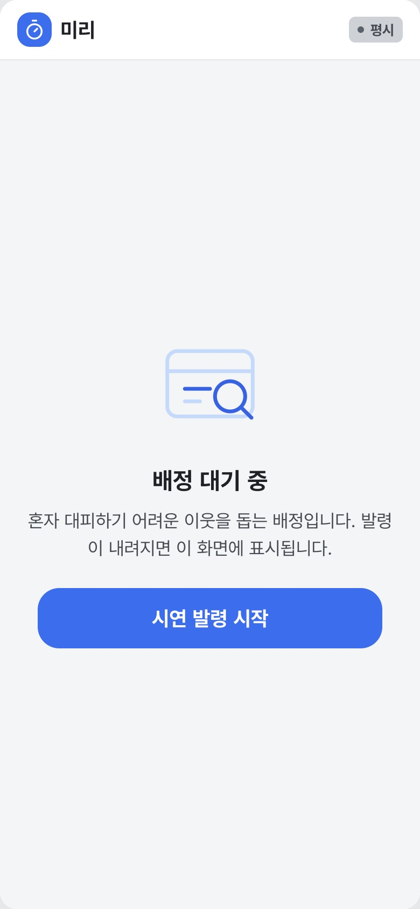 | 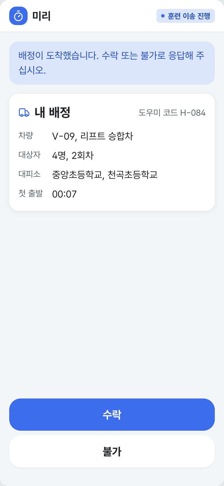 | 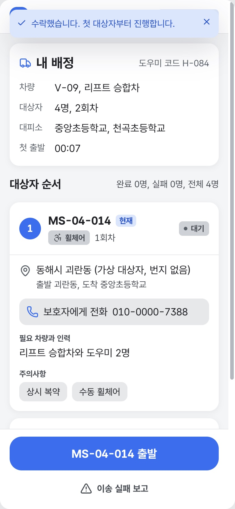 |
| 대기 | 배정 도착 | 수락 뒤 첫 대상자 |
| 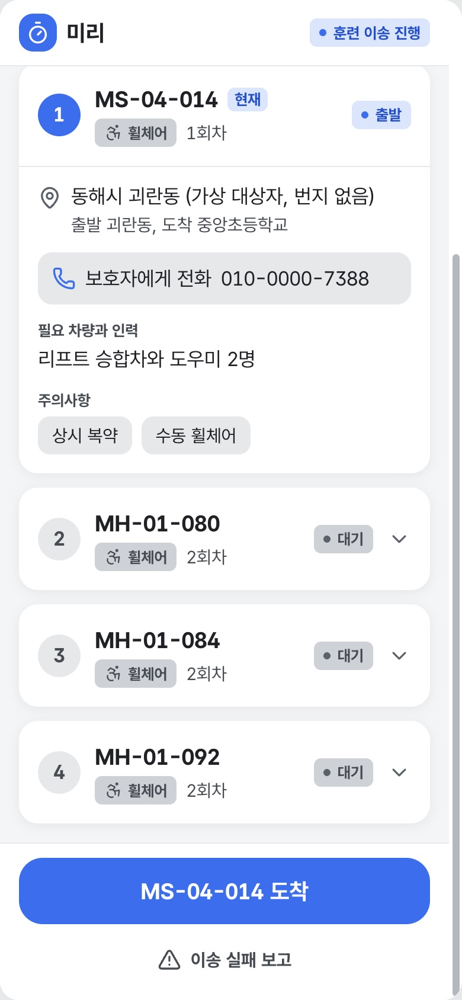 | 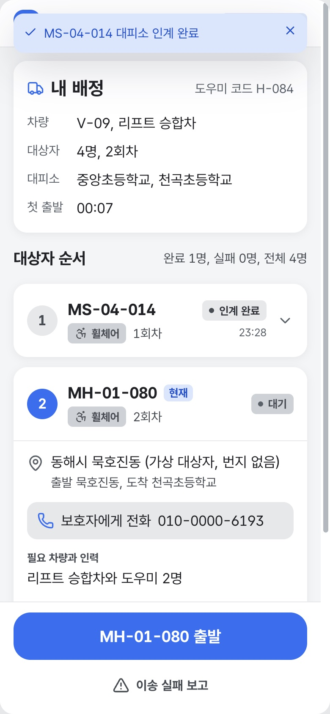 | 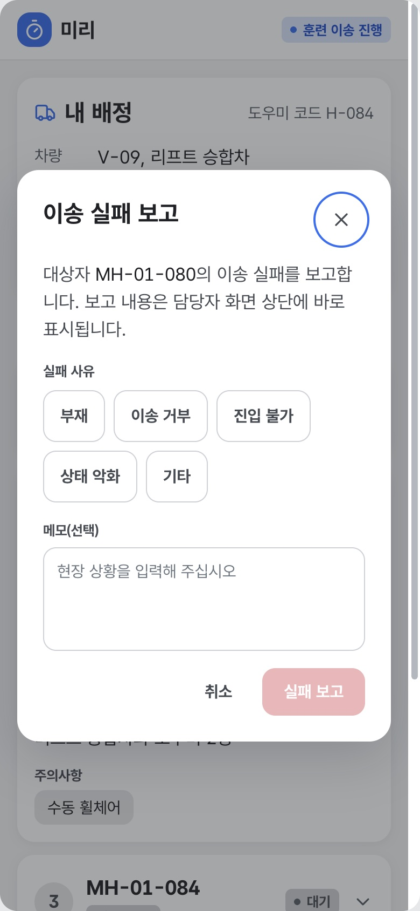 |
| 출발 보고 | 인계 완료 1명 | 이송 실패 보고 |

그림 22. 도우미 휴대폰 화면 단계별(390 폭)
출처: 공개 주소 /h/demo 촬영. 대상자와 보호자 번호(010-0000-xxxx)는 가상

### 4.11 이송 기록, 문서함, 개인정보 처리방침

| 화면 | 내용 |
| --- | --- |
| 이송 기록 | 종료한 발령의 대상 수, 이송 결과, 처음 추천 지표와 재배정 뒤 지표 |
| 문서함 | 공문, 보고서, 계획서, 공고, 회의, 협약, 인계, 조사 서식 21종. 상황판 숫자가 자동으로 들어가고 한글(HWPX)로 저장. 공문 검사와 법령 인용 확인 |
| 개인정보 처리방침 | 처리 목적과 항목, 보유 기간, 제3자 제공, 처리 위탁(Vercel 서울 실행, Upstash, 네이버 클라우드), 파기 |

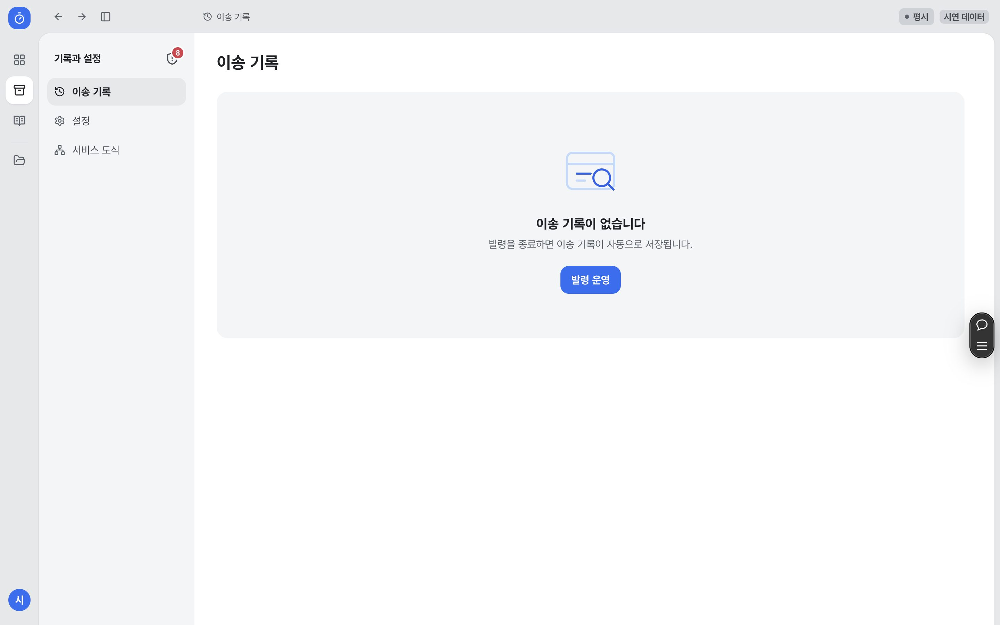

그림 23. 이송 기록
출처: 공개 주소 촬영

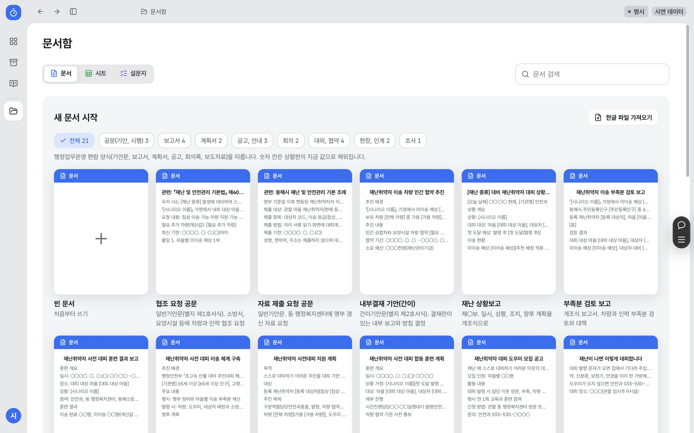

그림 24. 문서함
출처: 공개 주소 촬영

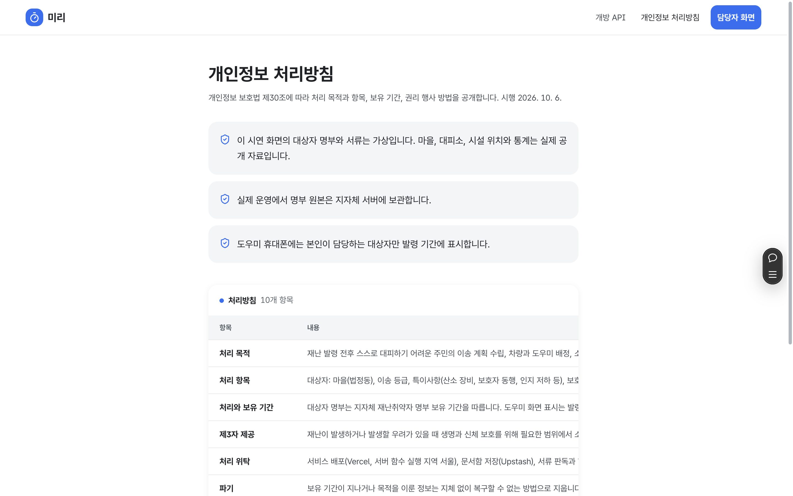

그림 25. 개인정보 처리방침
출처: 공개 주소 촬영

## 5 디자인 시스템

### 5.1 기준과 방향

- KRDS(디지털 정부 디자인 시스템) 원본 토큰을 옮겨 씀. 원본 github.com/KRDS-uiux/krds-uiux
- 유채색은 파랑(KRDS primary)과 빨강(KRDS point) 두 가지만 씀. 빨강은 부족과 위험에만 씀
- 면 구분은 선 대신 그림자 3단으로 함(무보더 원칙)

### 5.2 색 토큰

| 역할 | 값 | 쓰임 |
| --- | --- | --- |
| primary | #256EF4 | 주요 행동, 선택 상태 |
| primary hover, text | #0B50D0 | 눌림, 파랑 글자 |
| danger | #D63D4A | 부족 인원, 위험 |
| text pri, sec, meta | #1E2124, #464C53, #58616A | 본문, 보조, 설명 |
| page, canvas | #FFFFFF, #F4F5F6 | 바탕 |
| 문서함 종류색 | 문서 #256EF4, 시트 #0F9D58, 설문 #7A3CFF | 아이콘과 서식 카드 머리에만 |

출처: client/src/tokens.js

### 5.3 타이포그래피와 문구

| 항목 | 규칙 |
| --- | --- |
| 서체 | Pretendard GOV(KRDS 표준) |
| 단계 | display, h1, h2, h3, kpi, body, bodySm, strong, caption, meta. 굵기 400, 600, 700, 800 네 단계, 500 금지 |
| 크기 | clamp로 화면 폭에 맞춰 조절(예: 본문 15~17px) |
| 문구 | 안내는 합니다체, 상태는 명사형. 가운뎃점과 이모지 쓰지 않음 |

### 5.4 레이아웃과 컴포넌트

| 요소 | 규칙 |
| --- | --- |
| 반지름 | 6, 10, 12, 16, 20px와 원형 한 체계 |
| 그림자 | sm(카드), md(떠 있는 카드), lg(드로어, 모달, 시트) |
| 화면 폭 기준 | 320, 390, 768, 1024, 1280, 1440, 1920, 2560, 3840px |
| 본문 최대 폭 | 1400px(넓은 화면 1600px) |
| 움직임 | 누름 120ms, 색 160ms, 진입 280ms, 시트 360ms. UI 전환 300ms 미만 |

### 5.5 접근성

- 자체 점검 기록: 공모전/반영기록/접근성_자체점검.md(KWCAG 기본 항목)
- 입력 오류 설명을 aria-describedby로 연결하고 오류는 role=alert로 알림(49fc741)
- 대비가 높은 설정(prefers-contrast: more)에서 보조 선과 설명 글자를 진하게 바꿈(tokens.js contrastOverrides)
- 색만으로 상태를 알리지 않고 글자(미배정, 차량 부족 등)를 함께 표시
- 스크린리더 실사용 점검은 하지 않음

## 6 기능 명세

### 6.1 기능 요구와 구현 위치

| 번호 | 기능 | 내용 | 구현 위치 |
| --- | --- | --- | --- |
| F1 | 부족분 계산 | 마을별 이송 가능 인원과 부족분, 필요 추가 차량 | client/src/lib/shortageCalc.js, shortage.js |
| F2 | 시나리오 | 발화 지점, 확산 속도, 도달 시각 역산, 시간대 | lib/scenario.js, time.js |
| F3 | 추천 배정 | 기본 순서보다 미이송이 줄어드는 배정 탐색, 도우미 등급과 대피소 정원 제약 | lib/assign.js |
| F4 | 발령 시뮬레이션 | 훈련 발령 진행, 재배정, 종료 집계 | lib/dispatchSim.js |
| F5 | 서류 읽기 | CLOVA OCR, 가림, 잔존 검사, HyperCLOVA X, 근거 대조 | api/intake.js, api/_ncp.js, lib/intake.js |
| F6 | 현장 소식 | 글과 음성에서 명부 변경 후보 | api/note.js, lib/notes.js |
| F7 | 공공데이터 중계 | 산불위험지수, 특보, 예보, 응급실, 편의시설 등 | api/opendata.js |
| F8 | 이상 탐지 | 등급과 특이사항 불일치, 중복 의심, 협약 만료 | lib/anomaly.js |
| F9 | 문서함 | 서식 21종, 자료 넣기, 한글 저장, 공문 검사 | pages/workspace, api/hwpx.js, api/lint.js |
| F10 | 법령 확인 | 「법령명」 제N조 실재 여부 | api/law.js, public/law/core.json |
| F11 | 개방 API | 마을별 부족분, 대피소, 시설, 시나리오 | api/open.js |
| F12 | 시연 세션과 호출 상한 | 서명 쿠키 세션, AI 호출 상한 | api/session.js, api/_guard.js |

### 6.2 비기능 요구

| 항목 | 요구 | 대응 |
| --- | --- | --- |
| 개인정보 | 실제 개인정보를 다루지 않음 | 가상 자료 확인 체크, 가림 뒤 잔존 시 AI 호출 중단, 화면에는 대상자 코드만 |
| 처리 위치 | 서류 처리를 국내에서 | 네이버 클라우드 AI, 서버 함수 실행 지역 서울(icn1) |
| 비용 통제 | 공유 AI 키 남용 방지 | 서류 세션과 IP 분당 10회, 전체 분당 40회와 하루 400회. 소식 20, 20, 80, 800회. 공유 저장소가 없으면 AI 호출을 닫음 |
| 시간 제한 | 외부 호출이 멈추지 않게 | OCR 20초, HyperCLOVA X 25초, 음성 20초 |
| 신뢰성 | 확인하지 못한 값을 단정하지 않음 | 빈 판독은 422 확인 요청, 근거 불일치는 확인 필요 |
| 성능 | 3D 화면 분리 | 화면별 지연 로딩, 지형과 건물은 미리 구운 정적 파일, 저사양용 2D |

## 7 상태 설계

### 7.1 화면별 상태

| 화면 | 로딩 | 오류 | 빈 상태 | 정상 |
| --- | --- | --- | --- | --- |
| 현황판 공공데이터 | 불러오는 중 | "불러오지 못했습니다(사유)" | 정보 없음 | 값과 기관 입력 시각 |
| 서류 읽기 | 글자 인식, 등급 판정, 근거 추출, 원문 대조 4단계 표시 | 503 저장소 미연결, 429 사용량 초과, 413 파일 크기, 422 읽은 내용 없음 | 확인 대기 0건 | 확인 대기 목록 |
| 발령 운영 | 계산 중 | 계산 실패 안내 | 평시(발령 없음) | 5단계 진행 |
| 소방 인계 | 없음 | 응급실 응답 실패 사유 | "진행 중인 발령이 없습니다" | 미이송자 목록 |
| 도우미 화면 | 없음 | 종료된 배정 안내 | 배정 대기 중 | 배정과 대상자 순서 |

### 7.2 데이터 상태

| 대상 | 상태 값 | 화면에서 하는 일 |
| --- | --- | --- |
| 판독 결과 | 원문 불일치, 확인 권장, 원문 일치 | 불일치를 맨 위에. 일치는 한 번에 확인 가능 |
| 대상자 | 확인, 판독 확인 대기, 중복 의심 | 확인 대기는 잠정값으로 표시 |
| 발령 | 평시, 실행대기, 배정 검토, 이송 진행, 종료 | 단계 표시와 발령 띠 |
| 이송 단계 | 대기, 출발, 도착, 탑승, 인계 완료, 실패, 소방 인계, 미배정 | 사유(차량 부족, 도우미 부족, 대피소 자리 부족, 안전한 대피소 없음 등) 함께 표시 |
| 발령 종류 | 훈련, 실제 | 실제는 비활성 |

## 8 시스템 구성과 API

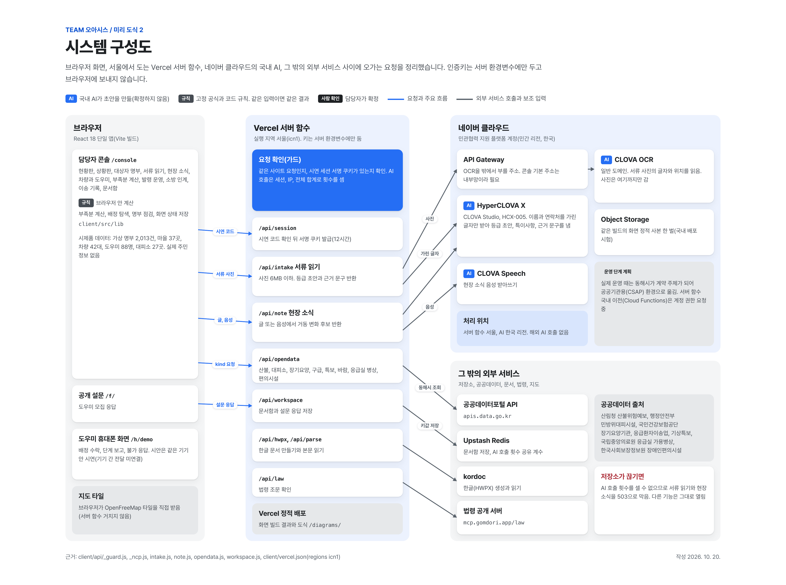

그림 26. 시스템 구성도
범례: 왼쪽 브라우저, 가운데 Vercel 서울(icn1) 서버 함수와 가드, 오른쪽 네이버 클라우드와 외부 서비스. 표시 "AI"는 국내 AI가 만든 초안(확정하지 않음), "규칙"은 고정 공식과 코드 규칙(같은 입력이면 같은 결과), "사람 확인"은 담당자가 확정하는 지점. 진한 화살표는 요청과 주요 흐름, 연한 화살표는 외부 서비스 호출과 보조 입력
출처: 저장소 docs/diagrams/system-architecture.html(16ac7d8)

### 8.1 구성 요소

| 구성 요소 | 역할 | 위치 |
| --- | --- | --- |
| 화면 | React 18, Vite, Tailwind CSS, React Router 6, zustand, lucide-react | client/src |
| 3D 상황판 | three.js, Web Worker, Delaunator, Constrainautor, earcut | client/src/three |
| 2D 지도 | MapLibre GL JS | client/src/components/map |
| 서버 함수 | Vercel 서버리스, 실행 지역 서울(icn1) | client/api |
| AI | 네이버 클라우드 CLOVA OCR(API Gateway 경유), HyperCLOVA X HCX-005, CLOVA Speech Recognition | client/api/_ncp.js |
| 저장 | Upstash Redis(문서함, 호출 횟수) | api/workspace.js, api/_guard.js |
| 한글 문서 | kordoc(HWPX 생성과 조판) | api/hwpx.js |
| 국내 정적 사본 | 네이버 클라우드 Object Storage 버킷 miri-web-oasis 정적 웹 호스팅(56e966e 판) | 플랫폼 활용 기록 |

### 8.2 API 명세

| 경로 | 방식 | 요지 |
| --- | --- | --- |
| /api/session | GET, POST, DELETE | 시연 코드 확인 뒤 서버 서명 쿠키 발급(12시간), 상태 조회, 해제 |
| /api/intake | POST | 서류 이미지 판독. 가상 자료 확인 필수. 결과는 대상자별 등급, 특이사항, 근거 문구, 일치도 |
| /api/note | POST | 현장 소식 글 또는 음성 판독 |
| /api/opendata?kind= | GET | 공공데이터 중계(산불위험, 특보, 예보, 대피시설, 장기요양기관, 이송업, er, access) |
| /api/open?kind= | GET | 개방 API(summary, villages, shelters, facilities, scenarios, scenario) |
| /api/hwpx | POST | 한글 문서 생성과 구조 검사 |
| /api/law | GET | 법령 조문 확인 |
| /api/lint | POST | 공문 표기 검사 |
| /api/workspace | GET, PUT, DELETE | 문서함 저장. 공개 설문 조회와 응답 제출 외에는 시연 세션 필요 |

### 8.3 데이터 출처

| 자료 | 기관 | 기준 시점 | 쓰는 곳 |
| --- | --- | --- | --- |
| 행정동별 주민등록인구 | 행정안전부(KOSIS DT_1B04005N) | 2026년 9월 | 고령화율, 대상자 배분 |
| 장기요양 등급과 급여이용수급자 | 국민건강보험공단(KOSIS) | 2025년 | 재가 수급자 추정 2,005명 |
| 이재민 임시주거시설 27곳 | 행정안전부 국민재난안전포털 | 2026. 10. 6. 조회 | 대피소 배정과 수용 |
| 마을회관과 경로당 138곳 | 동해시(공공데이터포털 15114136) | 2025. 11. 4. | 집결지 |
| 건물 196,111동 | 국토교통부 GIS건물통합정보 | 2026. 9. 9. | 3D 건물 |
| 도로 주행 시간 | OSRM 공개 서버(OpenStreetMap) | 빌드 때 계산 | 왕복 시간 |
| 산불위험지수 | 산림청 국립산림과학원 | 실시간 | 오늘 산불 여건 |
| 기상특보, 단기예보 | 기상청 | 실시간 | 특보, 바람 |
| 민방위대피시설 | 행정안전부 | 실시간 | 상황판 대피시설 |
| 장기요양기관 | 국민건강보험공단 | 실시간 | 상황판 시설 |
| 응급환자이송업 | 행정안전부 | 실시간 | 차량 자원 |
| 응급실 실시간 가용병상 | 국립중앙의료원(15000563) | 실시간, 기관 입력 시각 | 현황판, 소방 인계 |
| 장애인편의시설 | 한국사회보장정보원(15092317) | 실시간 | 현황판 |
| 산불통계 | 산림청(15121380) | 포털 수정일 2026. 9. 15. | 동해 산불 이력 4건 |
| 법령 원문 | 법제처 국가법령정보 | 2026. 10. 6. 수집 | 법령 확인(핵심 법령 11개 1,026조문) |

출처: README 데이터 출처 절, 공모전/플랫폼/데이터_활용현황_20261020.md

## 9 AI 서류 읽기와 계산 알고리즘 상세

### 9.1 국내 처리 흐름

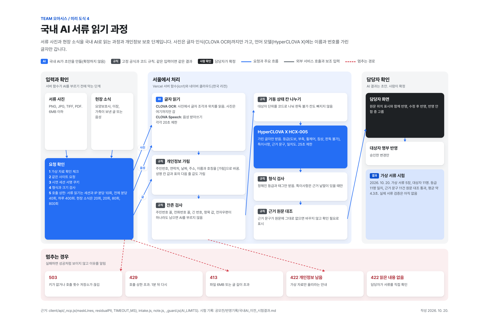

그림 27. 국내 AI 서류 읽기 과정
범례: 표시 "AI"는 국내 AI가 만든 초안(확정하지 않음), "규칙"은 고정 공식과 코드 규칙(같은 입력이면 같은 결과), "사람 확인"은 담당자가 확정하는 지점. 진한 화살표는 요청과 주요 흐름, 연한 화살표는 외부 서비스 호출과 보조 입력. 멈춤 결과는 503, 429, 413, 422
출처: 저장소 docs/diagrams/ai-pipeline.html(16ac7d8)

| 순서 | 단계 | 내용 |
| --- | --- | --- |
| 1 | 요청 검사 | 시연 세션, 가상 자료 확인, 파일 형식(PNG, JPG, TIFF, PDF)과 크기, 호출 상한 |
| 2 | 글자 인식 | 서류 사진을 CLOVA OCR(일반 도메인, API Gateway)에만 보냄 |
| 3 | 개인정보 가림 | 성명, 연락처, 주소, 주민번호 항목과 전화번호 모양, 줄 나뉜 값, 날짜, "○○○ 어르신" 표기를 [가림]으로 바꿈 |
| 4 | 잔존 검사 | 가린 뒤에도 이름이나 번호 모양이 남으면 AI 호출을 멈춤 |
| 5 | 칸 나누기 | "거동 상태" 칸을 코드로 나눠 대상자 단위를 정함. 판독 불가 칸도 대상자로 남김 |
| 6 | 문구 분류 | 가린 글자만 HyperCLOVA X(HCX-005)에 보내 등급, 특이사항, 근거 문구, 일치도를 받음 |
| 7 | 형식 검사 | 응답 형식이 맞지 않거나 비면 422 확인 요청 |
| 8 | 근거 대조 | 근거 문구가 원문에 그대로 없으면 바꾸지 않고 "확인 필요"로 표시 |
| 9 | 담당자 확인 | 원본과 대조해 확인, 수정, 제외 |

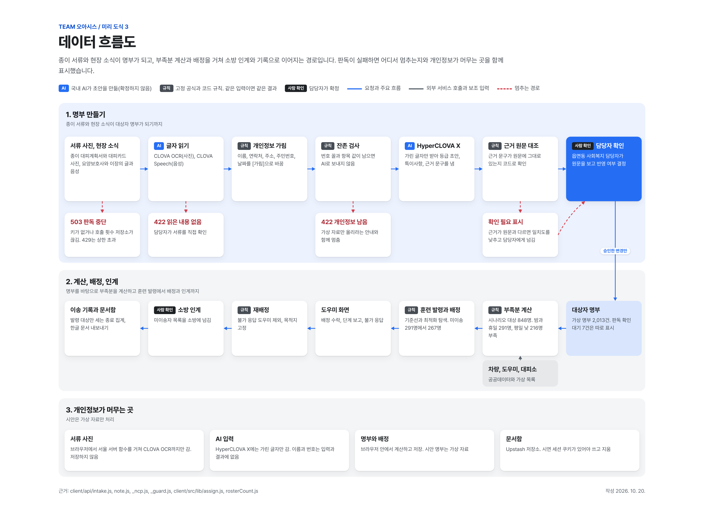

그림 28. 데이터 흐름도: 개인정보가 머무는 곳과 멈춤 경로
범례: 표시 "AI"는 국내 AI가 만든 초안(확정하지 않음), "규칙"은 고정 공식과 코드 규칙(같은 입력이면 같은 결과), "사람 확인"은 담당자가 확정하는 지점. 진한 화살표는 요청과 주요 흐름, 연한 화살표는 외부 서비스 호출과 보조 입력. "멈추는 경로"는 판독 실패 때 멈추는 지점
출처: 저장소 docs/diagrams/data-flow.html(16ac7d8)

### 9.2 시험 결과

| 서류(가상) | 대상자 | 등급 일치 | 근거 원문 대조 통과 | 걸린 시간 |
| --- | --- | --- | --- | --- |
| 망상동 심곡동 대피계획서(표 서식) | 4 | 4 | 4 | 약 6.7초 |
| 북삼동 지흥동 대피카드 | 1 | 1 | 1 | 약 3.5초 |
| 삼화동 이로동 대피계획서(흐린 사본, 판독 불가 칸) | 2 | 2 | 2 | 약 3.9초 |
| 묵호동 어달동 대피카드 | 2 | 2 | 2 | 약 3.8초 |
| 천곡동 가림 시험 서류(가짜 성명, 연락처, 주소) | 2 | 2 | 2 | 약 3.8초 |
| 합계 | 11 | 11 | 11 | 평균 약 4.3초 |

- 가림 시험에서 가짜 이름과 번호는 HyperCLOVA X 입력과 결과 어디에도 남지 않음
- 현장 소식 글 3건 모두 정답과 일치
- 가상 서류 5장 규모의 시험이라 실제 서류 정확도로 일반화하지 않음. 실제 서류 검증은 11월 계획
- 출처: 공모전/반영기록/국내AI_이전_시험결과.md(67aa51c 시점)

### 9.3 부족분 계산

```
이송 가능 인원 = 차량 수 x 왕복 가능 횟수
왕복 가능 횟수 = (이송 기한 - 준비 시간) / 왕복 시간
왕복 시간     = 집결지에서 임시주거시설까지 도로 주행 시간 x 2 + 탑승과 하차 시간(기본 20분)
부족분        = 대상자 수 - 이송 가능 인원
```

| 이송 등급 | 대상 | 필요 차량과 인력 |
| --- | --- | --- |
| 침상 | 누운 상태로만 이송 가능 | 구급차나 침상 승합차와 구급대원 |
| 휠체어 | 휠체어에 앉은 채로 이동 | 리프트 승합차와 도우미 2명 |
| 부축 | 부축을 받으면 승용차 탑승 가능 | 승용차와 도우미 1명 |
| 도보 | 안내만 받으면 스스로 이동 | 마을 버스나 승용차와 인솔 1명 |

- 장기요양 등급과 이송 등급 대응(1등급 침상, 2등급 휠체어, 3과 4등급 부축, 5등급과 인지지원등급 도보)은 팀 가정임

### 9.4 배정 규칙

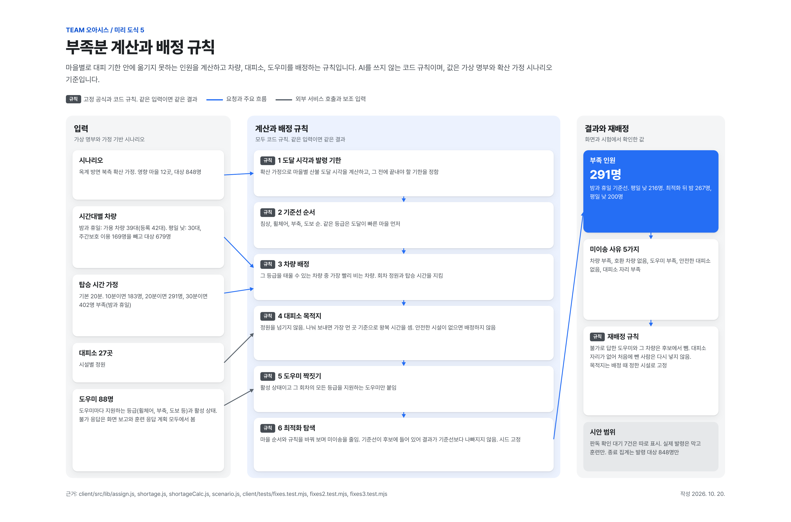

그림 29. 부족분 계산과 배정 규칙
범례: 입력(시간대 차량, 탑승 시간 가정, 대피소 정원, 도우미 등급), 규칙 6단계, 미이송 사유 5가지, 재배정 규칙. 모두 AI를 쓰지 않는 코드 규칙
출처: 저장소 docs/diagrams/assign-logic.html(16ac7d8)

| 규칙 | 내용 |
| --- | --- |
| 순서 | 이송 난도가 높은 침상부터 도보 순, 같은 등급 안에서는 도달 시각이 빠른 마을부터 |
| 시간대 | 평시 계산과 발령이 같은 차량 목록과 시간 조건을 씀. 밤이나 휴일 가용 39대, 평일 낮 30대 |
| 도우미 | 차량이 처음 쓰일 때 지원 등급이 맞는 도우미를 붙이고 모자라면 그 차량을 쓰지 않음. 남은 인원은 "도우미 부족" |
| 대피소 | 정원을 넘겨 보내지 않음. 나눠 보내면 가장 먼 목적지 시간으로 왕복을 계산. 안전한 시설이 없으면 배정하지 않음 |
| 재배정 | 발령 때 확정한 조건으로 다시 확인. 자리 없어 뺀 사람과 목적지 없는 사람은 거부. 불가 응답 도우미와 그 차량 제외 |
| 추천 배정 | 기본 순서보다 미이송이 줄어드는 배정을 규칙 기반으로 탐색. 기준 시나리오에서 291명이 267명(24명 감소) |

| 확인 값(코드에서 다시 계산) | 값 |
| --- | --- |
| 명부 | 2,013건(확인 2,005명, 판독 확인 대기 7건, 중복 의심 1건) |
| 기준 시나리오 대상 | 12곳 848명 |
| 미이송 예상(밤이나 휴일) | 291명, 추천 배정 267명 |
| 미이송 예상(평일 낮) | 대상 679명, 차량 30대에서 216명, 추천 배정 200명 |
| 탑승 시간 10, 20, 30분 | 183, 291, 402명 |
| 도우미, 임시주거시설 | 88명, 27곳 |

## 10 운영과 배포

| 항목 | 내용 |
| --- | --- |
| 배포 | Vercel 프로젝트 miri(client 루트). main 푸시 시 자동 배포, contest-eval은 로그인이 필요한 미리보기 |
| 실행 지역 | 서버 함수 서울(icn1, client/vercel.json regions) |
| 국내 사본 | 네이버 클라우드 Object Storage 정적 웹 호스팅(miri-web-oasis, 56e966e 판). 서버 기능은 Vercel 서울 사용 |
| 환경변수(이름만) | NCP_OCR_INVOKE_URL, NCP_OCR_SECRET, NCP_CLOVASTUDIO_KEY, NCP_CSR_CLIENT_ID, NCP_CSR_CLIENT_SECRET, DATA_GO_KR_KEY, LAW_OC, UPSTASH_REDIS_REST_URL, UPSTASH_REDIS_REST_TOKEN, MIRI_DEMO_CODE, MIRI_SESSION_SECRET. 비밀값은 저장소와 화면 코드에 두지 않음 |
| 시험 명령 | client에서 npm test(시험 6묶음 49개), node --test(6개) |
| 빌드 | vite build. 작업 환경에 따라 lightningcss 네이티브 모듈이 없으면 압축을 끈 빌드로 확인 |
| 운영 전환 계획 | 실제 운영 때 동해시가 계약 주체가 되어 공공기관용(CSAP) 환경으로 옮김 |

## 11 검증 결과

| 대상 | 방법 | 결과 |
| --- | --- | --- |
| 계산과 배정 규칙 | npm test 6묶음(logic 15, fixes 9, fixes2 12, fixes3 6, data 4, fixes4 3) | 49개 통과 |
| 서버와 평가기 | node --test | 6개 통과 |
| 국내 AI 판독 | 가상 서류 5장 11명 | 등급 11건, 근거 대조 11건 일치 |
| 배포 화면 | 공개 주소에서 직접 촬영 | 현황판, 서류 읽기(실제 판독), 명부, 상황판, 부족분, 발령 5단계, 재배정, 소방 인계, 문서함, 도우미 화면 확인 |
| 공공데이터 실시간 | 공개 주소 /api/opendata?kind=er, access | 200 응답. 응급실 1곳, 편의시설 실제 값 |
| 실행 지역 | 응답 머리 x-vercel-id | icn1 확인 |

### 11.1 GPT 코드 검토와 수정

| 차수 | 지적 | 처리 | 커밋 |
| --- | --- | --- | --- |
| 1차 | 심각 7, 중간 6, 낮음 2(15건) | 13건 수정, 2건(확인 전 판독 초안의 발령 포함, 기기 간 상태 공유)은 정책 결정과 서버 연결이 필요해 설명만 정정 | 49fc741 |
| 2차 | 필수 7건(인증 우회, 호출 상한, 근거 세탁, 가림 누락, 대피소 정원, 교체 도우미 자격, 형식 검증) | 7건 수정, 회귀 시험 12개 | 68dbc52 |
| 3차 | 남은 4건(저장소 장애 때 상한 우회, 정원 부족 재배정, 불가 도우미 재배정, 빈 판독 성공 처리) | 4건 수정, 회귀 시험 6개 | fa2d24d |
| 4차 | 공공데이터 카드 경미 4건(응급실 병상 빈 값, 편의시설 300곳 한 쪽만 읽음, 시도 표기 재조회 없음, 실제 기능과 다른 카드 문구) | 판정 "main 병합 가능". 4건 모두 수정 | f323a21, 138211e |
| 합계 | 지적 30건 | 28건 수정, 2건은 운영 단계 과제 | |
| 후속 | 화면 숫자 범위 통일(발령 기준 칸 848명과 명부 2,013건 구분, 현황판 잠정값을 대피 대상 구역 확인 대기 4건으로 통일, 도우미 조건 설명 정정), 회귀 시험 3개 | 공개 주소 반영 | 80a88bb, 37985c9 |

- 1차 검토에서 잡은 계산 오류: 평일 낮 발령이 빼야 할 차량을 그대로 써서 미이송이 216명 대신 176명으로 적게 나옴. 수정 뒤 평시와 발령이 같은 216명
- 출처: 공모전/반영기록/GPT_코드검토_20261020.md, GPT_재검토_20261020.md, GPT지적_수정기록_20261020.md

### 11.2 미확인 항목

- 실제 사용자 체험(과제 성공률, 시간, 만족도): 체험 자료 준비 완료(docs/usertest), 측정 전
- 음성 받아쓰기 실제 호출, 휴대폰 녹음 형식(webm, m4a)
- 한컴 한글 프로그램에서 저장 파일 직접 열람
- 실기기 휴대폰과 스크린리더 점검
- 3D 상황판 저사양 기기 성능

## 12 한계와 남은 과제

| 항목 | 현재 | 필요한 일 | 발표 때 표현 |
| --- | --- | --- | --- |
| 인증과 권한 | 서버 서명 쿠키 시연 세션 | 지자체 계정과 역할별 권한 | "시연 세션으로 보호한 시안" |
| 실제 발령 | 막아 둠 | 도우미 보고 서버, 문자 발송 연결 | "훈련 발령까지 구현" |
| 기기 간 전달 | 같은 화면 안 시연 | 서버 저장과 실시간 동기화 | "도우미 화면은 시연 화면" |
| 명부 | 가상 2,013건 | 동의 기반 시범 명부, 조례 검토 | "가상 명부로 계산" |
| AI 정확도 | 가상 서류 11명 | 실제 서류 검증(11월) | "가상 서류 시험에서 11명 일치" |
| 이름 가림 | 규칙 기반 | 표기 변형 대응, 운영 전 점검 | "가림 뒤 잔존 시 호출 중단" |
| 처리 환경 | 민간 리전(민관협력 지원 플랫폼 계정), Vercel 서울 | 공공기관용(CSAP) 이전 | "운영 때 CSAP 환경으로 이전" |
| CLOVA Studio 키 | 테스트 키 | 서비스 키 발급 확인 | 언급하지 않음 |
| 확산 시나리오 | 옥계 산불 기록 기반 가정 | 산불 확산 모델 연계 검토 | "가정 시나리오" |
| 승인 대기 데이터 | 재난안전데이터 8건 승인 대기 | 승인 뒤 대피소 좌표 대조(공공 자료끼리), 인명피해우려지역 겹치기 | "신청 완료, 승인 대기" |
| 건축물대장 | 승인, 미연결 | 대피소 건물 층수와 승강기부터 적용 | "승인 데이터, 연결 예정" |

## 13 다음 단계 제안

이 장은 사실이 아니라 제안임

| 순서 | 할 일 | 기대 |
| --- | --- | --- |
| 1 | 한림봉사센터 학생과 청년공간 열림 체험(docs/usertest 진행표와 SUS 설문) | 실제 사용자 수, 과제 성공률, 만족도 확보(본선 유용성) |
| 2 | 10. 26.~10. 30. 동해 현장에서 담당자 시연과 의견 | 공공기관 협력 근거 |
| 3 | 재난안전데이터 승인 뒤 통합대피소와 민방위대피시설 좌표 대조 | 데이터 품질 검사(김강민 회신 R29) |
| 4 | 실제 서류 형식 수집과 판독 검증 | AI 정확도 근거 |
| 5 | 도우미 보고 서버와 실시간 전달 | 실제 발령 열기 위한 전제 |

## 부록

### A 주요 파일 경로

| 영역 | 경로 |
| --- | --- |
| 라우트 | client/src/App.jsx, docs/ROUTES.md |
| 담당자 화면 | client/src/pages/console/*.jsx |
| 도우미 화면 | client/src/pages/helper/HelperPage.jsx |
| 계산과 배정 | client/src/lib/shortageCalc.js, shortage.js, assign.js, dispatchSim.js, scenario.js |
| 서버 함수 | client/api/intake.js, note.js, _ncp.js, _guard.js, session.js, opendata.js, open.js, workspace.js, hwpx.js, law.js |
| 디자인 토큰 | client/src/tokens.js, docs/DESIGN.md, docs/UI_PLAYBOOK.md |
| 시험 | client/tests/logic.test.mjs, fixes.test.mjs, fixes2.test.mjs, fixes3.test.mjs, data.test.mjs |
| 도식 | docs/diagrams/*.html |
| 사용자 체험 자료 | docs/usertest/ |
| 인수인계서 | client/src/lib/handoverDoc.js(앱 문서함 맨 위) |

### B 주소

| 대상 | 주소 |
| --- | --- |
| 서비스 | https://miri-indol.vercel.app |
| 도우미 화면 | https://miri-indol.vercel.app/h/demo |
| 국내 정적 사본 | http://miri-web-oasis.s3-website.kr.object.ncloudstorage.com |
| 소스 | https://github.com/hyunho2378/miri |

### C 근거 자료

| 자료 | 위치 |
| --- | --- |
| 국내 AI 이전 시험 결과 | 공모전/반영기록/국내AI_이전_시험결과.md |
| GPT 코드 검토, 재검토, 수정 기록 | 공모전/반영기록/ |
| 네이버 클라우드 서비스 조사 | 공모전/플랫폼/네이버클라우드_서비스조사_20261020.md |
| 데이터 활용현황 | 공모전/플랫폼/데이터_활용현황_20261020.md |
| 공공데이터와 재난안전데이터 신청 기록 | 공모전/플랫폼/ |
| 접근성 자체 점검 | 공모전/반영기록/접근성_자체점검.md |

### D 캡처 조건

- 데스크톱: 2026. 10. 20. 공개 주소(main 138211e 배포본)를 1440x900 창, 화면 배율 2배로 촬영. 그림 2, 11, 14는 main 37985c9 배포본으로 다시 촬영
- 휴대폰: 같은 배포본의 /h/demo를 390x844 틀에 넣어 촬영. 실기기 촬영 아님
- 발령 화면은 훈련 발령 60배 속도 진행 중 촬영이라 미이송 숫자가 0분 기준값(267명)과 다를 수 있음
- 서류 읽기 그림 5, 6은 샘플 서류를 실제 CLOVA OCR과 HyperCLOVA X로 판독한 결과
- 도식 5장은 저장소 docs/diagrams의 편집 가능한 HTML을 1920 폭 2배로 내보낸 것
