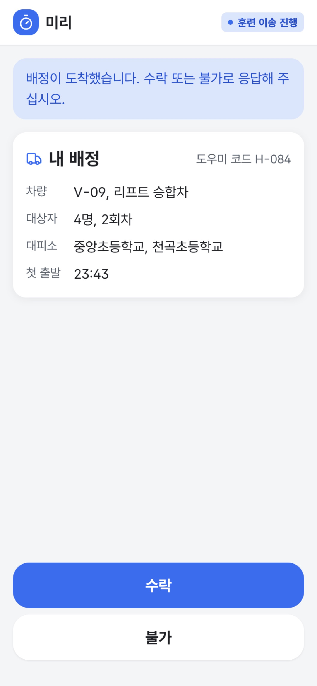
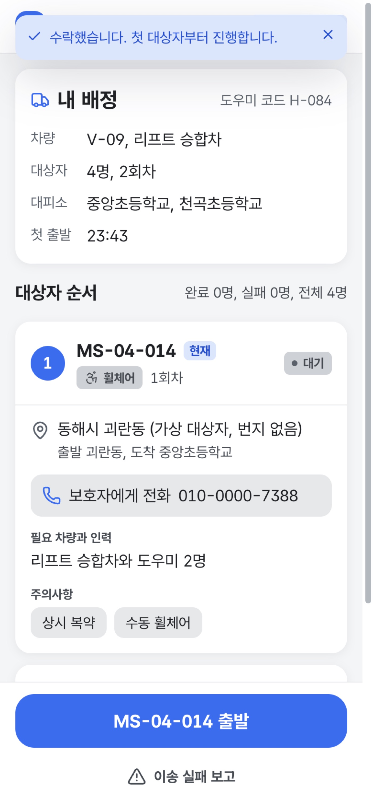
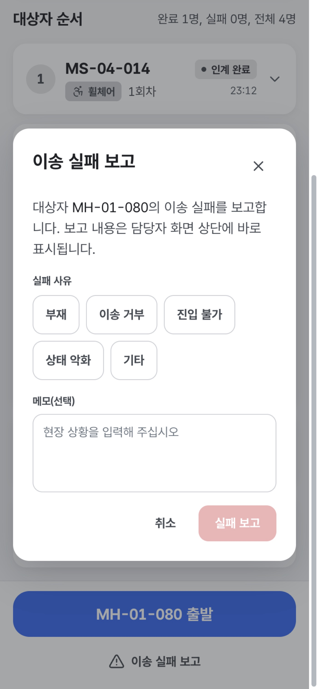
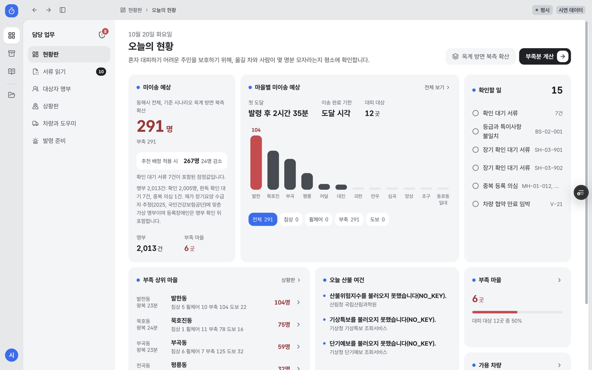
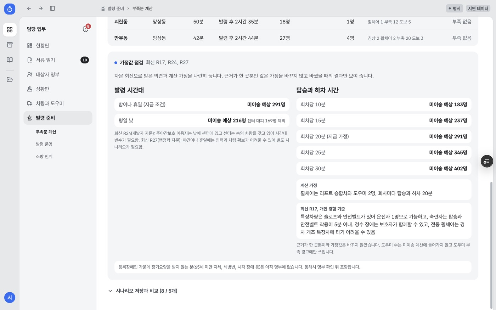
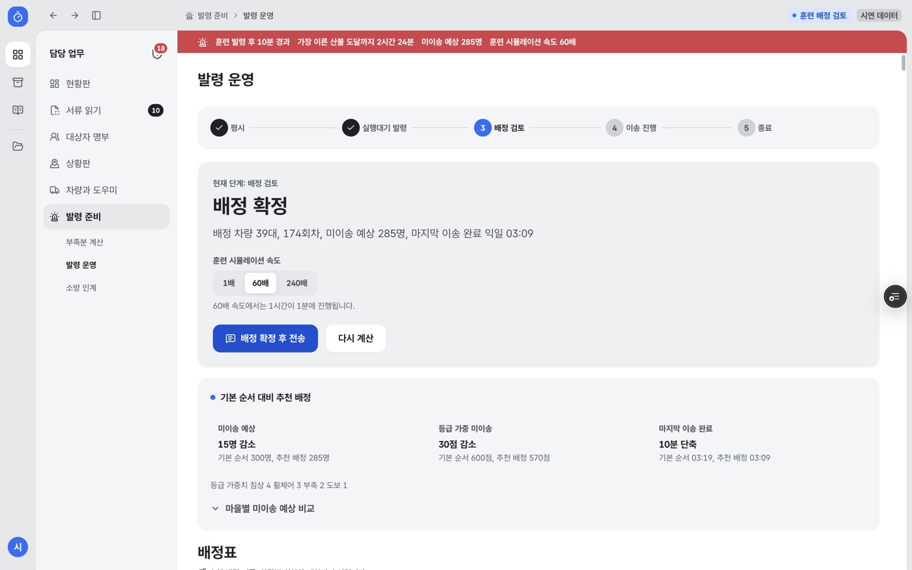
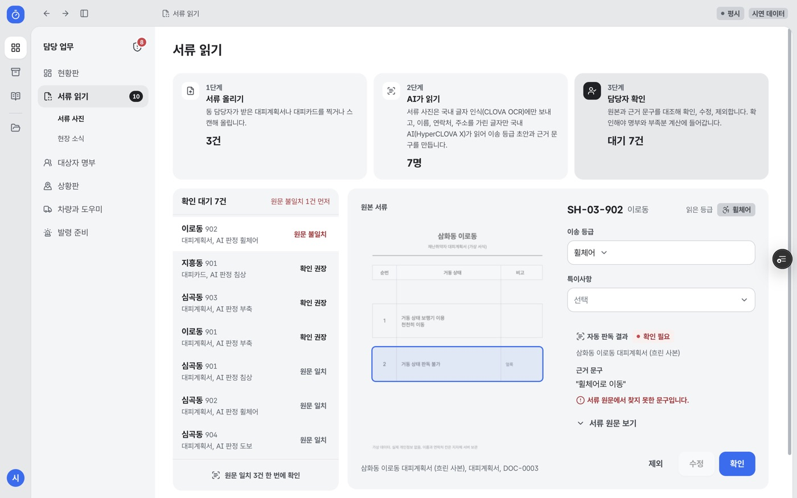

# 미리 학생 체험 안내문

> 한림봉사센터 학생이 재난 도우미와 동 담당자가 되어 미리를 20분 동안 직접 써 보고 의견을 주는 체험임

## 1. 미리는 어떤 서비스인가

- 미리는 산불 같은 재난 때 혼자 대피하기 어려운 이웃을 옮길 차와 도우미가 몇 명분 모자라는지 평소에 계산하는 서비스임
- 재난이 나면 담당자가 배정을 확정하고, 도우미 휴대폰에 누구를 어떤 차로 어느 대피소에 옮길지가 도착함
- 도우미는 버튼으로 출발, 도착, 인계를 보고하고, 못 옮긴 이웃은 실패 보고로 담당자에게 바로 알림

## 2. 체험 개요

| 항목 | 내용 |
|---|---|
| 걸리는 시간 | 약 20분(과제 15분, 설문 5분) |
| 준비물 | 휴대폰 1대(과제 1~3), 노트북 1대(과제 4~6) |
| 주소 | 도우미 화면 miri-indol.vercel.app/h/demo, 담당자 화면 miri-indol.vercel.app/console |
| 로그인 | 없음 |
| 진행 | 진행자 1명이 과제를 읽어 드리고, 시간을 재고, 막힌 곳을 기록함 |
| 부탁 | 생각나는 대로 소리 내어 말하며 써 주시면 됨. 틀려도 서비스의 문제이지 참여자의 문제가 아님 |

## 3. 도우미 과제 (휴대폰, 약 6분)

### 과제 1. 배정 받기

- 시작 화면: 도우미 화면의 '배정 대기 중'
- 할 일: '시연 발령 시작'을 누르고, 도착한 배정을 읽은 뒤 '수락'을 누름
- 끝난 상태: 위쪽에 '수락했습니다' 알림과 '대상자 순서' 목록이 보임
- 확인 질문: 내가 몰 차량과 가야 할 대피소를 말로 답해 주십시오

### 과제 2. 첫 대상자 이송 보고

- 시작 화면: 과제 1이 끝난 화면
- 할 일: 첫 대상자 카드에서 이동 방법, 필요한 차와 인력, 주의사항을 읽고 출발, 도착, 탑승 완료, 대피소 인계 완료를 차례로 누름
- 끝난 상태: 대상자 순서 옆 숫자가 '완료 1명'으로 바뀜

### 과제 3. 못 옮긴 이웃 알리기

- 시작 화면: 두 번째 대상자가 '현재'로 표시된 화면
- 할 일: 두 번째 대상자 집에 아무도 없다고 가정하고 '이송 실패 보고'에서 사유 '부재'를 골라 보고함
- 끝난 상태: '실패 보고 완료. 다음 대상자로 넘어갑니다' 알림이 뜨고 '실패 1명'이 표시됨

## 4. 담당자 과제 (노트북, 약 9분)

### 과제 4. 부족분 읽기

- 시작 화면: 담당자 화면 첫 화면 '오늘의 현황'
- 할 일: 기준 시나리오에서 대피 기한 안에 못 옮길 것으로 보이는 인원과 가장 부족한 마을을 찾고, '부족분 계산'의 '가정값 점검'에서 평일 낮이면 몇 명으로 바뀌는지 찾음
- 끝난 상태: 세 가지 답을 진행자에게 말함

### 과제 5. 훈련 발령과 배정 확정

- 시작 화면: '발령 준비'의 '발령 운영'
- 할 일: 훈련 발령을 개시하고, 추천 배정을 계산하고, 배정을 확정해 도우미에게 전송함
- 끝난 상태: 위쪽 단계 표시가 '4 이송 진행'에 와 있음

### 과제 6. AI가 읽은 서류 확인

- 시작 화면: '서류 읽기'
- 할 일: '원문 불일치'로 표시된 서류를 열고, AI가 고른 근거 문구가 실제 서류에 있는지 원본과 대조한 뒤 확인, 수정, 제외 가운데 맞는 것을 고름
- 끝난 상태: 그 서류가 확인 대기 목록에서 빠짐
- 확인 질문: 왜 그렇게 골랐는지 한 문장으로 말해 주십시오

## 5. 체험 뒤

- 만족도 설문 13문항(약 5분): [설문 링크 자리]
- 설문은 이름을 묻지 않고 참여 번호로만 기록함
- 체험 결과는 미리의 화면을 고치는 데 쓰고, 무엇을 고쳤는지 봉사센터에 다시 알려 드림

## 6. 문의

- 한림대학교 서비스디자인 수업 Team 오아시스 팀장 주현호
- 메일 ekjjodia@naver.com
- 2026 AI·디지털 기반 사회문제 해결 챌린지 참가 서비스
